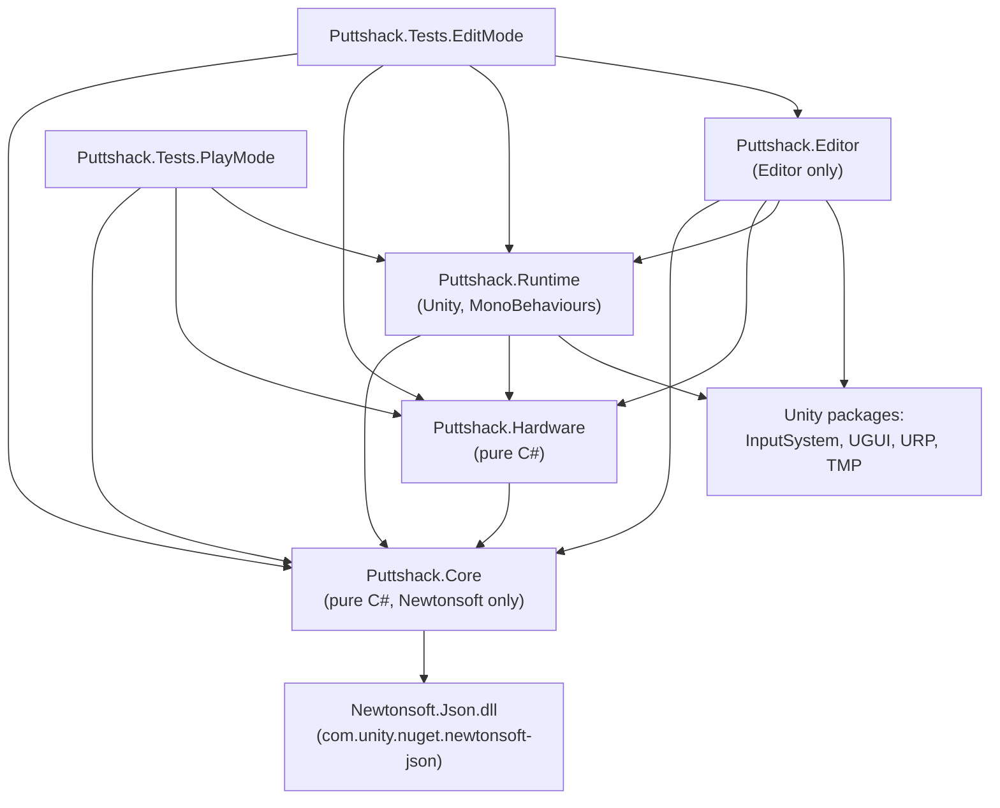
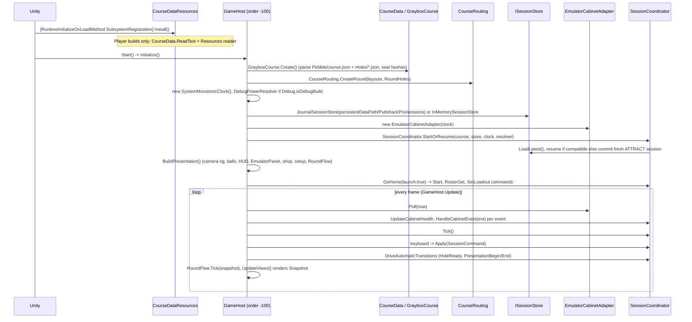
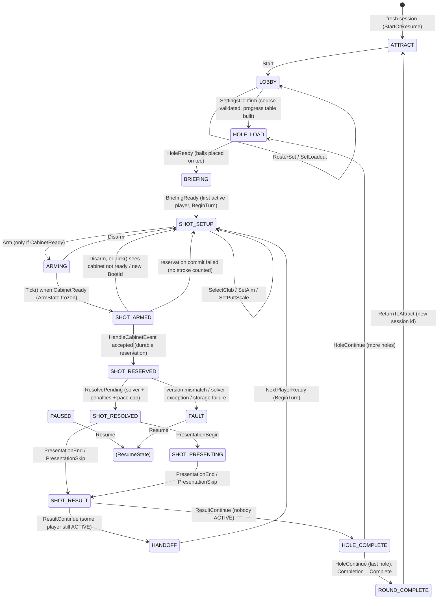

# 02 - Architecture (Core, Hardware, and how Runtime wires them)

Puttshack Pro is split into a pure C# game core (`Puttshack.Core`, no UnityEngine references) that owns all rules, scoring, ball physics, content parsing and persistence; a small hardware-abstraction assembly (`Puttshack.Hardware`) that turns a physical or emulated "cabinet" into normalized input events; and a Unity presentation layer (`Puttshack.Runtime`) whose single bootstrap MonoBehaviour, `GameHost`, forwards input and commands into one authoritative `SessionCoordinator` and renders the immutable snapshot it returns. Every state change in the coordinator is written to an append-only JSON-lines journal before it becomes authoritative, so a crash or power cut resumes the round where it was. Physics is a deterministic, fixed-step, double-precision solver that runs synchronously when a shot is accepted; the Unity side only plays back the precomputed trajectory. This document covers those foundations. Gameplay presentation is in [03-gameplay.md](03-gameplay.md), the hardware seam in [06-hardware-and-protocol.md](06-hardware-and-protocol.md).

Note on naming: the code and comments repeatedly cite "spec section N". That spec document is not in the repository; treat the code as the source of truth.

---

## 1. Assemblies and dependency rules

| Assembly | Folder | References | Engine refs | Notes |
|---|---|---|---|---|
| `Puttshack.Core` | [Assets/_Game/Scripts/Core](../Assets/_Game/Scripts/Core) | none (precompiled `Newtonsoft.Json.dll` only, `overrideReferences: true`) | `noEngineReferences: true` | Root namespace `Puttshack`. Sub-namespaces: `Content`, `Domain`, `Input`, `Protocol`, `Rules`, `Session`, `Shop`, `Simulation`, `Storage`, `Time`. Newtonsoft comes from the package `com.unity.nuget.newtonsoft-json` 3.2.2 in `Packages/manifest.json`. |
| `Puttshack.Hardware` | [Assets/_Game/Scripts/Hardware](../Assets/_Game/Scripts/Hardware) | `Puttshack.Core` | `noEngineReferences: true` | `ICabinetAdapter`, `EmulatorCabinetAdapter`, `EmulatorScript`. |
| `Puttshack.Runtime` | [Assets/_Game/Scripts/Runtime](../Assets/_Game/Scripts/Runtime) | Core, Hardware, `Unity.InputSystem`, `UnityEngine.UI`, URP Core + Universal Runtime, `Unity.TextMeshPro` | yes | All MonoBehaviours. Entry point `GameHost`. |
| `Puttshack.Editor` | [Assets/_Game/Scripts/Editor](../Assets/_Game/Scripts/Editor) | Core, Hardware, Runtime, UI, InputSystem, URP, TMP | yes | Editor-only (`includePlatforms: ["Editor"]`), `autoReferenced: false`. Bakers and menu tools, see [04-editor-tools.md](04-editor-tools.md). |
| `Puttshack.Tests.EditMode` | [Assets/_Game/Tests/EditMode](../Assets/_Game/Tests/EditMode) | Core, Hardware, Runtime, Editor, UI, TMP, TestRunner (both) + `nunit.framework.dll`, `Newtonsoft.Json.dll` | yes | Editor-only, `UNITY_INCLUDE_TESTS`. |
| `Puttshack.Tests.PlayMode` | [Assets/_Game/Tests/PlayMode](../Assets/_Game/Tests/PlayMode) | Core, Hardware, Runtime, UI, URP Universal, TestRunner + `nunit.framework.dll` | yes | `UNITY_INCLUDE_TESTS`. |

**Rules to keep:**

1. `Puttshack.Core` and `Puttshack.Hardware` must never reference `UnityEngine`. The asmdefs enforce this (`noEngineReferences: true`). This is what lets the whole rules/physics stack run in EditMode tests with a `VirtualClock` and no scene.
2. Only `Puttshack.Runtime` may touch scenes, GameObjects, input devices, and `Application.persistentDataPath`. Unity-specific adapters are injected into Core through function hooks or interfaces (for example `CourseData.ReadText`, `ISessionStore`, `IMonotonicClock`, `IInputResolver`).
3. Nothing in Core reads renderer state. `ICollisionWorld` ([CollisionWorld.cs](../Assets/_Game/Scripts/Core/Simulation/CollisionWorld.cs)) says so explicitly: what the ball hits is computed from the same analytic content the bakers used to build the visuals.
4. The direction of dependency inside Core is roughly `Domain <- Content <- Input/Simulation/Rules <- Session`, with `Storage` and `Session` referencing each other (`JournalEntry` carries `SessionData`; `SessionCoordinator` uses `ISessionStore`). `Content.CourseRouting` also uses `Storage.JournalSerializer.Clone` to deep-copy holes. These are all in one assembly so the compiler does not police it.

---

## 2. Boot sequence (what runs when `Main.unity` plays)

`Assets/_Game/Scenes/Main.unity` is the only scene in `ProjectSettings/EditorBuildSettings.asset`. It contains one `GameHost` component (serialized values in the scene: `InMemoryStorage: 0`, `PlaybackSpeed: 1`, `ReducedMotion: 0`, `ShowEmulatorPanel: 1`, `HomeInProShop: 1`, `RoundHoles: 18`). Pressing Play in `ProShop.unity` launches `Main.unity` instead (editor helper [PlayFromMain.cs](../Assets/_Game/Scripts/Editor/PlayFromMain.cs)).

Step by step, with sources:

1. **Before the scene loads** - [CourseDataResources.Install](../Assets/_Game/Scripts/Runtime/Course/CourseDataResources.cs) (`SubsystemRegistration`) replaces `CourseData.ReadText` with a `Resources.Load<TextAsset>("Course/...")` reader, but only when `!Application.isEditor`. In the editor the default reader reads `Assets/_Game/Resources/Course/...` from disk relative to the working directory. The audio system also has static bootstrap hooks (`GolfAudioDirector`, see 03).
2. **`GameHost.Start()` -> `Initialize()`** ([GameHost.cs](../Assets/_Game/Scripts/Runtime/GameHost.cs), lines 101-132). `GameHost` is `[DefaultExecutionOrder(-100)]`.
   - `_layouts = GrayboxCourse.Create()` - the 6 authored holes, sealed.
   - `_course = CourseRouting.CreateRound(_layouts, RoundHoles)` - the playable round (18 by default) built from `course.json` `"Routing"`, with stand-in copies for unauthored hole numbers.
   - `_clock = new SystemMonotonicClock()` (a `Stopwatch` started now).
   - `DebugInput = new DebugPowerResolver()` when `Debug.isDebugBuild` (true in the editor and development builds). It is passed to the coordinator as its `IInputResolver`; with no queued power it behaves exactly like `MeterPowerResolver`.
   - Storage: `InMemoryStorage || ForceInMemoryStorage` selects `InMemorySessionStore`; otherwise `JournalSessionStore(Path.Combine(Application.persistentDataPath, "PuttshackPro", "sessions"))` and `RosterMemory(.../PuttshackPro/roster.json)`.
   - `Emulator = new EmulatorCabinetAdapter(_clock)` - always the emulator; there is no real hardware adapter in the repo (see 06).
   - `Coordinator = SessionCoordinator.StartOrResume(...)`; if it recovered a round that is not in LOBBY, a "Round restored" notice is shown.
   - `BuildPresentation()` finds or creates the camera rig, HUD (`HudView` or runtime fallback), `CourseGolfer`, `ProShopController`, `PlayerSetupController`, creates 6 `BallView`s, the `AimFanView`, `CartDrive`, the `EmulatorPanel` (if `ShowEmulatorPanel`) and `RoundFlow`.
   - `GoHome(launch: true)` - with `HomeInProShop` the idle session skips ATTRACT: it sends `Start`, restores names/profiles/looks from `RosterMemory` via `RosterSet` and `SetLoadout`, then opens Player Setup (or the Pro Shop if no setup UI is in the scene).
3. **Per frame, `GameHost.Update()`** (lines 365-377): `PumpCabinet()` -> `Coordinator.Tick()` -> `HandleKeyboard()` -> `DriveAutomaticTransitions()` -> `GoHome(false)` -> `ReturnToSetup()` -> `_flow.Tick(snapshot)` -> `UpdateViews()`.
4. **On quit**, `OnApplicationQuit` sends `EndRound` if a round is in progress, so a clean quit never resumes a round on next launch; only a crash does (lines 253-258).

All coordinator calls from `GameHost` go through `Guarded(...)`, which catches `SimulatedCrashException` (the debug crash hook) and calls `SimulateRestart`, which builds a new `SessionCoordinator` from the same store, exactly like a process restart.

---

## 3. The session service: `SessionCoordinator`

File: [Core/Session/SessionCoordinator.cs](../Assets/_Game/Scripts/Core/Session/SessionCoordinator.cs). Supporting types: [SessionData.cs](../Assets/_Game/Scripts/Core/Session/SessionData.cs), [SessionSnapshot.cs](../Assets/_Game/Scripts/Core/Session/SessionSnapshot.cs), [Commands.cs](../Assets/_Game/Scripts/Core/Session/Commands.cs), [Domain/Enums.cs](../Assets/_Game/Scripts/Core/Domain/Enums.cs), [Domain/Models.cs](../Assets/_Game/Scripts/Core/Domain/Models.cs).

### 3.1 Responsibilities and invariants

- It is the **single owner** of `SessionData` (authoritative state) and the shot ledger (`Dictionary<int, ShotRecord>`). Nothing else may mutate them.
- **Every mutation goes through `TryMutate(kind, change, shot)`** (line 914): clone `_data` (JSON round trip), apply the change to the clone, bump `Revision`, `ISessionStore.Commit(JournalEntry)` the whole draft (plus the shot record if any), and only on success swap the draft in. On `StoreException` nothing changes and the method returns `false`.
- **Commands are revision-guarded and idempotent.** `Apply(SessionCommand)` (line 366) rejects a missing `CommandId`, returns `Ok(duplicate:true)` for a repeated `CommandId` with the same payload fingerprint, `COMMAND_ID_CONFLICT` for the same id with a different payload, and `STALE_REVISION` when `ExpectedRevision != Revision`. Accepted command ids and their fingerprints are stored in `SessionData.AppliedCommands`.
- **Cabinet events are idempotent by identity** `DeviceId|BootId|Sequence` (`CabinetEvent.Key`). Consumed identities live in `SessionData.ConsumedEvents`; re-delivery returns the original `InputAck` with `Duplicate = true`.
- **Presentation reads only `Snapshot`** (line 87): a detached deep copy (`SessionSnapshot`) that also derives the scorecard via `ScoreEngine.BuildRow` and the cabinet status string. It is cached until the next mutation or a change in cabinet readiness.
- **Never restores an armed meter.** On restart, `Reconcile()` (line 807) maps `ARMING`/`SHOT_ARMED` back to `SHOT_SETUP` and `SHOT_PRESENTING` back to `SHOT_RESOLVED`, and refuses to continue (FAULT) if `CheckIntegrity()` finds shot counts that disagree with the resolved shot records.

Public API used by Runtime:

| Member | Purpose |
|---|---|
| `static StartOrResume(course, store, clock, resolver = null)` | Loads `store.LoadLatest()`; resumes if `CourseContentHash` matches and state is not `ATTRACT`/`ROUND_COMPLETE`; otherwise commits a fresh session in `ATTRACT`. |
| `Apply(SessionCommand) -> CommandReply` | All player/staff actions. |
| `HandleCabinetEvent(CabinetEvent) -> InputAck` | Shot input. Validates, reserves durably, then resolves synchronously. |
| `UpdateCabinetHealth(CabinetHealth)` / `CabinetReady(out status)` | Health gate for arming. |
| `Tick()` | Time-driven transitions (see below). Call every frame. |
| `Snapshot`, `State`, `Revision`, `CurrentHole`, `World` | Read side. |
| `Preview(lane = 10)` | Solves a hypothetical shot at `Settings.PreviewPower` (0.75) for the aim fan; cached by a string key. |
| `CrashAfter`, `Log`, `Recovered` | Debug crash hook, in-memory event log, and whether this instance resumed a stored session. |

Constants on the class: `HeartbeatTimeoutMs = 1500`, `MaxPlayers = 6`, `MaxNameLength = 16`, default names `Caleb, Maya, Jordan, Sam, Nia, Leo`.

### 3.2 State machine

States are `SessionState` in [Enums.cs](../Assets/_Game/Scripts/Core/Domain/Enums.cs). `PAUSED` and `FAULT` are overlays: the underlying state is kept in `SessionData.ResumeState`, and `SessionSnapshot.EffectiveState` returns it. `TUTORIAL` exists in the enum but nothing transitions into it.

Overlay rules (from `Dispatch`, lines 593-621, and helpers lines 694-713):

- `Pause` is accepted in any in-round state (`HOLE_LOAD` through `HOLE_COMPLETE`) **except `SHOT_RESERVED`**. It clears `Arm` and sets `ResumeState = PauseTarget(state)`: `ARMING`/`SHOT_ARMED` resume to `SHOT_SETUP`, `SHOT_PRESENTING` resumes to `SHOT_RESOLVED`, anything else resumes to itself.
- `Resume` is accepted from `PAUSED` or `FAULT`; it restores `ResumeState` and, if that is `SHOT_RESERVED`, immediately retries `ResolvePending`.
- `EndRound` is accepted in-round or from `PAUSED`, but not when a shot is reserved (directly, or behind a pause/fault). It sets `ROUND_COMPLETE` with `Completion = Complete` only if every hole of every player is `HOLED`, `CAPPED` or `WITHDRAWN`, otherwise `Incomplete`. It is not accepted from `FAULT`.
- `SetLoadout` (Pro Shop save) is accepted in `LOBBY` and `PAUSED` only.

### 3.3 Who drives each transition

| Transition | Driven by |
|---|---|
| `Start`, `RosterSet`, `SetLoadout` at launch/home | `GameHost.GoHome` (and `PlayAgain`), from `RosterMemory`. |
| Roster edits | `PlayerSetupController` (`RosterSet`), lobby arrow keys in `GameHost.LobbyInput`. |
| `SetLoadout` | `ProShopController` save. |
| `SettingsConfirm` | `GameHost.StartRound()` (Enter in lobby / setup UI). |
| `HoleReady` | `GameHost.DriveAutomaticTransitions` once the hole visual exists and the cart drive (holes 2+) has ended or been skipped. |
| `BriefingReady`, `HoleContinue` | `RoundFlow` (fly-over / hole summary pages); also `GameHost.HandleKeyboard` fallbacks. |
| `SelectClub`, `SetAim`, `SetPuttScale`, `Arm`, `Disarm` | `GameHost.SetupInput` (arrows, Shift = 5 degrees, P = putt scale, Enter = Arm, Esc = Disarm). |
| `ARMING -> SHOT_ARMED` | `SessionCoordinator.Tick()` when `CabinetReady` is true. |
| `SHOT_ARMED -> SHOT_RESERVED -> SHOT_RESOLVED` | `SessionCoordinator.HandleCabinetEvent`, called from `GameHost.PumpCabinet` for each event returned by `ICabinetAdapter.Poll`. Resolution is synchronous in the same call. |
| `PresentationBegin`, `PresentationEnd` | `GameHost.DriveAutomaticTransitions` (ball playback finished + 0.8 s hold). `PresentationSkip` from Enter/Space. |
| `ResultContinue`, `NextPlayerReady`, `Pause`, `Resume`, `EndRound`, `ReturnToAttract` | Keyboard in `GameHost.HandleKeyboard`, pause-menu helpers `Restart()`, `PlayAgain()`, `ReturnToMenu()`. |

### 3.4 Shot pipeline (the one transaction that matters)

1. **Arm** (`SHOT_SETUP` -> `ARMING`): rejected with `DEVICE_NOT_READY` unless `CabinetReady`.
2. **`Tick()` in `ARMING`** calls private `Arm()` (line 244), which commits an `ArmState`: token `"{SessionId}-{TurnId}-{ArmSequence}"`, `EpochMs = clock.NowMs` (meter time zero), `SweepSeconds = club.SweepBaseSeconds * profile.SweepMultiplier`, device/boot/calibration copied from the cabinet capabilities, frozen origin, aim direction, lie, club, putt scale and `FanHalfAngleRad`.
3. **Cabinet event** -> `HandleCabinetEvent` (line 143): duplicate check, state check, `IInputResolver.Validate`, `IInputResolver.Resolve` -> `ShotIntent` (power from capture time, yaw from lane). A `ShotRecord` with `Status = RESERVED` is committed **in the same journal entry** as the state change to `SHOT_RESERVED` (transaction "shot.reserve"). If that commit fails the service disarms back to `SHOT_SETUP` with "no stroke was counted".
4. **`ResolvePending()`** (line 282): refuses (FAULT) if the intent's `SimulationVersion`, `RulesVersion` or `HoleVersion` differ from the running build; runs `ShotSolver.Solve(intent, World)`; `PenaltyRules.Evaluate`; then commits "shot.resolve": `Played++`, penalties added, new `BallState`, `HOLED`/pace-cap status, `ShotRecord.Status = RESOLVED`, state `SHOT_RESOLVED`.
5. **Ball placement after a shot**: holed -> cup, lie Green; penalty -> relief position/lie; `SolverFault` -> back to origin (the stroke still counts: `Played++` happens before the outcome branch); otherwise final position and lie.

`CrashPoint.AfterReservation` / `AfterResolution` throw `SimulatedCrashException` right after the respective commit to exercise recovery (used by the emulator panel and `RecoveryTests`).

---

## 4. Simulation (ball physics)

Files: [ShotSolver.cs](../Assets/_Game/Scripts/Core/Simulation/ShotSolver.cs), [CupCapture.cs](../Assets/_Game/Scripts/Core/Simulation/CupCapture.cs), [CollisionWorld.cs](../Assets/_Game/Scripts/Core/Simulation/CollisionWorld.cs), plus content tables [ClubCatalog.cs](../Assets/_Game/Scripts/Core/Content/ClubCatalog.cs), [SurfaceCatalog.cs](../Assets/_Game/Scripts/Core/Content/SurfaceCatalog.cs), [TerrainModel.cs](../Assets/_Game/Scripts/Core/Content/TerrainModel.cs), `CupProfile` in [HoleDefinition.cs](../Assets/_Game/Scripts/Core/Content/HoleDefinition.cs).

`ShotSolver.Solve(ShotIntent intent, ICollisionWorld world, SolverParameters p = null) -> ShotResult` is a static, deterministic, fixed-step integrator. No randomness, no frame-rate dependency, double precision. It is called:

- once per accepted shot, inside `SessionCoordinator.ResolvePending` (main thread, synchronous);
- for the aim-fan preview, `SessionCoordinator.Preview` (cached by setup key);
- by `DebugAutoPlay.BestPower` (development fast-forward, ~30 solves per stroke).

### 4.1 Inputs

From `ShotIntent` ([Models.cs](../Assets/_Game/Scripts/Core/Domain/Models.cs)): `ClubId`, `Power01` (0..1), `PuttScale`, `OriginM`, `AimForward` (horizontal), `YawRad` (lane yaw after assistance), `Lie`, `WindMps`. From the world: `GroundHeight`, `GroundNormal`, `SurfaceAt`, `HazardAt`, `InBounds`, `SweepTrees`, and `Hole.CupM` / `Hole.Cup`.

`AnalyticWorld` (the only `ICollisionWorld`) is built per hole from the `HoleDefinition`: height and normal from `TerrainModel` (normal by central differences, `e = 0.02` m), surface by highest-priority polygon containing the point (hazard polygons override everything as `Water`; outside all regions `Hole.DefaultSurface`), `InBounds` = inside `PlayableBoundary`, trees are vertical cylinders (`TrunkRadius`, `TrunkHeight`; canopy is visual only).

### 4.2 Algorithm summary

- **Launch.** Putter: speed `ClubCatalog.PuttSpeed(power, scale, Green.RollingResistance) = sqrt(2 * a * power * scaleMax)` along the ground plane (always uses the *green's* rolling resistance for the launch speed, whatever the lie). Full shots: `ClubCatalog.LaunchSpeed` (piecewise-linear over 5 `SpeedSamples` at power 0, .25, .5, .75, 1) times the lie's `LaunchMultiplier` (or the club's `BunkerLaunchMultiplier` in a bunker), at `LaunchAngleDeg`. Airborne only if speed > 0.05 m/s.
- **Flight.** Gravity + quadratic drag on velocity relative to wind (`DragK`) + a lift term `LiftCoefficient * |v_rel|^2` perpendicular to the relative velocity (stands in for backspin). Tree sweep per step; a trunk hit reflects the horizontal velocity (`TreeRestitution`, `TreeTangentialRetention`) and keeps 30% of vertical speed.
- **Ground impact.** First contact records `CarryM`. OOB and hazard checks. Tangential velocity after impact: `(1 - TangentialDamping)`, minus Coulomb friction `ImpactFriction * (1 + e) * |vn|`, then times `(1 - spin * SpinGrip)` where `spin` starts at the club's `LandingCheck` and is multiplied by `SpinRetentionPerImpact` after each impact. Rebound `-vn * Restitution`; below `RollTransitionSpeed` the ball starts rolling. A cup check happens on each impact.
- **Roll.** Deceleration `RollingResistance + RollingDrag * max(0, speed - SkidSpeed)` plus the downhill component of gravity; stops when speed < `StopSpeed` and the slope force is within `max(HoldingAcceleration, RollingResistance)`. Rim assist pulls slow balls toward the cup. Closest approach to the cup each step decides drop vs lip-out (lip-out rotates the velocity by up to 0.35 rad and multiplies it by `CupProfile.LipSpeedRetention`; lip-outs re-arm once the ball is more than `2 * LipRadius` away).
- **Holing.** `CupCapture.Drops(offset, speed)`: within `CaptureRadius + EdgeMarginM` and slower than a chord-scaled `CaptureSpeed`. A ball coming to rest within `CaptureRadius + RestDropMarginM` also drops. `CupCapture.AppendDrop` appends a scripted roll-in-and-fall animation to the samples.
- **Termination.** `MaxDurationS = 40` s -> `ShotOutcome.SolverFault`.

### 4.3 Outputs

`ShotResult`: `Outcome` (`Rest`, `Holed`, `Water`, `OutOfBounds`, `SolverFault`), `FinalPosition` (ball **base**, i.e. center minus radius), `FinalLie`, `CarryM`, `RollM`, `TotalM`, `ApexM`, `DurationS`, `CrossingPosition` (last playable point before a hazard/boundary, used by penalty relief), `HazardId`, `Samples` (time + position every `SampleEvery = 4` steps, i.e. 30 Hz), `Events` (Launch, FirstContact, Bounce, TreeHit, StartRoll, LipOut, Cup, WaterEntry, OutOfBounds, Rest, Fault), and `ResultHash` (SHA-256 of outcome, lie, final position, carry, roll, duration, hazard id and sample count, for replay comparison).

### 4.4 Key constants and where they live

| Group | Location | Values |
|---|---|---|
| Integrator | `SolverParameters` in [ShotSolver.cs](../Assets/_Game/Scripts/Core/Simulation/ShotSolver.cs) lines 10-30 | `Gravity 9.81`, `DragK 0.0048`, `Dt 1/120`, `BallRadius 0.02135`, `RollTransitionSpeed 1.2`, `StopSpeed 0.04`, `MaxDurationS 40`, `SampleEvery 4`, `TreeRestitution 0.35`, `TreeTangentialRetention 0.6`, `SpinRetentionPerImpact 0.35` |
| Cup forgiveness | `CupCaptureParameters` in [CupCapture.cs](../Assets/_Game/Scripts/Core/Simulation/CupCapture.cs) lines 13-33 | `EdgeMarginM 0.008`, `CentreSpeedScale 1.2`, `EdgeSpeedScale 0.9`, `AssistReachM 0.02`, `AssistAccel 0.6`, `AssistMaxSpeed 0.6`, `RestDropMarginM 0.012`, `DropMinSpeed 0.3`, `DropDepthM 0.06` |
| Cup geometry | `CupProfile` in [HoleDefinition.cs](../Assets/_Game/Scripts/Core/Content/HoleDefinition.cs) lines 79-89 | `CupRadius 0.054`, `CaptureRadius 0.075`, `CaptureSpeed 1.55`, `LipRadius 0.11`, `LipSpeedRetention 0.8`. Not read from hole JSON: every hole uses these defaults. |
| Surfaces | `SurfaceCatalog.Surfaces` in [SurfaceCatalog.cs](../Assets/_Game/Scripts/Core/Content/SurfaceCatalog.cs) lines 42-52 (`Version = "surfaces-1.2"`) | Per surface: `LaunchMultiplier`, `Restitution`, `TangentialDamping`, `RollingResistance`, `HoldingAcceleration`, `SpinGrip`, `ImpactFriction`, `RollingDrag`, `SkidSpeed`. The doc comment on lines 31-37 lists the tuning targets asserted by `SolverTests` and `BallBounceTests`. |
| Clubs | `ClubCatalog.All` in [ClubCatalog.cs](../Assets/_Game/Scripts/Core/Content/ClubCatalog.cs) lines 51-62 (`Version = "clubs-1.1"`) | 9 clubs: driver, wood3, iron5, iron7, iron9, pw, sw, lw, putter. Per club `SpeedSamples`, `LaunchAngleDeg`, `LiftCoefficient`, `LandingCheck`, `SweepBaseSeconds`, `FanHalfAngleDeg`, range labels, optional `BunkerLaunchMultiplier`. |
| Putt distance scales | `ClubCatalog.PuttScaleMaxMeters` lines 41-49 | Short 15 ft, Medium 40 ft, Long 90 ft (flat-green roll at power 1). |
| Version stamp | `Versions` in [Models.cs](../Assets/_Game/Scripts/Core/Domain/Models.cs) lines 7-13 | `Rules = "rules-1.0"`, `Simulation = "sim-1.3"`, `Protocol = 1`, `IntentSchema = 1`. |

**Versioning rule.** The comments on `SolverParameters` and `CupCaptureParameters` say any change requires a new simulation version. Bump `Versions.Simulation` whenever you change solver behaviour. The only runtime enforcement is in `ResolvePending`: a shot reserved under one version and resolved after an upgrade (crash recovery across a deploy) enters FAULT instead of silently producing a different result.

---

## 5. Input math (meter, lanes, assistance)

File: [Core/Input/InputMath.cs](../Assets/_Game/Scripts/Core/Input/InputMath.cs) and [MeterPowerResolver.cs](../Assets/_Game/Scripts/Core/Input/MeterPowerResolver.cs).

- **Power meter** `MeterWaveform.Power(elapsedMs, sweepSeconds)`: triangle wave `p = 1 - |u - 1|`, `u = (t / T) mod 2`. Power rises 0 -> 1 in `T` seconds and falls back in another `T`. `T = club.SweepBaseSeconds * AssistanceProfile.SweepMultiplier`. Elapsed time is `CabinetEvent.EffectiveCaptureMs - ArmState.EpochMs`, i.e. capture time, not delivery time.
- **Lanes** `LaneMapper`: `LaneCount = 20`; `Q(lane) = (lane - 10.5) / 9.5` maps lane 1 to -1 (full left) and lane 20 to +1 (full right); raw yaw `= Q * FanHalfAngleRad`. There is no centre lane; lanes 10 and 11 are each about 0.05 of the fan off centre. `Preview()` uses lane 10 by default, so the preview line is very slightly left of the aim.
- **Assistance** `Assistance.ApplyYaw`: deadband then gain around the aim centre. Profiles in `AssistanceProfiles.Get` ([ClubCatalog.cs](../Assets/_Game/Scripts/Core/Content/ClubCatalog.cs) lines 143-157): Amateur (sweep x1.25, deadband 1.5 deg, gain 0.70), Club (default; x1.00, 0.6 deg, 0.85), Pro (x0.85, 0 deg, 1.00). Assistance only changes meter speed and yaw, never the landing.
- **`IInputResolver`** is the seam for alternative input modes ("A future SpeedPowerResolver can replace this while preserving ShotIntent"). `MeterPowerResolver.Validate` checks arm present, device id, boot id, lane 1-20, calibration version, `EventQuality.ClockUncertain`, finite capture time, and `ArmState.EpochMs <= capture <= receivedMs + 1`. Details in [06](06-hardware-and-protocol.md).

---

## 6. Rules and scoring

Folder: [Core/Rules](../Assets/_Game/Scripts/Core/Rules).

| Class | Rule |
|---|---|
| [PenaltyRules](../Assets/_Game/Scripts/Core/Rules/PenaltyRules.cs) | The played stroke always counts. `Water`: +1, ball dropped at the hazard's authored `DropPoint` if `IsValidRelief` (in bounds, not in a hazard, not nearer the cup than the crossing point), otherwise replay from the previous origin (`UsedFallback = true`). `OutOfBounds`: +1, replay from the previous origin. Other outcomes: no penalty. |
| [PaceCap](../Assets/_Game/Scripts/Core/Rules/PaceCap.cs) | If enabled (`SessionSettings.PaceCapEnabled`, default true), once `Played + Penalties >= Par + PaceCapOverPar` (default 5) the hole becomes `CAPPED` with `CompletionScore = Par + 5`. Shown with an `M` suffix ("MAX"). `PaceCapOverPar` has no command to change it. |
| [ScoreEngine](../Assets/_Game/Scripts/Core/Rules/ScoreEngine.cs) | Scorecard is derived, never edited. Hole score = `Played + Penalties` when `HOLED`, `CompletionScore` when `CAPPED`, null otherwise. In-progress holes show `N*` and never count toward totals. `Out` = holes 1-9, `In` = 10+. `ToParDisplay`: `E`, `+n`, `-n`, `-` before any completed hole. `NextStrokeNumber = StrokesSoFar + 1`. |
| [TurnScheduler](../Assets/_Game/Scripts/Core/Rules/TurnScheduler.cs) | One shot per turn, cyclic in roster order, skipping `HOLED`, `CAPPED`, `WITHDRAWN`. `NextActive` may return the same player (single player, or last one left). No "farthest from the hole plays first" rule. |
| Club suggestion | `ClubCatalog.Suggest` ([ClubCatalog.cs](../Assets/_Game/Scripts/Core/Content/ClubCatalog.cs) line 115): putter on green or < 12 yd, sand wedge in bunker, driver only from the tee beyond 250 yd, else the longest-range club whose `RangeMaxYd * 0.95` still covers the distance. On the tee the hole's `Briefing.SuggestedClubId` wins. Suggestion never restricts the bag. |
| Putt scale suggestion | `SessionCoordinator.SuggestPuttScale`: <= 12 ft Short, <= 34 ft Medium, else Long. |

---

## 7. Content and data definitions

### 7.1 Courses and holes (data-driven JSON)

- **Files:** [Assets/_Game/Resources/Course/Pebble/course.json](../Assets/_Game/Resources/Course/Pebble/course.json) and one file per hole in [Assets/_Game/Resources/Course/Pebble/Holes/](../Assets/_Game/Resources/Course/Pebble/Holes) (currently `h03-garden-green`, `h04-cypress-ridge`, `h05-arrowhead-point`, `h06-headland-climb`, `h07-lands-end`, `h08-the-chasm`). Format documentation: [ArtSource/Course/README.md](../ArtSource/Course/README.md).
- **course.json keys:** `Format` (must be 1), `Id` (`puttshack-pro-graybox`), `Version` (`graybox-0.4`), `Name`, `Notes`, `SeaLevelM`, `ProposedPars` (18 pars; only used by a test asserting par 72), `Paths` (named coast polylines as Catmull-Rom pieces), `Shelves` (cliff/beach terrain features along a path), `CartPaths` (first entry must be a closed loop; spurs may `JoinStart`/`JoinEnd`), `Holes` (hole ids to load, in order), `Routing` (layout id per hole number of an 18-hole round).
- **Hole JSON keys** (from `CourseSpec.BuildHole`, [CourseData.cs](../Assets/_Game/Scripts/Core/Content/CourseData.cs) lines 242-342): `Id` (must match file name), `Version`, `Name`, `Number`, `Par` (3-5), `YardageYd`, `DefaultSurface`, `WindMps` `[x,y,z]`, `Briefing {Hazard, SafePlan, SuggestedClubId}`, `Terrain` (Plateau/Tilt/Bowl features), `Surfaces` (each `{Id, Surface, Priority, Shape, Bowl?}` or a `{CartPaths: {Priority}}` placeholder), `Hazards {Id, DropPointId, Shape, WaterLevelM?}`, `Drops {Id, HazardId, At}`, `Trees {Id, At, Trunk [r,h], Canopy [r,h]}`, `PlayableBoundary` (shape), `Tee`, `Cup`, `Route` (waypoints). Shapes: `Rect`, `Ellipse`, `Loop`, `Polygon`, `InlandStrip`, `Sea`.
- **Parser strictness:** unknown keys are errors (except `Notes`), numbers are converted exactly (`Json.ToDouble`, max 15 significant digits) so content hashes are identical on every runtime, and messages name the file and key.
- **Loading:** `CourseData.Load("Pebble")` parses once and caches a `CourseSpec`; `CourseData.Invalidate()` clears it. `CourseData.ReadText` is the file hook (editor: disk under `CourseData.ProjectFolder = "Assets/_Game/Resources/Course"`; player: `Resources.Load<TextAsset>` installed by `CourseDataResources`). `GrayboxCourse.Create()` = `CourseData.Load().Build()`.
- **Shared terrain:** every hole carries a copy of the whole course heightfield (`CourseSpec.Terrain()`: all holes' Plateau/Tilt/Bowl features, then bunker bowls, then coast shelves) so holes see their neighbours. `TerrainModel.Height` is analytic and is mirrored in Python for Blender; parity is guarded by [TerrainParity.cs](../Assets/_Game/Scripts/Core/Content/TerrainParity.cs), the golden `Assets/_Game/Tests/EditMode/Fixtures/terrain_parity.golden.json`, `TerrainParityTests` and `ArtSource/Blender/scripts/test_terrain_parity.py`.
- **Cart paths:** [CourseLayout.cs](../Assets/_Game/Scripts/Core/Content/CourseLayout.cs) (`CartPathNetwork`): ribbons become `SurfaceId.CartPath` regions on holes whose boundary they come within 6 m of; between-hole drive routes (loop-only route or Dijkstra over the graph); tee parking 11 m from the tee.
- **Routing and stand-ins:** [CourseRouting.CreateRound](../Assets/_Game/Scripts/Core/Content/CourseRouting.cs) builds the round. A routing number whose layout is not that hole's own number becomes a deep copy with id `h{NN}~{layoutId}`, the new `Number`, and `LayoutId` pointing at the original so Runtime reuses the baked visuals (`HoleDefinition.VisualId`). The round's `Id` is `{courseId}-{count}` and `Version` `{version}+routing-1`.
- **Validation:** [CourseValidator](../Assets/_Game/Scripts/Core/Content/CourseValidator.cs) runs at `SettingsConfirm` (whole course) and `HoleReady` (current hole): par 3-5, finite tee/cup, boundary present, tee and cup in bounds and not in hazards, every hazard has an in-bounds drop not inside any hazard, no degenerate region, cup on a green region, unique ids and numbers.
- **Content hash:** [ContentHasher.Seal](../Assets/_Game/Scripts/Core/Content/ContentHasher.cs) computes SHA-256 per hole over canonical JSON (excluding `ContentHash` and `[JsonIgnore]` `LayoutId`) and a course hash over id, version and hole hashes. The coordinator only resumes a stored session whose `CourseContentHash` equals the current round's. Baked visuals also compare hashes (see 04/05).

### 7.2 Clubs, surfaces, cosmetics, golfer profiles (C# tables)

| Data | Where | How it is "loaded" |
|---|---|---|
| Clubs (9) and assistance profiles | [ClubCatalog.cs](../Assets/_Game/Scripts/Core/Content/ClubCatalog.cs) | Static readonly list, compiled in. |
| Pro Shop club read-outs | [ClubTraits.cs](../Assets/_Game/Scripts/Core/Content/ClubTraits.cs) | Derived 0..1 values from `ClubDefinition` (display only). |
| Surfaces (8) | [SurfaceCatalog.cs](../Assets/_Game/Scripts/Core/Content/SurfaceCatalog.cs) | Static dictionary. |
| Cosmetics (clothes, shoes, belts, bags) | [CosmeticCatalog.cs](../Assets/_Game/Scripts/Core/Content/CosmeticCatalog.cs) | Static list built in `Build()`. Ids like `top.polo.royal`, `bag.tour.classic`. `Price` 0 = starter (always owned). `DefaultFor(colorIndex)` gives each of 6 roster identities a starter look. |
| Golfer profiles (gender, skin, hair colour, hair style) | [ProfileCatalog.cs](../Assets/_Game/Scripts/Core/Content/ProfileCatalog.cs) | Static lists. `DefaultFor(rosterIndex)`: slot 0 is the male body, slot 1 the female body, then mixes. |

There are no ScriptableObjects in Core. Visual assets for these ids (meshes, materials, icons) are resolved in Runtime (see 03/05).

---

## 8. Storage and persistence

Files: [Core/Storage/SessionStore.cs](../Assets/_Game/Scripts/Core/Storage/SessionStore.cs), [JournalSessionStore.cs](../Assets/_Game/Scripts/Core/Storage/JournalSessionStore.cs); Runtime: [RosterMemory.cs](../Assets/_Game/Scripts/Runtime/RosterMemory.cs).

**What is saved.** Every `TryMutate` writes one `JournalEntry { Seq, SessionId, Revision, Kind, MonotonicMs, WallUtc, Session, Shot }` where `Session` is the **entire** `SessionData` after the change (players, settings, progress table, setup, arm, consumed event ids, applied command ids with fingerprints) and `Shot` is the `ShotRecord` touched by that transaction (with full `ShotIntent` and `ShotResult` including trajectory samples). `Kind` is e.g. `session.create`, `cmd.SetAim`, `shot.armed`, `shot.reserve`, `shot.resolve`, `session.fault`, `session.recover`.

**Format.** Newtonsoft JSON, one object per line, enums as strings, nulls omitted, `FloatFormatHandling.String` (`JournalSerializer.Settings`).

**Where on disk.** `Path.Combine(Application.persistentDataPath, "PuttshackPro", "sessions")`, files `session-{id:D6}.jsonl` plus an optional `session-{id:D6}.snapshot.json`. With the current `ProjectSettings` (`companyName: DefaultCompany`, `productName: Real-Golf`) that is `~/Library/Application Support/DefaultCompany/Real-Golf/PuttshackPro/sessions/` on macOS (Unity's standard `persistentDataPath`; on Windows it is under `%USERPROFILE%\AppData\LocalLow\DefaultCompany\Real-Golf\`). `roster.json` (last roster's names, profiles and loadouts, written by `RosterMemory.Remember` after each accepted `RosterSet`/`SetLoadout`) sits next to `sessions/`. Changing company or product name moves this folder and orphans existing sessions.

**Durability.** `JournalSessionStore.Commit` opens the file in append mode and calls `FileStream.Flush(true)` per entry; any `IOException`/`UnauthorizedAccessException` becomes `StoreException`, which makes the coordinator roll back. Every `snapshotEvery` entries (default 100, minimum 10) it writes a folded `StoredSession` to `.snapshot.json` via temp file + `File.Replace`; the snapshot only speeds up loading and failures are swallowed.

**Loading / recovery.** `LoadLatest()` picks the highest session id, loads the snapshot if present, replays journal lines with `Seq` greater than the snapshot's, and:
- a malformed **last** line is a torn write: the file is copied to `session-NNNNNN.jsonl.torn-{ticks}` and truncated to the valid lines;
- a malformed **earlier** line throws `StoreCorruptException` (no caller catches it; see risks in [core and hardware risks](notes/core-and-hardware-risks.md)).

Only the newest session is ever loaded. Old session files are never deleted.

**Test store.** `InMemorySessionStore` serializes every entry the same way and can simulate `FailNextCommit` and `TearNextCommit`. `GameHost.InMemoryStorage` / static `GameHost.ForceInMemoryStorage` select it.

`ISessionStore` (3 methods: `NextSessionId`, `Commit`, `LoadLatest`) is the seam for a different backend; the class comment suggests SQLite.

---

## 9. Time abstraction

File: [Core/Time/MonotonicClock.cs](../Assets/_Game/Scripts/Core/Time/MonotonicClock.cs).

- `IMonotonicClock { double NowMs }` - all durations, arm epochs, capture times and heartbeats are in this domain.
- `SystemMonotonicClock` - `Stopwatch` started at construction (in `GameHost.Initialize`). Values restart from 0 on every launch; they are stored in the journal (`MonotonicMs`, `ArmState.EpochMs`) but only meaningful within one process. That is why recovery never restores an armed meter.
- `VirtualClock` - manual `Advance`/`AdvanceTo` (throws if moved backwards). Used by tests (`SessionHarness` starts at 1000 ms).
- Wall-clock time appears only as `JournalEntry.WallUtc` (log only).
- Unity's `Time` is used only by presentation (`GameHost` playback, notices).

---

## 10. Shop domain model

Files: [Core/Shop/LoadoutEditor.cs](../Assets/_Game/Scripts/Core/Shop/LoadoutEditor.cs), [Domain/Loadout.cs](../Assets/_Game/Scripts/Core/Domain/Loadout.cs), [Content/CosmeticCatalog.cs](../Assets/_Game/Scripts/Core/Content/CosmeticCatalog.cs).

- `Loadout` is one player's equipped cosmetic ids for six `CosmeticSlot`s (`Top`, `Bottom`, `Socks`, `Shoes`, `Belt`, `Bag`) plus `Owned` (priced items taken home this session). It is stored on `PlayerState.Loadout`. **Appearance only:** nothing in rules, solver, meter or scoring reads it. Clubs are not a slot; everyone has the full 9-club bag.
- Prices are display-only "CR" credits. There is no wallet, balance, payment or account: "buying" means equipping a priced item and pressing Save, after which `CosmeticCatalog.WithEquippedOwned` marks it owned.
- `LoadoutEditor` holds unsaved drafts over a detached copy of the committed roster: `Equip(itemId)`, `Reset()` (identity starter look), `PendingSave` (what Save sends), `Committed(index, loadout)` (call after the coordinator accepted `SetLoadout`), `DiscardAll()` (Back), `StateOf(itemId)` (`ForSale`/`Owned`/`Equipped`). `ShopOrigin` is `Lobby` or `Paused`; the edited player is independent of whose turn it is.
- Persisting a save is a normal coordinator command: `SessionCommand { Type = SetLoadout, PlayerId, Loadout }`, validated by `CosmeticCatalog.Validate`, allowed in `LOBBY` and `PAUSED` only. `ProShopController` (Runtime) owns the editor instance.
- Back-compat: journals written before the shop/setup features have null `Loadout`/`Profile`; always read them through `CosmeticCatalog.LoadoutOf(player)` and `ProfileCatalog.ProfileOf(player)`, which fill defaults and drop ids that left the catalog.

---

## 11. Where to change X

| To change... | Edit | Notes |
|---|---|---|
| Ball bounce / check / roll on a surface | [SurfaceCatalog.cs](../Assets/_Game/Scripts/Core/Content/SurfaceCatalog.cs) `SurfaceCatalog.Surfaces` (`Restitution`, `TangentialDamping`, `ImpactFriction`, `SpinGrip`, `RollingResistance`, `RollingDrag`, `SkidSpeed`, `HoldingAcceleration`) | Bump `SurfaceCatalog.Version` and `Versions.Simulation`; rerun `SolverTests`, `BallBounceTests`. |
| Club distance / launch / height | [ClubCatalog.cs](../Assets/_Game/Scripts/Core/Content/ClubCatalog.cs) `ClubCatalog.All` -> `SpeedSamples`, `LaunchAngleDeg`, `LiftCoefficient` | Speeds were "fitted on the flat no-wind fixture". |
| Backspin / landing check | `ClubDefinition.LandingCheck` (same file) and `SolverParameters.SpinRetentionPerImpact` in [ShotSolver.cs](../Assets/_Game/Scripts/Core/Simulation/ShotSolver.cs) | |
| Gravity, drag, timestep, stop speed, max flight time | `SolverParameters` in [ShotSolver.cs](../Assets/_Game/Scripts/Core/Simulation/ShotSolver.cs) lines 10-30 | Bump `Versions.Simulation`. |
| Lip-outs / how forgiving the cup is | `CupCaptureParameters` in [CupCapture.cs](../Assets/_Game/Scripts/Core/Simulation/CupCapture.cs); `CupProfile` defaults in [HoleDefinition.cs](../Assets/_Game/Scripts/Core/Content/HoleDefinition.cs) | Lip deflection 0.35 rad is hard-coded in `ShotSolver.Solve` (line 236). |
| Putting distance per scale | `ClubCatalog.PuttScaleMaxMeters` | Short/Medium/Long = 15/40/90 ft. |
| Putt scale auto-selection | `SessionCoordinator.SuggestPuttScale` (line 686) | |
| Meter speed | `ClubDefinition.SweepBaseSeconds` and `AssistanceProfile.SweepMultiplier` (`AssistanceProfiles.Get`) | |
| Aim fan width per club | `ClubDefinition.FanHalfAngleDeg` | |
| Lane count / lane-to-angle mapping | `LaneMapper` in [InputMath.cs](../Assets/_Game/Scripts/Core/Input/InputMath.cs) | `CabinetReady` requires `TargetHoleCount == LaneMapper.LaneCount`. |
| Difficulty (assist deadband/gain) | `AssistanceProfiles.Get` in [ClubCatalog.cs](../Assets/_Game/Scripts/Core/Content/ClubCatalog.cs) lines 143-157 | Lobby default is Club (`SessionSettings.Assistance`). |
| Pace cap (par + N) | `SessionSettings.PaceCapOverPar` / `PaceCapEnabled` in [Models.cs](../Assets/_Game/Scripts/Core/Domain/Models.cs); logic in [PaceCap.cs](../Assets/_Game/Scripts/Core/Rules/PaceCap.cs) | Bump `Versions.Rules` for rule changes. |
| Water / OOB penalties and relief | [PenaltyRules.cs](../Assets/_Game/Scripts/Core/Rules/PenaltyRules.cs) | |
| Scorecard math and labels (`M`, `*`, `WD`, `E`) | [ScoreEngine.cs](../Assets/_Game/Scripts/Core/Rules/ScoreEngine.cs) | |
| Turn order | [TurnScheduler.cs](../Assets/_Game/Scripts/Core/Rules/TurnScheduler.cs) | |
| Club suggestion | `ClubCatalog.Suggest`; per-hole tee suggestion `Briefing.SuggestedClubId` in the hole JSON | |
| Hole geometry, par, wind, trees, hazards | `Assets/_Game/Resources/Course/Pebble/Holes/<id>.json` | Bump the hole `Version`; changes the content hash (stale bakes, no resume of old sessions). Re-bake (see 04). |
| Which holes the round plays | `course.json` `"Routing"` (and `"Holes"` to load a new file); `GameHost.RoundHoles` for the count | |
| Max players, name length, heartbeat timeout, default names | Constants at the top of [SessionCoordinator.cs](../Assets/_Game/Scripts/Core/Session/SessionCoordinator.cs) | Default names are duplicated in `GameHost.DefaultNames` (line 683). |
| Cosmetic items, prices, starter looks | `CosmeticCatalog.Build()` / `DefaultFor()` | Art for new `Style` parts lives in Runtime/art (see 05). |
| Golfer skin/hair options | [ProfileCatalog.cs](../Assets/_Game/Scripts/Core/Content/ProfileCatalog.cs) | |
| Journal folder / snapshot cadence | `GameHost.Initialize` lines 117-123; `JournalSessionStore(directory, snapshotEvery)` | |
| Swap the input source (real cabinet) | Implement `ICabinetAdapter`; replace `new EmulatorCabinetAdapter` in `GameHost.Initialize` | See [06](06-hardware-and-protocol.md). |
