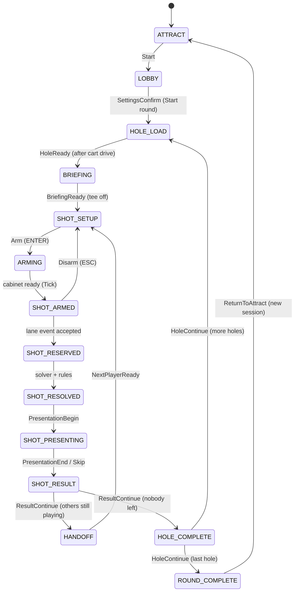
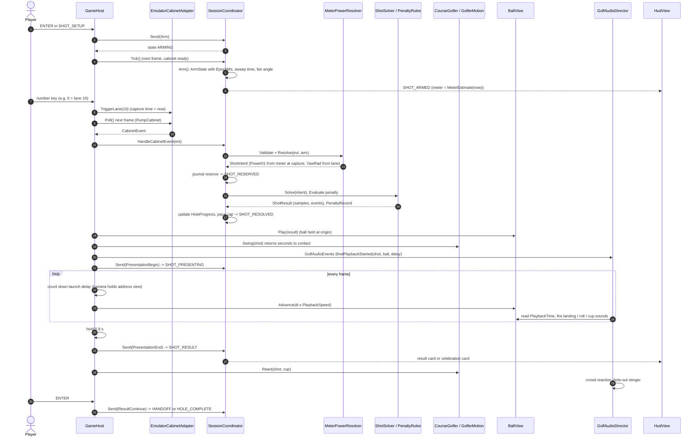

# 03 - How the Game Works

Puttshack Pro is a 1-6 player, turn-based golf game built for a Puttshack bay cabinet. The game is a round on a stylised Pebble Beach coastline: players set up who is playing (names and golfer looks), optionally dress their golfer in the Pro Shop, then take turns on each hole. A shot is not "swung" with a stick: the player arms a shot, a power meter sweeps up and down, and the cabinet reports which of 20 physical target holes ("lanes") the ball went into. The time of that event sets the power and the lane sets the direction inside an aim fan. A deterministic solver computes the whole ball flight in one go, the result is saved to a journal, and only then is it animated (golfer swing, ball flight, camera, crowd). In the editor there is no cabinet, so the **number keys 1-0 (and SHIFT+1-0) stand in for the 20 lanes**. This document walks through the player journey, the controls, the course, the golfers, clubs, HUD, camera and audio, naming the class that drives each step.

> Scope: runtime code in `Assets/_Game/Scripts/Runtime/` (assembly `Puttshack.Runtime`), the input math in `Assets/_Game/Scripts/Core/Input/`, and the scenes `Main.unity` / `ProShop.unity`. The session state machine, journal, solver and cabinet protocol are covered in depth in [02-architecture.md](02-architecture.md) and [06-hardware-and-protocol.md](06-hardware-and-protocol.md); they appear here only as far as gameplay needs them.
>
> Snapshot: written against the working tree on 2026-10-19. The working tree has many uncommitted changes on top of commit `8592497` (for example six authored holes instead of the one in the last commit message). Where the on-disk scene and the code disagree it is called out.

---

## Contents

1. [The player journey](#1-the-player-journey)
2. [Controls](#2-controls)
3. [A single shot, step by step](#3-a-single-shot-step-by-step)
4. [The course](#4-the-course)
5. [Characters: Caleb and Maya](#5-characters-caleb-and-maya)
6. [Clubs](#6-clubs)
7. [HUD and overlay cards](#7-hud-and-overlay-cards)
8. [Camera](#8-camera)
9. [Audio](#9-audio)
10. [What is in each scene](#10-what-is-in-each-scene)
11. [Developer and debug features](#11-developer-and-debug-features)

---

## 1. The player journey

### Who owns what

| Concern | Class | File |
|---|---|---|
| Boot, per-frame loop, keyboard handling, camera choice, ball/golfer placement | `GameHost` | [GameHost.cs](../Assets/_Game/Scripts/Runtime/GameHost.cs) |
| Rules, turns, scoring, states (authoritative) | `SessionCoordinator` (Core) | [SessionCoordinator.cs](../Assets/_Game/Scripts/Core/Session/SessionCoordinator.cs) |
| Between-stroke presentation (hole title, flyover, hole summary page, winner finale, Midnight "dip" fades) | `RoundFlow` | [RoundFlow.cs](../Assets/_Game/Scripts/Runtime/RoundFlow.cs) |
| Player Setup screen | `PlayerSetupController` + `PlayerSetupView` | [Setup/](../Assets/_Game/Scripts/Runtime/Setup/) |
| Pro Shop | `ProShopController` + `ProShopView` | [Shop/ProShopController.cs](../Assets/_Game/Scripts/Runtime/Shop/ProShopController.cs) |
| Golfer on the course | `CourseGolfer`, `GolferAppearance`, `GolferMotion` | [Shop/](../Assets/_Game/Scripts/Runtime/Shop/) |
| Ball, aim fan, gameplay camera | `BallView`, `AimFanView`, `GolfCameraRig` | [Views/ShotViews.cs](../Assets/_Game/Scripts/Runtime/Views/ShotViews.cs) |
| HUD | `HudView` (baked prefab) or `HudFallback` | [Hud/](../Assets/_Game/Scripts/Runtime/Hud/) |
| Cart drive between holes | `CartDrive` | [Course/CartDrive.cs](../Assets/_Game/Scripts/Runtime/Course/CartDrive.cs) |
| Hole intro camera | `HoleFlyover` | [Course/HoleFlyover.cs](../Assets/_Game/Scripts/Runtime/Course/HoleFlyover.cs) |
| Sound | `GolfAudioDirector` | [Audio/](../Assets/_Game/Scripts/Runtime/Audio/) |

The guiding rule, stated in almost every class comment: **presentation owns no rules**. Everything the player does becomes a `SessionCommand` sent through `GameHost.Send(...)` to the `SessionCoordinator`; the views only render the committed `SessionSnapshot` that comes back.

### Session states

The journey is a walk through the Core `SessionState` enum ([Enums.cs](../Assets/_Game/Scripts/Core/Domain/Enums.cs)). `TUTORIAL` exists in the enum but nothing in the runtime enters it.

`PAUSED` can be entered from most in-round states (ESC) and returns to where it came from; `FAULT` is entered by the coordinator on storage or solver problems and is cleared with ENTER ("STAFF ENTER").

### Step 1 - Boot

1. `Main.unity` is the only scene in Build Settings ([EditorBuildSettings.asset](../ProjectSettings/EditorBuildSettings.asset)).
2. `GameHost.Start()` calls `Initialize()` ([GameHost.cs:103](../Assets/_Game/Scripts/Runtime/GameHost.cs)):
   - builds the course: `GrayboxCourse.Create()` (the six authored holes) then `CourseRouting.CreateRound(..., RoundHoles)` (18 numbered holes, see [The course](#4-the-course));
   - opens storage. With `InMemoryStorage` off (the scene default) the session journal is written under `Application.persistentDataPath/PuttshackPro/sessions` and the remembered roster to `.../PuttshackPro/roster.json`. On macOS with the current Player Settings (company `DefaultCompany`, product `Real-Golf`) that is `~/Library/Application Support/DefaultCompany/Real-Golf/PuttshackPro/`;
   - creates the cabinet emulator (`EmulatorCabinetAdapter`) and `SessionCoordinator.StartOrResume(...)`. A session left mid-round (anything except `ATTRACT` and `ROUND_COMPLETE`) is resumed and the banner shows "Round restored - your scores are saved.";
   - `BuildPresentation()` finds or creates the camera rig, six `BallView`s (one per possible player, tinted with the player colour), the `AimFanView`, the `CartDrive`, the `RoundFlow`, and looks up the scene's `HudView`, `ProShopController`, `PlayerSetupController` and `CourseGolfer`. Each missing piece logs a `[Puttshack] No ... in this scene. Run Puttshack > ...` warning and uses a stand-in.
3. `GoHome(launch: true)`: with `HomeInProShop` on (the scene default) the attract screen is skipped. A fresh session is sent `Start` (which creates a default two-player roster "Caleb" and "Maya"), then the remembered roster, golfer profiles and saved loadouts are re-applied with `RosterSet` / `SetLoadout`, and **Player Setup** opens (or the Pro Shop if the scene has no Player Setup).

A clean quit (`OnApplicationQuit`, which includes leaving Play mode in the editor) sends `EndRound` so the next launch starts at home; only a crash resumes a round.

> Scene note: before handover, the saved `Assets/_Game/Scenes/Main.unity` had lost its `HUD.prefab` instance (present in the previous commit) and had never received a `PlayerSetupUI.prefab` instance. The handover commit restores both with `Puttshack > HUD > Place HUD in Main Scene` and `Puttshack > Player Setup > Place Player Setup in Main Scene`. If you ever see "No baked HUD in this scene" or "No Player Setup in this scene" in the Console, run those two menu items again. Details in [runtime risks](notes/runtime-risks.md).

### Step 2 - Player Setup (how many players, names, golfer)

`PlayerSetupController` ([PlayerSetupController.cs](../Assets/_Game/Scripts/Runtime/Setup/PlayerSetupController.cs)) runs over the `LOBBY` state, using the Pro Shop's floor, lights and turntable golfer as a live preview (`ProShopController.BeginStage`). The screen is titled **PLAYER SETUP** with the header "N PLAYERS". Its fields, top to bottom (`SetupField`):

| Field | What it does | Values |
|---|---|---|
| LOBBY (back button) | Closes setup; the lobby ("Round setup") card is shown | |
| Count | Number of players, "N OF 6", with -/+ steppers | 1-6. Added players get the next unused default name: Caleb, Maya, Jordan, Sam, Nia, Leo |
| Players | Roster list: colour disc, initial, live portrait, "MALE · LIGHT · DARK BROWN SHORT"-style detail | |
| NAME ("PLAYER n") | TMP input field | 1-16 characters; empty is refused with "A NAME NEEDS AT LEAST ONE LETTER" |
| BODY | MALE or FEMALE. **This is the golfer choice:** male shows the Caleb body, female the Maya body (`GolferAppearance.CharacterOf`) | |
| SKIN TONE | 7 swatches | Porcelain, Light, Warm Beige, Golden, Medium, Brown, Deep |
| HAIR COLOUR | 8 swatches | Black, Dark Brown, Chestnut, Auburn, Copper, Honey, Blonde, Silver |
| HAIR STYLE | 3 choices | Short (Caleb's hair mesh), Long (Maya's hair mesh), Shaved |
| PRO SHOP · OUTFIT | Opens the Pro Shop on the selected player; its back button reads BACK TO PLAYERS and returns here | |
| START ROUND · SOLO / START ROUND · N PLAYERS | Sends `SettingsConfirm` with the lobby's assistance and pace-cap settings and starts the round | |

Options come from `ProfileCatalog` ([ProfileCatalog.cs](../Assets/_Game/Scripts/Core/Content/ProfileCatalog.cs)). Each roster slot has a default golfer: slot 0 is Caleb as himself, slot 1 Maya as herself, slots 2-5 are mixes (`ProfileCatalog.DefaultFor`). Every change is one `RosterSet` command carrying all names and profiles, and every accepted `RosterSet`/`SetLoadout` is also written to `roster.json` by `RosterMemory` so the next session reopens with the same players and looks.

The **lobby card** ("ROUND SETUP", `HudView.RenderLobby`) sits behind Player Setup. It holds the round settings that Player Setup does not show:

- **Difficulty / assistance**: AMATEUR, CLUB (default), PRO (`AssistanceProfiles` in [ClubCatalog.cs](../Assets/_Game/Scripts/Core/Content/ClubCatalog.cs)). It changes the meter sweep speed (x1.25, x1.0, x0.85) and compresses aim error (deadband 1.5°/0.6°/0°, gain 0.70/0.85/1.00). It never changes where a shot lands after the fact.
- **Pace cap**: on by default, "MAX PAR +5". A player who reaches par + 5 strokes on a hole is capped (`PaceCap`), scored as par + 5 and marked MAX.

### Step 3 - Pro Shop

The Pro Shop is a baked clubhouse interior that lives in `Main.unity` itself (the `Pro Shop` root, from `ProShop.prefab`). When it opens, `ProShopController.EnterStage` disables the course camera rig and hands the main camera to `ProShopCameraRig` (a 1.6 s ease from an establishing overview into a portrait framing, then a slow 1.2° sway), swaps in a warm trilight ambient, and `CourseSunRig` / `CourseAtmosphere` give the shop daylight and turn off the course fog.

It can be opened from:

| Origin | How | Back button label |
|---|---|---|
| Player Setup | PRO SHOP · OUTFIT | BACK TO PLAYERS |
| Lobby card | `P` (or gamepad Y) | BACK TO LOBBY |
| Pause card | `P` (or gamepad Y) | BACK TO ROUND (the player whose turn it is gets a turn marker; the turn never moves) |

Layout (`ProShopView`): category column (TOPS, BOTTOMS, SHOES, SOCKS, BAGS, CLUBS), item list with "OWNED n/m", the dressed golfer on a turntable centre stage, a plinth showing the bag (or the focused club), an EQUIPPED summary, **SAVE LOADOUT** and **RESET** buttons, and a strip of player tabs along the bottom.

What can be "bought" and equipped (`CosmeticCatalog`, [CosmeticCatalog.cs](../Assets/_Game/Scripts/Core/Content/CosmeticCatalog.cs)):

| Category | Items |
|---|---|
| Tops | 10 polos (Royal Blue, Sky Blue, Course Green, Sunset Coral, Clubhouse Cream, Midnight, Violet, Clubhouse Gold, Lagoon Teal, Tour White) and 4 tees (White, Heather Grey, Coral, Navy) |
| Bottoms | Chinos (Light Grey, Khaki, Navy, White, Black), shorts (Khaki, Grey, Navy, Coral, White), then belts (No Belt, Brown Leather, Black Leather, White Tour) |
| Socks | No-show, ankle and crew in several colours |
| Shoes | White Spikeless, Tour White, White / Black, Black Tour, Stealth Black |
| Bags | Puttshack Classic (tour bag, free), four stand bags (350 CR), two cart bags (420 CR), two tour bags (600 CR) |
| Clubs | View only: the 9 clubs with POWER / METER SPEED / ACCURACY WIDTH / FORGIVENESS / WIND SENSITIVITY bars (`ClubTraits`). ENTER shows "EVERY PLAYER CARRIES ALL 9 CLUBS" |

Prices are in "CR" and are **display only**: there is no wallet, payment or account. Price 0 items are starter items everyone owns. Saving marks the equipped priced items as owned for the session and the button reads "SAVE LOADOUT · 350 CR" while unsaved new items are equipped. Every screen states that cosmetics have **no gameplay effect** ("COSMETIC ONLY · NO GAMEPLAY EFFECT", "BAGS ARE COSMETIC · SAME 9 CLUBS"); the solver never reads a loadout.

Edits are held in a `LoadoutEditor` (Core) per player. **Save** sends one `SetLoadout` for the edited player (accepted only in `LOBBY` or `PAUSED`) and toasts "SAVED · CALEB'S LOADOUT". **Back discards every unsaved edit** for every player ("Pro Shop: unsaved changes were not kept."). **Reset** puts the starter look back ("STARTER LOOK · SAVE TO KEEP IT"). If the session leaves `LOBBY`/`PAUSED` while the shop is open it closes itself with "Pro Shop closed - the round needs attention.". Player tabs show live head-and-shoulders portraits rendered by `PortraitStudio`, an off-stage photo booth under the shop floor.

### Step 4 - On the course: hole intro

When the round starts (`SettingsConfirm`) the session goes to `HOLE_LOAD`:

1. **Cart drive (hole 2 onwards).** `GameHost.DrivingToHole` asks `CartDrive.Begin` to drive the next hole's first active player in the golf cart along the cart path from the last green to the new tee (4.5-7.5 s at 10 m/s, chase camera, then a reveal behind the new tee). The banner reads `ON TO HOLE n · NAME · PAR p · Y YD      ENTER TO SKIP`. ENTER, SPACE, ESC, gamepad A or Start skips it. `SeatedDriverPose` IK-poses the golfer in the seat. The session stays in `HOLE_LOAD` until the drive finishes, then `GameHost` sends `HoleReady`. The first hole has no drive: `RoundFlow` fades in from Midnight instead.
   
2. **Briefing.** `HoleReady` puts every active player's ball on the tee and moves to `BRIEFING`. `RoundFlow.BeginIntro` shows the **hole title card** (pink hole number, "HOLE n OF 18", hole name, "PAR p · Y YD", a tick per hole) for 2.8 s and starts the **flyover** (`HoleFlyover`: rises behind the tee, glides down the play route, swings round the flag, climbs back and settles on the address view; 8-12 s). When the title clears, the **briefing card** shows the hole number, par and yardage, the hazard and the "safe plan" text from the hole JSON, wind, and "CALEB TEES OFF".
3. ENTER while the title is up hides it; the next ENTER tees off (`BriefingReady`). If the flyover is still moving it dips through Midnight to the address view rather than racing back.

### Step 5 - Taking a shot

`BriefingReady` picks the first active player in roster order and enters `SHOT_SETUP` with a suggested club (the hole's `Briefing.SuggestedClubId` on the tee, otherwise `ClubCatalog.Suggest` by distance and lie) aimed straight at the cup. Then:

1. **Set up** (`SHOT_SETUP`): LEFT/RIGHT rotate the aim 1° (SHIFT: 5°) around the ball (`SetAim`), UP/DOWN cycle the club (`SelectClub`), `P` cycles the putt scale when the putter is selected (Short 15 ft, Medium 40 ft, Long 90 ft maximum roll). The golfer addresses the ball with the club, the 20-lane aim fan and a dotted preview line at 75% power are drawn from the ball.
2. **Ready** (ENTER, `Arm`): the session goes to `ARMING`, and as soon as the cabinet reports healthy, `SHOT_ARMED`. The arm stamps a start time; from then the **power meter** runs a triangle wave 0 -> 100% -> 0 with a period of 2 x the club's sweep time (`MeterWaveform.Power`, [InputMath.cs](../Assets/_Game/Scripts/Core/Input/InputMath.cs)). The HUD power bar and percentage follow it and the ready dot pulses aqua. ESC disarms.
3. **Hit** (cabinet lane event; in the editor a number key): the event's capture time freezes the power and its lane (1-20) picks the direction inside the fan: `yaw = (lane - 10.5) / 9.5 x fanHalfAngle`, so lane 1 is the far edge on one side, lane 20 the other, and lanes 10/11 are just either side of the aim line (there is no exactly-centred lane). The assistance profile then compresses the yaw (`Assistance.ApplyYaw`). See [Section 3](#3-a-single-shot-step-by-step) for what happens next.

### Step 6 - Ball flight and roll

`ShotSolver.Solve` (Core) simulates the whole shot at 120 Hz before anything moves on screen: launch speed from the club's speed curve and the lie's launch multiplier, drag and wind, lift, bounces with per-surface restitution, friction and landing spin, rolling with per-surface resistance and slope, tree hits, water entry and out of bounds. Putts use `ClubCatalog.PuttSpeed` (roll distance = power x putt scale on a flat green). The result is a list of trajectory samples plus events (`FirstContact`, `Bounce`, `StartRoll`, `TreeHit`, `LipOut`, `WaterEntry`, `Cup`, `OutOfBounds`, `Rest`).

`BallView.Advance` simply interpolates those samples at `PlaybackSpeed` (default 1) with a cyan trail; skipping (ENTER) jumps to the stored final position. Presentation never changes the outcome. The ball is drawn 1.5x real size (64 mm instead of 42.67 mm) for readability (`BallView.VisualScale`).

### Step 7 - Cup capture and holing out

Each hole has a `CupProfile` (cup radius 0.054 m, capture radius 0.075 m, capture speed 1.55 m/s; [HoleDefinition.cs](../Assets/_Game/Scripts/Core/Content/HoleDefinition.cs)). `CupCapture` ([CupCapture.cs](../Assets/_Game/Scripts/Core/Simulation/CupCapture.cs)) adds game-feel forgiveness: an 8 mm edge margin, a faster allowed speed through the centre (1.2x) than at the edge (0.9x), a small rim pull for slow balls, and a ball stopping within capture radius + 12 mm topples in. A holed ball's playback ends with it sunk 6 cm (`DropDepthM`); a fast ball over the edge can `LipOut`.

On the course the cup is a disc drawn by the CupInterior shader plus a flagstick whose cloth streams downwind (`CourseVisualBuilder.BuildCupAndFlag`). The flag is never removed for putts.

### Step 8 - Result, penalties, scoring

When the ball has finished playing back, `GameHost` holds 0.8 s, sends `PresentationEnd`, and the session is in `SHOT_RESULT`:

- **Result card** (`HudView.RenderResult`): title is the finishing surface (FAIRWAY, GREEN, BUNKER, LIGHT ROUGH, ...), or the score word if holed (BIRDIE, PAR, BOGEY ...), WATER, OUT OF BOUNDS, or RETRY NEEDED (solver fault). It shows CARRY / ROLL / TOTAL in yards (DISTANCE for putts), distance to pin (feet inside 30 yards, yards beyond), and a footer "LANE n   POWER p%   CLUB".
- **Penalties** (`PenaltyRules`): water is +1 and a drop at the hazard's authored drop point (if valid) else replay from the previous spot ("+1 · DROP TAKEN" / "+1 · REPLAY FROM LAST SPOT"); out of bounds is +1 and replay from the previous spot. The played stroke always counts.
- **Celebration card** replaces the result card for a hole finished under par: birdie gets pink rings, eagle or better and any ace get the top tier (blue rings, dots, "HOLE IN one" art for an ace).
- **Scoring** (`ScoreEngine`): strokes so far = strokes played + penalty strokes; holed score = that count; capped score = par + 5.
- The golfer reacts (`GolferMotion.ReactionTo`): holed -> celebrate; water/OB -> disappointed; putt finishing within 0.9 m -> fist pump, beyond 3 m -> disappointed; other shots on the green or within 4 m -> fist pump, in bunker or deep rough -> disappointed, fairway -> fist pump.

ENTER (`ResultContinue`) moves to the next active player in roster order (`TurnScheduler.NextActive`; holed, capped and withdrawn players are skipped, and the same player can go again if they are the only one left). With other players the **handoff card** ("NAME", "STROKE n", "X YD TO PIN", lie) waits for ENTER (`NextPlayerReady`). When no one is left the hole is complete.

### Step 9 - Hole complete, scorecard, next hole

`HOLE_COMPLETE` is presented by `RoundFlow` as two pages:

1. **Hole card**: "HOLE n" with one column per player (score, BIRDIE/PAR/BOGEY..., MAX or WITHDRAWN). Footer "ENTER SCORECARD".
2. ENTER -> **running scorecard** page (paper scorecard: 18 hole columns plus OUT, IN, TOTAL, TO PAR, THRU). Footer "ESC BACK   ENTER NEXT HOLE" (or "ENTER FINAL RESULTS" on the last hole). ESC goes back to the hole card.
3. ENTER again dips through Midnight and sends `HoleContinue`: the next hole loads (cart drive, title, flyover...) or the round completes.

TAB opens or closes the scorecard at any time during play ("TAB CLOSE").

### Step 10 - End of round

`RoundFlow.BeginFinale`: for a completed round the winner (most holes completed, then fewest strokes) is stood 2.4 m from the last cup, the camera orbits them (`CameraMode.Celebration`) while they alternate the victory and fist-pump clips every 4.2 s, confetti falls, and a banner shows "ROUND COMPLETE · 18 HOLES", the name, "wins" / "share the win", "N STROKES · -2" and "ENTER STANDINGS". ENTER shows the **standings card** (rank with ties as T2, name, total, to par, thru "F"). From there:

- **ENTER - Play again**: `GameHost.PlayAgain()` starts a new session with the same players, golfers, looks and settings, straight to the first tee.
- **ESC - Player Setup**: `ReturnToAttract`, then `GoHome` restores the roster and opens Player Setup.

A round ended early from the pause card (E) has `Completion = Incomplete`: no finale, the standings say "ROUND ENDED · SCORES SAVED" and the leader "leads".

---

## 2. Controls

All input is read by polling `Keyboard.current` / `Gamepad.current` from the Unity Input System (package 1.19.0). The project-wide actions asset `Assets/InputSystem_Actions.inputactions` is registered in Project Settings but **no runtime code reads it**. "Confirm" below means ENTER, numpad ENTER or SPACE; "Back" means ESC.

### In the round (`GameHost.HandleKeyboard`, `RoundFlow.HandleInput`)

These are ignored while the Pro Shop or Player Setup is open, and `RoundFlow` swallows all keys while a Midnight dip is running.

| Key | When | Action |
|---|---|---|
| `1` `2` ... `9` `0` | Any time (accepted only when SHOT_ARMED) | Emulated cabinet lane 1-9, `0` = lane 10 |
| `SHIFT` + `1` ... `9` `0` | Any time (accepted only when SHOT_ARMED) | Lanes 11-19, `SHIFT+0` = lane 20 |
| `LEFT` / `RIGHT` | SHOT_SETUP | Aim 1° left / right |
| `SHIFT` + `LEFT` / `RIGHT` | SHOT_SETUP | Aim 5° left / right |
| `UP` / `DOWN` | SHOT_SETUP | Previous / next club (wraps through all 9) |
| `P` | SHOT_SETUP, putter selected | Cycle putt scale Short -> Medium -> Long |
| Confirm | SHOT_SETUP | Ready: arm the shot (meter starts) |
| `ESC` | SHOT_SETUP, BRIEFING, SHOT_RESULT, HANDOFF | Pause |
| `ESC` | ARMING, SHOT_ARMED | Disarm (back to setup) |
| Confirm | SHOT_PRESENTING | Skip the flight to the result |
| Confirm | SHOT_RESULT | Continue |
| Confirm | HANDOFF | Next player ready |
| Confirm | BRIEFING | 1st press hides the hole title; next press tees off |
| Confirm / `ESC` | HOLE_LOAD (cart drive) | Skip the cart drive |
| Gamepad `A` (south) or `Start` | HOLE_LOAD (cart drive) | Skip the cart drive |
| Confirm | HOLE_COMPLETE | Hole card -> scorecard page -> next hole |
| `ESC` | HOLE_COMPLETE, scorecard page | Back to the hole card |
| Confirm | ROUND_COMPLETE, winner banner | Show standings |
| Confirm | ROUND_COMPLETE, standings | Play again (same players) |
| `ESC` | ROUND_COMPLETE, standings | Home (Player Setup) |
| Confirm / `ESC` | PAUSED | Resume |
| `P` or gamepad `Y` (north) | PAUSED | Open the Pro Shop |
| `E` | PAUSED | End round (goes to standings) |
| `R` | PAUSED | Restart: end round without the finale, back home with the same players |
| Confirm | FAULT | Resume (staff) |
| `TAB` | Any in-round state | Toggle the scorecard; Confirm or `ESC` also closes it |
| `F1` | Any | Toggle the "Cabinet emulator (F1)" window |
| `F9` | Development builds and the Editor | Auto-play the rest of the current hole |
| `SHIFT` + `F9` | Development builds and the Editor | Auto-play to the last hole's result |
| Confirm | ATTRACT | Start (normally never seen: `HomeInProShop` skips attract) |

### Lobby ("Round setup") card

| Key | Action |
|---|---|
| `UP` | Add a player (max 6, next default name) |
| `DOWN` | Remove the last player (min 1) |
| `LEFT` / `RIGHT` | Cycle difficulty AMATEUR / CLUB / PRO |
| `C` | Toggle pace cap |
| `S` | Open Player Setup |
| `P` or gamepad `Y` | Open the Pro Shop |
| Confirm | Start round |

### Pro Shop and Player Setup (`ShopInput`)

Directions auto-repeat while held (first repeat after 0.38 s, then every 0.085 s).

| Keyboard | Gamepad | Pro Shop | Player Setup |
|---|---|---|---|
| Arrows | D-pad / left stick | Move between zones and rows | UP/DOWN move between fields (on the player list, between players); LEFT/RIGHT change the value |
| `ENTER` / `SPACE` | `A` | Try on focused item; press Save/Reset/Back when focused | Activate field (player list -> name; name -> start typing; PRO SHOP · OUTFIT; START ROUND; other fields step forward) |
| `ESC` / `BACKSPACE` | `B` | Back (discards unsaved edits) | Back to the lobby card |
| `Q` / `E` | `LB` / `RB` | Previous / next player | Previous / next player |
| `TAB` / `SHIFT+TAB` | `RT` / `LT` | Next / previous category | (ignored) |
| (none; `RIGHT` then Confirm on SAVE LOADOUT) | `Y` | Save loadout | (ignored) |
| (none; RESET button) | `X` | Reset to starter look | (ignored) |
| Hold `A` / `D` | Right stick X | Rotate the golfer (110°/s) | Rotate the golfer |
| Mouse click | | Rows, categories, player tabs, SAVE LOADOUT, RESET, back button | Every button, swatch, stepper, row and the name field |

Typing a name: ENTER or ESC ends editing (that key press is not passed on to the screen).

### Mouse

The only mouse input is uGUI buttons in the Pro Shop and Player Setup, and the IMGUI buttons in the emulator window. There is no mouse or gamepad control for aiming or shooting in the round.

---

## 3. A single shot, step by step

Notes on the steps above:

- The emulator stamps the capture time when the key is pressed (`EmulatorCabinetAdapter.TriggerLane` -> `Emit(lane, _clock.NowMs)`), so the meter value at the key press is the power. The event is polled on the next frame (plus any delay set in the emulator window).
- The resolver rejects events that are not armed, from another device or boot, lane out of range, wrong calibration, or captured outside the arm interval ([MeterPowerResolver.cs](../Assets/_Game/Scripts/Core/Input/MeterPowerResolver.cs)). Rejections are logged in the emulator window.
- Swing sync: `GolferMotion.Swing` plays the club's swing state from the start and returns the contact time measured at bake time (driver/iron ~1.18 s, wedge ~1.43 s, putter ~1.18-1.19 s; serialized on `Caleb_Golfer.prefab`). `GameHost` holds the ball on its origin and the camera on the address framing until that time has elapsed, so the ball leaves on contact. `GolferHandIK` keeps both hands on the club and nudges the clubface onto the ball around impact.

---

## 4. The course

### Baked, not generated at runtime

Course content is data: [Assets/_Game/Resources/Course/Pebble/course.json](../Assets/_Game/Resources/Course/Pebble/course.json) (shared world frame in metres, x east, z north; sea level, cliff edge and shore lines, cart path network, the list of authored holes and the 18-hole routing) and one JSON per hole under `Resources/Course/Pebble/Holes/`. In the editor `CourseData` reads the files directly; in a player build `CourseDataResources` reads them as TextAssets from Resources.

The visuals are **baked in the editor** by `Puttshack > Bake Course` / `Build Main Scene` into prefabs under `Assets/_Game/Course/Baked/` (one per hole, plus `Environment/PebbleBeach_Scenery.prefab`). Each hole prefab carries a `BakedHole` component with the hole id, version and **content hash**. At runtime `GameHost.EnsureHoleVisual` uses the baked prefab whose hash matches the current hole definition. If none matches it warns ("Baked visuals for h03... are stale (hash mismatch). Run Puttshack > Bake Course.") and builds a runtime fallback with `CourseVisualBuilder` from the same data. All six hole prefabs stay active together because they share one ground grid (`CourseTiling`) and can see each other.

Gameplay never touches the meshes: collision, surfaces and heights come from the analytic `TerrainModel` and the hole's polygons. Select a `BakedHole` in the Scene view to see its gameplay data as gizmos (surface polygons, hazards in blue, drop points in yellow, boundary in white, trees, tee in cyan, cup in red).

### The holes

Six layouts are authored:

| File | Name | Par | Yards | Suggested tee club | Hazard |
|---|---|---|---|---|---|
| `h03-garden-green.json` | Stillwater Cliffs | 3 | 165 | 5 Iron | Stillwater Cove (sea, whole left side) |
| `h04-cypress-ridge.json` | Cypress Ridge | 4 | 289 | 3 Wood | none |
| `h05-arrowhead-point.json` | Arrowhead Point | 3 | 121 | 9 Iron | Carmel Bay |
| `h06-headland-climb.json` | Headland Climb | 5 | 444 | Driver | Pacific (right) |
| `h07-lands-end.json` | Land's End | 3 | 107 | Pitching Wedge | Land's End sea |
| `h08-the-chasm.json` | The Chasm | 4 | 409 | 3 Wood | The Chasm |

**"Pebble Beach / Stillwater Cove par 3"** is `h03-garden-green` ("Stillwater Cliffs", par 3, 165 yd): a clifftop par 3 with the Pacific (the `stillwater-cove` hazard, drop point `drop-cove`) along the whole left side, a tilted green guarded by four bunkers and seven cypress trees. It was the first authored hole (commit `f3dedfd`); the file name is older than the hole's name.

`CourseRouting.CreateRound` maps 18 hole numbers onto these layouts using the `Routing` list. Only hole 3 plays its own layout; every other number replays a layout as a **stand-in** (copied, renumbered, id like `h01~h04-cypress-ridge`, shown with the original's baked visuals). The current routing is:

| Hole | 1 | 2 | 3 | 4 | 5 | 6 | 7 | 8 | 9 | 10 | 11 | 12 | 13 | 14 | 15 | 16 | 17 | 18 |
|---|---|---|---|---|---|---|---|---|---|---|---|---|---|---|---|---|---|---|
| Layout | h04 | h05 | h03 | h04 | h05 | h06 | h07 | h08 | h06 | h07 | h08 | h06 | h07 | h08 | h06 | h07 | h08 | h06 |
| Par | 4 | 3 | 3 | 4 | 3 | 5 | 3 | 4 | 5 | 3 | 4 | 5 | 3 | 4 | 5 | 3 | 4 | 5 |

That makes the playable round par 70 (the `ProposedPars` in course.json is a separate par-72 plan). Stand-ins keep the original hole's name, so hole 1 is titled "Cypress Ridge". `GameHost.RoundHoles` (default 18) shortens the round to the first N numbers.

### Surfaces

Each hole lists surface polygons with priorities; anything not covered is the hole's `DefaultSurface` (LightRough for all six). The cart path network is added as `CartPath` surface. Parameters are in `SurfaceCatalog` ([SurfaceCatalog.cs](../Assets/_Game/Scripts/Core/Content/SurfaceCatalog.cs), version `surfaces-1.2`):

| Surface | Launch multiplier from this lie | Behaviour |
|---|---|---|
| Tee | 1.00 | Like fairway |
| Fairway | 1.00 | Clear first hop, normal rollout |
| Light rough | 0.92 | Hops once, stops within a few yards |
| Deep rough | 0.82 | Stops quickly |
| Bunker | 0.70 (Sand Wedge: 0.90) | Stops almost at once |
| Green | 1.00 | Rolls at about stimp 10; slopes break putts |
| Cart path | 1.00 | Hard, bouncy, fast roll |
| Water | 0 | Penalty (hazard) |

The ground mesh shader draws crisp outlines from per-vertex signed distances to the gameplay polygons, with mowing stripes. `GrassField` draws GPU-instanced grass on rough areas.

### Tee, cup, flag and furniture

- **Tee**: `Tee` point in the hole JSON (balls start here at ground height), tee pad terrain plateau, tee markers and a tee sign lettered with hole number, name, par and yardage (`CourseVisualBuilder.Dressing`).
- **Cup and flag**: see [Step 7](#step-7---cup-capture-and-holing-out).
- **Hazards** have red stakes along their playable edge; **out of bounds** is the `PlayableBoundary` rectangle.
- **Trees** in the hole JSON are solver obstacles (trunk + canopy) shown with Monterey cypress models; the decorative groves outside the boundaries have no collision.
- **Lighting**: `Environment/Atmosphere` (`CourseAtmosphere`) uses the `GoldenHour` preset ([Assets/_Game/Course/Lighting/](../Assets/_Game/Course/Lighting/); Midday, Overcast and MarineLayer also exist), driving the sun (`CourseSunRig`), height fog (`Rendering/HeightFogFeature`) and cloud-shadow cookie.

---

## 5. Characters: Caleb and Maya

### Two bodies, one rig

There are two modular golfer models, **Caleb** (male body, `Art/Characters/Caleb/Caleb_Modular.fbx`) and **Maya** (female body, `Art/Characters/Maya/Maya_Modular.fbx`), on one shared Humanoid skeleton layout with one `SkinnedMeshRenderer` per part. Both live in one prefab, [Prefabs/ProShop/Caleb_Golfer.prefab](../Assets/_Game/Prefabs/ProShop/Caleb_Golfer.prefab): Caleb is body 0 (the root), Maya is body 1 under a child root (`Maya_Body`) with its own Animator.

A player's profile gender picks the body; everything else is applied by `GolferAppearance.Apply(look, profile)` ([GolferAppearance.cs](../Assets/_Game/Scripts/Runtime/Shop/GolferAppearance.cs)):

- **Parts**: only the parts named by the equipped items are enabled (`Top_Polo` / `Top_Tee`, `Bottom_Chinos` / `Bottom_Shorts`, `Socks_Ankle` / `Socks_Crew`, `Shoes_Golf`, `Belt`), plus `Body_Arms`, the body's head pieces (`Head_`, `Eyes_`, `Brows_`, `Lashes_` + name) and the chosen hair (`Hair_Caleb` = Short, `Hair_Maya` = Long, none = Shaved; each mesh is fitted to both heads).
- **Outfit colours**: materials are swapped by role (`Top`, `Collar`, `Bottom` ...) to baked `Role@HEX~BaseMaterial` variants from `CosmeticArt` (`Art/Characters/Materials/Variants/`), falling back to a runtime copy (`CosmeticPaint`).
- **Skin and hair colour**: tinted per material slot with a `MaterialPropertyBlock`, as a ratio to the material's baked average albedo (`Tone`), so texture detail is kept. Each body's native skin/hair renders untouched.
- **Face**: `GolferMotion` blinks every 2-5.5 s and drives `Smile` / `Frown` / `Open` blend shapes for reactions.
- If a body is missing, the player is shown as a **stand-in**: body 0 with a mannequin head and mannequin skin.

### Where golfers appear

| Golfer | Object | Used for |
|---|---|---|
| Course golfer | `Course Golfer` root in `Main.unity` (`CourseGolfer` with a `Caleb_Golfer` prefab instance and a `Bag Stand` holding the three bag models) | One golfer, re-dressed as whoever is shooting. Stands at the ball for setup, swings, reacts; drives the cart; celebrates in the finale |
| Shop turntable golfer | inside `ProShop.prefab` | Pro Shop and Player Setup preview |
| Portrait subject | inside `ProShop.prefab` (`PortraitStudio`) | Player tab portraits |

`CourseGolfer.Stand` places the golfer so the club meets the ball (using the per-club ball offset measured at bake time), faces them across the aim line, puts their bag 1.1 m behind and 0.9 m out, and either addresses with the club or (in HANDOFF) waits with the club put away. If the scene has no `CourseGolfer`, a coloured capsule (`GolferView`) is used instead.

### Animation

Both bodies use one Animator controller, [Art/Characters/Caleb/Caleb_Shop.controller](../Assets/_Game/Art/Characters/Caleb/Caleb_Shop.controller) (despite its name it is used on the course too). It has one layer, default state `Idle`, and **no transitions**: `GolferMotion` plays states directly with `CrossFadeInFixedTime` / `Play`.

| State | Clip (Mixamo, retargeted) | Used when |
|---|---|---|
| `Idle` | `Idle_Standard` (loops) | Shop, waiting turn, sitting base pose in the cart |
| `Address_Driver` | `Golf_Drive_Standard` frozen (speed 0) | Driver and 3 Wood setup |
| `Swing_Driver` | `Golf_Drive_Standard` | Driver and 3 Wood shot |
| `Address_Iron` | `Golf_Drive_Standard` frozen | 5, 7, 9 Iron setup |
| `Swing_Iron` | `Golf_Drive_Standard` | Iron shot (same clip as the driver) |
| `Address_Wedge` | `Golf_Chip_Swing2` frozen | PW, SW, LW setup |
| `Swing_Wedge` | `Golf_Chip_Swing2` | Wedge shot |
| `Putt_Address` | `Golf_Putt_Medium` frozen | Putter setup |
| `Putt` | `Golf_Putt_Medium` | Putt |
| `React_Good` | `React_FistPump` | Good result; finale alternation |
| `React_Miss` | `React_Disappointed` | Miss, water, OB |
| `Celebrate` | `React_Victory` | Holed; finale |

Clips live in `Art/Characters/Animations/` (`YBot_Reference.fbx` there is a reference rig, not used by the controller). Club ids map to four held-club models by `GolferMotion.ClubModel`: Driver (driver, wood3), Iron (iron5/7/9), Wedge (pw/sw/lw), Putter. Contact times and ball offsets per club model and body are baked by `Puttshack > Characters > Bake Golfers` (see [05-art-pipeline.md](05-art-pipeline.md)).

---

## 6. Clubs

Every player carries the same nine clubs (`ClubCatalog`, [ClubCatalog.cs](../Assets/_Game/Scripts/Core/Content/ClubCatalog.cs), version `clubs-1.1`). Nothing in the shop changes them.

| Club | Id | Range (yd) | Launch | Meter sweep (s) | Fan half-angle | Notes |
|---|---|---|---|---|---|---|
| Driver | `driver` | 200-300 | 11° | 1.6 | 12° | Longest, fastest meter, least landing spin |
| 3 Wood | `wood3` | 180-240 | 13° | 1.8 | 11° | |
| 5 Iron | `iron5` | 150-200 | 17° | 2.0 | 10° | |
| 7 Iron | `iron7` | 120-170 | 21° | 2.2 | 9° | |
| 9 Iron | `iron9` | 100-140 | 27° | 2.4 | 8° | |
| Pitching Wedge | `pw` | 60-110 | 32° | 2.5 | 8° | |
| Sand Wedge | `sw` | 20-80 | 40° | 2.5 | 7° | Bunker launch 0.90 instead of 0.70 |
| Lob Wedge | `lw` | 10-50 | 46° | 2.5 | 7° | Most check-up |
| Putter | `putter` | Feet scale | 0° | 2.8 | 4° | Ground roll; power x putt scale |

How a club shapes a shot:

- **Power -> speed**: `ClubCatalog.LaunchSpeed` interpolates five speed samples (power 0, 0.25, 0.5, 0.75, 1). Putts use `PuttSpeed` from the putt scale instead.
- **Meter speed**: sweep seconds x the assistance multiplier. Faster meters are harder to time.
- **Accuracy**: the fan half-angle; a wider fan means the same lane error sends the ball further offline.
- **Flight and stop**: launch angle, lift coefficient (stands in for backspin) and landing check (spin braking on first impact, scaled by surface grip).
- **Suggestion**: on each turn the session picks a club (`Suggest`): putter on the green or within 12 yd, sand wedge in a bunker, driver from the tee beyond 250 yd, otherwise the shortest club whose range covers 95% of the distance. It never restricts the bag.

Club **models** are cosmetic: `ClubLibrary` ([Clubs/ClubLibrary.cs](../Assets/_Game/Scripts/Runtime/Clubs/ClubLibrary.cs), asset `Resources/Clubs/ClubLibrary.asset`) holds three sets (`cyan` "Puttshack Cyan", `midnight` "Midnight", `tour` "Tour Chrome"), assigned by roster colour index modulo 3. `HeldClubView` spawns the set's model into the golfer's lead-hand seat (`ClubGrip_<Kind>`) and hides the baked `Club_<Kind>` skin. The shop plinth (`BagDisplay`) shows the focused club in the CLUBS category.

---

## 7. HUD and overlay cards

The baked HUD is `Prefabs/HUD/HUD.prefab` (built by `Puttshack > HUD > Bake HUD`). `HudView` ([Hud/HudView.cs](../Assets/_Game/Scripts/Runtime/Hud/HudView.cs) and partials) only fills text, colours and visibility each frame from a `HudContext` built by `GameHost.UpdateViews` and decorated by `RoundFlow.Decorate`. The design rule: during a shot the whole HUD is one Midnight **rail** along the bottom; everything else is a full-screen card, one at a time. If the scene has no `HudView`, `HudView.Create()` builds `HudFallback`: plain boxes with the same states and shorter text. The HUD is hidden while the Pro Shop or Player Setup is open.

### The rail (in play, no card showing)

| Element | Field | Driven by |
|---|---|---|
| Player pill | `RailPlayer` | Current player name and colour, "STROKE n" (`ScoreEngine.NextStrokeNumber`, or the shot's stroke while its result shows) |
| HOLE n | `RailHole` | `snap.Hole.Number` |
| Distance | `RailDistance` | Ball to cup, "165 YD" or "12 FT" (`Units.FormatDistance`) |
| PAR n | `RailPar` | Hole par |
| Club | `RailClub` | Armed or selected club, "PUTTER" for the putter |
| Wind | `WindValue`, `WindArrow` | Hole wind in MPH (or CALM), arrow relative to the aim |
| Power | `PowerFill`, `PowerValue` | SHOT_ARMED: live meter; after the shot: the shot's power; setup: preview power 75% |
| Ready dot | `ReadyDot`, `ReadyPulse` | Pulsing aqua when armed, white during the result, sun yellow in handoff, grey otherwise, red when the cabinet is offline |
| Key hints | `PlayHints` | SHOT_SETUP: "← → AIM  ↑ ↓ CLUB  ENTER READY"; SHOT_ARMED: "1-0 / SHIFT+1-0 LANE" (`GameHost.Hints`, laid out as keycaps by `HudHints`) |
| Banner | `Banner`, `BannerText` | Fault reason, else a notice from `GameHost.ShowNotice` (4 s), else the cabinet status when not ready |

### Cards (`HudView.RenderCard`)

| State | Card | Contents | Footer hint |
|---|---|---|---|
| ATTRACT | Attract | Title screen | ENTER START |
| LOBBY | Lobby ("ROUND SETUP") | 6 player slots (OPEN when empty), "PLAYERS · n OF 6", AMATEUR/CLUB/PRO, pace cap toggle | ENTER START ROUND; S PLAYERS   P PRO SHOP |
| BRIEFING (after the title) | Briefing | Hole number, "PAR p · Y YD", hazard, safe plan, wind, "NAME TEES OFF" | ESC PAUSE   ENTER TEE OFF |
| SHOT_RESULT | Result | See [Step 8](#step-8---result-penalties-scoring); roster chips across the top with each player's strokes | ENTER CONTINUE |
| SHOT_RESULT (under par) | Celebrate | Score word or HOLE IN one art, "HOLE n • k STROKES • m UNDER PAR" | ENTER CONTINUE |
| HANDOFF | Handoff | Player colour halo, name, chips: STROKE n, distance to pin, lie | ESC PAUSE   ENTER READY |
| HOLE_COMPLETE | Hole complete | One column per player | ENTER SCORECARD |
| ROUND_COMPLETE | Final results | Winner disc, ranked rows | ENTER PLAY AGAIN; ESC PLAYER SETUP   TAB SCORECARD |
| PAUSED | Paused | "ROUND SAVED", "HOLE n OF 18 · NAME'S SHOT" | ESC RESUME; P PRO SHOP   E END ROUND   R RESTART |
| FAULT | Fault | "A staff member is on the way.", reason · ROUND SAVED | STAFF ENTER |
| any (TAB) | Scorecard | Paper scorecard, hole columns sized to the hole count | TAB CLOSE |

### Round overlay (above the HUD)

`RoundOverlay` ([Hud/RoundOverlay.cs](../Assets/_Game/Scripts/Runtime/Hud/RoundOverlay.cs)) is built at runtime on its own canvas (sorting order 15: above the HUD at 10, below the shop UI at 20) and borrows the HUD's fonts. It provides the **Midnight dip** (fade out, run an action at black, hold, fade in), the **first-tee reveal**, the **hole title card**, and the **winner banner with confetti**.

---

## 8. Camera

One camera (`Main Camera`) is shared by everything. Ownership at any moment:

| Owner | When |
|---|---|
| `ProShopCameraRig` | Pro Shop or Player Setup open (course rig disabled) |
| `CartDrive` | Cart drive between holes (blends in over 1 s from wherever the camera was, chases off the driver's shoulder, reveals the new tee in the last 1.7 s) |
| `HoleFlyover` | BRIEFING, until tee off |
| `GolfCameraRig` (mode set by `GameHost.UpdateCamera` or `RoundFlow`) | Everything else |

`GolfCameraRig` modes ([ShotViews.cs](../Assets/_Game/Scripts/Runtime/Views/ShotViews.cs)); it smooth-damps position (0.35 s in Follow, 0.6 s otherwise) and slerps rotation, and never alters a trajectory:

| Mode | States | Framing |
|---|---|---|
| Attract | ATTRACT, LOBBY | Slow orbit (6°/s) 55 m up, 95 m out, around a point 55% of the way from tee to cup |
| Flyover | HOLE_LOAD, BRIEFING, HOLE_COMPLETE, ROUND_COMPLETE (when nothing else owns the camera) | Same orbit |
| Setup | SHOT_SETUP, ARMING, SHOT_ARMED, SHOT_RESERVED, HANDOFF (non-putter) | 7.5 m behind the ball, 2.6 m up, looking 40 m down the aim line |
| Putting | Same states with the putter | 3.2 m behind, 1.25 m up, looking 4 m ahead |
| (hold) | SHOT_RESOLVED / SHOT_PRESENTING before contact | Keeps the Setup or Putting framing while the golfer swings |
| Follow | SHOT_PRESENTING after contact | 14 m behind and 6 m above the ball, looking 6 m ahead of it |
| Result | SHOT_RESULT | 9 m behind, 7 m up, 4 m to the side, looking at the ball |
| Celebration | Finale | Low orbit (7°/s) 4.8 m from the winner at 1.6 m height |

Through a shot: address framing -> (golfer swing, ~1.2-1.4 s) -> Follow chases the ball -> Result looks down at where it stopped -> HANDOFF/next setup frames the next ball. `ReducedMotion` on `GameHost` slows the orbits, lengthens smoothing, skips the flyover and the cart drive, and halves dip times.

`CourseCameraFocus` on the camera adds a Gaussian depth of field per mode (Putting 16-70 m, Celebration 9-45 m, Setup 240-900 m, flight 420-1400 m) through a runtime global Volume, off while the shop is open. See the camera note in [runtime risks](notes/runtime-risks.md) about whether it actually finds the rig.

---

## 9. Audio

`GolfAudioDirector` ([Audio/GolfAudioDirector.cs](../Assets/_Game/Scripts/Runtime/Audio/GolfAudioDirector.cs) and partials) is created automatically after any scene with a `GameHost` loads (`RuntimeInitializeOnLoadMethod`), persists across scenes, and reads the committed snapshot each frame, like the HUD. Sounds come from `GolfSoundBank.LoadForRuntime()`: an optional `Resources/Audio/GolfSoundBank` asset (none exists today, so code presets are used) with clips found by filename prefix under `Resources/Audio/` (e.g. every `Ball/strike_iron_*` clip is a `StrikeIron` variant). Routing is through the optional `Resources/Audio/GolfMixer.mixer` with buses Music, Ambience, SFX, UI and Crowd; context ducks are applied in code so it works without the mixer. Files with `_ph_` in the name are placeholders.

| When | Cue(s) | Driven from |
|---|---|---|
| Always on course (attract to standings) | Surf bed (thins with distance from shore), positional surf emitters sliding along the shoreline, wind (follows hole wind and camera height), inland birds, gulls off the coast, crowd murmur by the green | `GolfAudioDirector.Ambience` |
| Pro Shop / Player Setup open | Ambience and crowd ducked and low-passed ("indoors") | `ReadContext` / `UpdateMix` |
| Flyover, putting, cart drive, finale, pause | Ambience/crowd ducks; pause low-passes and ducks everything except UI | `UpdateMix` |
| Club changed in setup | `ClubChange` | `UpdateFlow` |
| BRIEFING starts | `UiTitle` | `Enter` |
| SHOT_ARMED | `UiConfirm` (50%) | `Enter` |
| Shot playback starts | `Whoosh` timed ahead of contact (not for putts), then `Strike<Driver/Wood/Iron/Wedge/Putter>` at contact, plus `StrikeSand` from a bunker or `StrikeRough` from rough | `GolfAudioDirector.Shot` |
| Each bounce / first contact | `Land<Fairway/Rough/Green/Bunker/CartPath>` scaled by impact speed | solver events |
| Rolling | `Roll<Green/Fairway/CartPath>` loop, level and pitch from ball speed, surface sampled under the ball | `UpdateRoll` |
| Tree hit, lip out, water, cup | `TreeHit`, `LipOut` (+ `CrowdOoh`), `Splash`, `CupDrop` | solver events |
| Shot finishes | Crowd: ace -> Cheer + Ovation; holed full shot or eagle-or-better putt -> Cheer + ApplauseBig; birdie putt or long putt -> ApplauseBig (+ Cheer); other holed putts -> ApplauseSmall; water/OB -> CrowdAww; near-miss putt -> CrowdOoh; close approach -> ApplauseBig/Small; long drive on par 4/5 fairway -> ApplauseSmall | `ReactToShot` |
| Player holes out | Stinger by score: Ace, Eagle, Birdie, Par, Bogey, Double | `HoleOutStinger` |
| HOLE_COMPLETE | `UiConfirm` | `Enter` |
| ROUND_COMPLETE (finished round) | `StingerRound` then `Ovation` | `Enter` |
| Cart moving | `CartHum` positional on the cart | Ambience |
| Menu navigation | `UiSelect` / `UiConfirm` / `UiBack` from every `ShopInput` poll, every uGUI Button click (by button name), and ENTER/ESC on round pages | `GolfAudioDirector.Ui` |
| Music | `MusicMenu` outside the round, `MusicRound` in it (halved while putting) | `UpdateMusic`; **no music clips exist** (`Resources/Audio/Music/` is absent), so both are silent |

Sources and licences are listed in [Resources/Audio/CREDITS.txt](../Assets/_Game/Resources/Audio/CREDITS.txt).

---

## 10. What is in each scene

### `Assets/_Game/Scenes/Main.unity` (the game)

Root objects as saved on disk (mapped from script GUIDs in the scene YAML):

| Root | Contents |
|---|---|
| `Game Host` | `GameHost` with `InMemoryStorage` off, `PlaybackSpeed` 1, `ReducedMotion` off, `ShowEmulatorPanel` on, `HomeInProShop` on, `RoundHoles` 18 |
| `Course` | Six baked hole prefabs from `Assets/_Game/Course/Baked/` (h03-h08), each with `BakedHole` |
| `Course Golfer` | `CourseGolfer`; child `Caleb_Golfer` prefab instance (`GolferAppearance`, `GolferMotion`, both bodies); child `Bag Stand` (`BagDisplay`) with `GolfBag_Stand`, `GolfBag_Cart`, `GolfBag_Tour` prefabs (`BagAppearance`) |
| `Pro Shop` | `ProShop.prefab`: `ProShopController`, `ProShopView` UI, turntable golfer and portrait subject (`GolferAppearance` x2), 3 bag models, 52 `CosmeticDisplay` items on hangers, shelves and mannequins |
| `Environment` | `PebbleBeach_Scenery` prefab; `Atmosphere` (`CourseAtmosphere`, GoldenHour preset); `Course Post Volume` (URP Volume); `Course Probe Volume` (APV); `Reflection Probes` (course probe + green probes) |
| `Main Camera` | Camera, URP camera data, `CourseCameraFocus`, and a serialized `GolfCameraRig` entry whose script reference has no GUID (see notes) |
| `Sun` | Directional light, `CourseSunRig`, URP light data, `LensFlareComponentSRP` |
| `EventSystem` | `EventSystem` + `InputSystemUIInputModule` |

Not in the saved scene but expected by the code: `HUD` (`Prefabs/HUD/HUD.prefab`) and `Player Setup UI` (`Prefabs/PlayerSetup/PlayerSetupUI.prefab`). Created at runtime: `Shot Presentation` (balls, aim fan, cart drive, round flow, hole flyover), `Round Overlay`, `Golf Audio` (DontDestroyOnLoad), and the `EmulatorPanel` component on `Game Host`.

### `Assets/_Game/Scenes/ProShop.unity` (preview only)

Roots: `Preview Camera`, `Sun (course sun, shop-relative)`, and a `ProShop` prefab instance. There is no `GameHost`, so pressing Play here shows the static shop with an idling golfer; the shop UI never opens. It is written and opened by `Puttshack > Pro Shop > Open Preview Scene` for art review.

---

## 11. Developer and debug features

- **Cabinet emulator window** (`EmulatorPanel`, F1, hidden by default): state, revision and boot id; cabinet status; 20 lane buttons ("Target holes (lanes)"); Delay (0-1000 ms) and Jitter (0-300 ms) sliders; toggles "Duplicate next event", "Suppress heartbeat", "Supply capture timestamps"; buttons "Late event", "Conflict 7+8", "Reboot", "Disconnect"/"Reconnect"; crash injection "After reserve" / "After result" (arms a simulated crash; the service rebuilds from the journal and shows "Recovered: ..."), "Restart service now"; last input ack and the last 30 log lines. Full fault semantics are in [06-hardware-and-protocol.md](06-hardware-and-protocol.md).

- **Auto-play** (`DebugAutoPlay`, F9 / SHIFT+F9, `Debug.isDebugBuild` only, which includes the Editor): plays real strokes through the normal commands and emulator, choosing the power the solver says finishes nearest the cup (lanes 9-12) with up to 8% scatter. Notices: "DEBUG · HOLE PLAYED OUT", "DEBUG · PLAYED ON TO THE LAST HOLE", "DEBUG · NOTHING TO AUTO-PLAY HERE".
- **Inspector switches on `Game Host`**: `InMemoryStorage` (no journal on disk; set before Play), `PlaybackSpeed` (presentation only), `ReducedMotion`, `ShowEmulatorPanel`, `HomeInProShop`, `RoundHoles` (1-18).
- **Fresh start**: the journal and roster under `~/Library/Application Support/DefaultCompany/Real-Golf/PuttshackPro/` make the game resume or remember players. Turn on `InMemoryStorage`, or clear that folder, to start clean.
