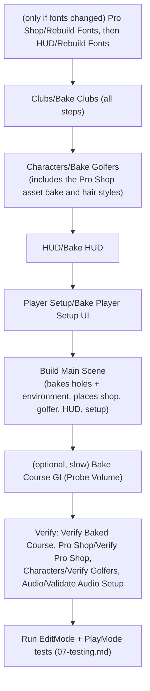

# 04 - Editor Tools (the `Puttshack` menu)

Almost everything you see in `Main.unity` (the six course holes, the Pebble Beach scenery and lighting, the Pro Shop, the on-course golfer, the HUD and the Player Setup overlay) is **generated by editor code** in [Assets/_Game/Scripts/Editor](../Assets/_Game/Scripts/Editor) (assembly `Puttshack.Editor`, namespace `Puttshack.EditorTools`). Nothing of this is built at runtime; the menu commands bake prefabs, materials, meshes and scenes into `Assets/`, and the runtime only loads them. This page lists every `Puttshack/*` menu item with its inputs, outputs and side effects, gives the order for a full rebuild, says which commands are safe and which overwrite work, and documents every `AssetPostprocessor` (import rule) by folder. Every statement below was read from the source files linked in each row; where the code leaves something open it says so.


> **Golden rule.** Treat generated assets (`Main.unity`, `ProShop.unity`, `Assets/_Game/Course/Baked/**`, `Assets/_Game/Prefabs/**`, `Art/Characters/Materials`, `Art/Clubs/{Materials,Palettes,Prefabs}`, font `SDF/` folders) as **build output**. Hand edits to them are lost the next time the matching bake runs. Change the code or the source art instead.

---

## 1. Menu reference

Legend for the **Scene** column: **none** = does not open or modify a scene; **opens** = opens a scene (may discard unsaved work, see notes); **saves Main** = writes `Assets/_Game/Scenes/Main.unity`.
Legend for **Safety**: **Safe** = read-only or writes only to `Logs/` / `ArtSource/Review/`; **Rebake** = overwrites generated assets (normal use, but hand edits are lost); **Destructive** = replaces whole scenes/settings or deletes and regenerates assets with new GUIDs.

### 1.1 Course and scene

| Menu path | Source | What it does | Reads | Writes | Scene | Safety |
|---|---|---|---|---|---|---|
| `Puttshack/Bake Course` | [CourseBaker.cs](../Assets/_Game/Scripts/Editor/CourseBaker.cs) `BakeCourseMenu` | Builds every hole of the data-driven course (`GrayboxCourse.Create()`) with `CourseVisualBuilder`, persists meshes and materials, marks renderers static (`CourseEnvironmentBaker.MarkStatic`) and saves one prefab per hole. Deletes mesh assets of a hole that the new build no longer produces. Shows a dialog with the count. | Course JSON under `Assets/_Game/Resources/Course/Pebble/` (via `CourseData`); `HudFonts.CondensedBold` SDF font (throws if missing); shader `Puttshack/GrassInstanced` (only if the grass material is missing); `Resources/Models/Course/**` models and textures loaded by `CourseVisualAssets` | `Assets/_Game/Course/Baked/<holeId>.prefab` (currently h03...h08), `Course/Baked/Meshes/<holeId>_*.asset`, `Course/Baked/Materials/*.mat` (updated in place so GUIDs survive), `Assets/_Game/Resources/Models/Course/Nature/GrassInstanced.mat` (created once, never overwritten) | none (the open `Main.unity` instances follow because they are prefab instances) | Rebake |
| `Puttshack/Build Main Scene` | [CourseBaker.cs](../Assets/_Game/Scripts/Editor/CourseBaker.cs) `BuildMainSceneMenu` -> `BuildMainScene` | Prompts to save open scenes, runs **Bake Course**, then creates a **brand-new empty scene** with: Sun, Main Camera (+`AudioListener`, `GolfCameraRig`), `Course` root with every hole prefab, `Game Host` (`GameHost`, `ShowEmulatorPanel = true`), then calls in order `ProShopBaker.PlaceInScene`, `CourseGolferBaker.PlaceInScene`, `CourseEnvironmentBaker.PlaceInScene`, `HudBaker.PlaceInScene`, `PlayerSetupUIBuilder.PlaceInScene`. Saves the scene and sets **Build Settings to exactly one scene** (`Main.unity`). | Everything Bake Course reads, plus `Prefabs/ProShop/ProShop.prefab` (skipped if missing), `Prefabs/ProShop/Caleb_Golfer.prefab` (**throws** if missing), `Art/Course/PebbleBeach/PebbleBeach_Scenery.fbx` (**throws** if missing), `Course/Baked/Materials/Foliage.mat`, `Course/Lighting/*.asset`, `Art/Course/PebbleBeach/Textures/{pebble_sky.hdr, ocean_normal.png, foam_noise.png}`, HUD and Player Setup prefabs (baked on the fly if missing) | `Assets/_Game/Scenes/Main.unity` (replaced), `ProjectSettings/EditorBuildSettings.asset`, everything under `Assets/_Game/Course/Baked/Environment/` (see 1.2), the four `Course/Lighting/*.asset` presets (only if missing), **`Assets/Settings/PC_RPAsset.asset`, `Assets/Settings/PC_Renderer.asset`, `ProjectSettings/GraphicsSettings.asset`** (pipeline settings), scene lighting data in `Assets/_Game/Scenes/Main/` | saves Main | **Destructive** (scene rebuilt from nothing; any hand edits in Main.unity are lost; project render settings rewritten) |
| `Puttshack/Verify Baked Course` | [CourseBaker.cs](../Assets/_Game/Scripts/Editor/CourseBaker.cs) `VerifyMenu` | For each hole, checks `Course/Baked/<id>.prefab` exists and its `BakedHole.ContentHash` matches the current hole definition. Dialog: "Baked course matches..." or "Stale bake:" plus one line per hole. | Course JSON, baked prefabs | nothing | none | Safe |
| `Puttshack/Bake Course GI (Probe Volume)` | [CourseEnvironmentBaker.cs](../Assets/_Game/Scripts/Editor/CourseEnvironmentBaker.cs) `BakeCourseGIMenu` | Prompts to save, opens `Main.unity`, sets the `Course_Lighting.lighting` settings with `bakedGI = true` (Progressive GPU, 32/256/256 samples, 2 bounces, Mixed = Baked Indirect) and runs a synchronous `Lightmapping.Bake()`, then saves Main. Slow. | `Main.unity` (must already be built) | `Course/Baked/Environment/Course_Lighting.lighting`, `Main.unity`, the probe-volume and lighting data in `Assets/_Game/Scenes/Main/` (the existing files there are ~40 MB each) | opens + saves Main | Rebake (slow) |
| `Puttshack/Capture Course Preview` | [CourseBaker.cs](../Assets/_Game/Scripts/Editor/CourseBaker.cs) `CapturePreviewMenu` | Opens `Main.unity` **without a save prompt** and renders three 1600x900 shots of the first hole with a hidden camera. | `Main.unity` | `Logs/CoursePreview/course-tee.png`, `course-approach.png`, `course-overview.png` | opens Main (unsaved changes in the open scene are discarded; save first) | Safe |
| `Puttshack/Export Course Layout For Blender` | [CourseExport.cs](../Assets/_Game/Scripts/Editor/CourseExport.cs) `ExportMenu` | Re-reads the course JSON and writes the expanded layout Blender builds the scenery around: course id/version/hash, `SeaLevelM`, the ground `Grid` (MinX/MinZ/MaxX/MaxZ/Nx/Nz/Spacing), cliff and shore control points and sampled lines, the cart path and every cart path line, and every hole definition. Logs the path. | Course JSON | `ArtSource/Blender/pebble_course.json` (canonical JSON) | none | Safe (but changes a tracked file) |
| `Puttshack/Course/Write Terrain Parity Golden` | [CourseExport.cs](../Assets/_Game/Scripts/Editor/CourseExport.cs) `ParityMenu` | Writes the C#/Python terrain golden: every terrain feature and ~1600 probe heights from `TerrainModel`, stored as IEEE double bit patterns. Imports the file. | Course JSON (`GrayboxCourse.CourseTerrain()`) | `Assets/_Game/Tests/EditMode/Fixtures/terrain_parity.golden.json` | none | Safe (changes a test fixture; see [07-testing.md](07-testing.md)) |


### 1.2 What `Build Main Scene` adds via `CourseEnvironmentBaker.PlaceInScene`

[CourseEnvironmentBaker.cs](../Assets/_Game/Scripts/Editor/CourseEnvironmentBaker.cs) has no menu of its own except **Bake Course GI**; it runs inside Build Main Scene and does the following, in order:

1. Creates any missing time-of-day preset in `Assets/_Game/Course/Lighting/` (`GoldenHour.asset`, `Midday.asset`, `MarineLayer.asset`, `Overcast.asset`). Existing presets are **kept** (they are meant to be tuned by artists). The active preset is hard-coded: `ActivePresetPath = GoldenHourPreset`.
2. Persists materials in `Assets/_Game/Course/Baked/Environment/`: `CourseGroundScenery.mat` (copy of `Course/Baked/Materials/CourseGround.mat` with `_UseMasks = 0`), `Ocean.mat` (shader `Puttshack/Ocean`), `PebbleSky.mat` (shader `Puttshack/HazySky`), `HeightFog.mat` (shader `Hidden/Puttshack/HeightFog`).
3. Instantiates `Art/Course/PebbleBeach/PebbleBeach_Scenery.fbx`, unpacks it, swaps Blender materials `PB_Terrain` -> ground, `PB_Ocean` -> ocean, any `PB_Foliage*` -> `Course/Baked/Materials/Foliage.mat`, and saves `Course/Baked/Environment/PebbleBeach_Scenery.prefab`.
4. Sun (`CourseSunRig`): rotation/colour/intensity from the preset, Mixed light mode, a cloud-shadow cookie written to `Course/Baked/Environment/CloudShadows.png`, a lens flare asset `SunFlare.asset`.
5. Render settings: skybox ambient, exponential-squared fog from the preset.
6. `Course Post Volume` (local box volume centred at (-200, 0, 200), size 3200 x 1200 x 3400, so the Pro Shop at x = 2500 stays outside). Its profile `Course_PostVolume.asset` is **deleted and recreated** on every run (new GUID).
7. Reflection probes: one course probe plus one `Green Reflection Probe NN` per hole.
8. `Course Probe Volume` (Adaptive Probe Volume) sized from the holes' playable boundaries plus 60 m.
9. `Atmosphere` (`CourseAtmosphere`) linked to preset, sun and volume.
10. Main camera: HDR, post-processing, SMAA High, depth texture, adds `CourseCameraFocus`.
11. **Project settings** (`ConfigurePipeline`): in `Assets/Settings/PC_RPAsset.asset` shadow distance 220, 4 cascades, 4096 shadow map, depth texture on, opaque texture off, HDR grading with 64 LUT, light cookies, lens flares, GPU Resident Drawer + GPU occlusion culling, Probe Volumes with SH L1; in `ProjectSettings/GraphicsSettings.asset` BatchRendererGroup stripping "Keep All"; in `Assets/Settings/PC_Renderer.asset` SSAO settings and a `HeightFog` renderer feature (added if missing).
12. Lighting bake: writes `Course_Lighting.lighting`, saves Main, runs `Lightmapping.Bake()`. GI is baked only when the environment variable `PUTTSHACK_BAKE_GI=1` is set for the editor process; otherwise only environment lighting and reflection probes are baked.

### 1.3 Characters

| Menu path | Source | What it does | Reads | Writes | Scene | Safety |
|---|---|---|---|---|---|---|
| `Puttshack/Characters/Bake Golfers` | [GolferCharacterBaker.cs](../Assets/_Game/Scripts/Editor/GolferCharacterBaker.cs) `BakeMenu` -> `BakeAll` | (1) **Copies changed staged files** from `ArtSource/Exports/Characters/{Caleb,Maya}/` (`<Name>_Modular.fbx` and the textures with suffixes `_Face_Albedo/_Face_Mask/_Face_Normal/_Skin_Albedo/_Skin_Mask/_Skin_Normal/_Eye_Albedo/_Eye_Mask/_Hair/_Hair_Normal/_Brow/_Lash`.png) and every PNG in `ArtSource/Exports/Characters/Shared/Textures/` into `Assets/_Game/Art/Characters/`; copies `YBot_Reference.fbx` and the 7 clips the controller uses from `ArtSource/Mixamo/YBot_TPose/` into `Art/Characters/Animations/`; **deletes** textures and clip FBXs in those folders that are no longer used; reimports clips imported with old settings. (2) Builds skin/eye/hair/cloth materials on the `Puttshack/Character/*` shaders in `Art/Characters/Materials/` and **deletes** other materials there; remaps the FBX materials to them. (3) Bakes tinted garment variants per catalogue colour into `Art/Characters/Materials/Variants/`. (4) **Runs `ProShopBaker.BakeAll()`** (rebuilds `Caleb_Golfer.prefab`, bags, icons, `ProShopUI.prefab`, `ProShop.prefab`; see 1.4). (5) Points the `Caleb_Shop.controller` states at the Mixamo clips (Idle -> `Idle_Standard`, Swing_Driver and Swing_Iron -> `Golf_Drive_Standard`, Swing_Wedge -> `Golf_Chip_Swing2`, Putt -> `Golf_Putt_Medium`, React_Good -> `React_FistPump`, React_Miss -> `React_Disappointed`, Celebrate -> `React_Victory`, plus held Address states) and removes other states. (6) Adds `Maya_Body`, `GolferHandIK`, `GolferMotion` (measured club contact per body) and the hair styles (`GolferLookBaker.Bake`) to `Caleb_Golfer.prefab`. (7) Runs **Verify Golfers** and logs the result (no dialog). | `ArtSource/Exports/Characters/**`, `ArtSource/Mixamo/YBot_TPose/*.fbx`, `Art/Characters/**`, plus everything Bake Pro Shop reads | `Assets/_Game/Art/Characters/{Caleb,Maya,Shared}/**`, `Art/Characters/Animations/*.fbx`, `Art/Characters/Materials/**`, `Art/Characters/Caleb/Caleb_Shop.controller`, `Art/Characters/Hair/*.asset`, `Prefabs/ProShop/Caleb_Golfer.prefab` and everything in 1.4's Bake Pro Shop **except** scene placement | none (Main and ProShop scenes hold prefab instances, so they follow) | Rebake (deletes unused materials/clips/textures in the character folders) |
| `Puttshack/Characters/Verify Golfers` | [GolferCharacterBaker.cs](../Assets/_Game/Scripts/Editor/GolferCharacterBaker.cs) `VerifyMenu` | Checks `Caleb_Golfer.prefab`: both bodies, every cosmetic slot part, baked skin/hair tones, valid Humanoid avatars and controllers, right-hand grip and measured strike per club model, `Puttshack/Character/` shaders, clubs seated on their `ClubGrip_*` bone, every required controller state on a Humanoid clip, and `GolferMotion` per club. Logs an error listing problems, or "Golfers verified." | `Caleb_Golfer.prefab`, controller | nothing | none | Safe |
| `Puttshack/Characters/Bake Hair Styles` | [GolferLookBaker.cs](../Assets/_Game/Scripts/Editor/GolferLookBaker.cs) `BakeMenu` | Fits each body's hair onto the other body (`Hair_Maya` under Caleb, `Hair_Caleb` under Maya), then measures average skin/hair albedo into `GolferAppearance.Tones`. Already part of Bake Golfers; use alone only when iterating on hair. | `Caleb_Golfer.prefab` | `Art/Characters/Hair/Hair_<From>_On_<To>.asset`, `Caleb_Golfer.prefab` | none | Rebake |
| `Puttshack/Characters/Render Review Stills` | [GolferReviewShots.cs](../Assets/_Game/Scripts/Editor/GolferReviewShots.cs) `RenderMenu` | Opens `ProShop.unity` (**no save prompt**), poses each golfer in Idle at 0.5 s and renders face front, face 3/4 and full body. | `Assets/_Game/Scenes/ProShop.unity` | `ArtSource/Review/Characters/{Caleb,Maya}_{face_front,face_34,body}_latest.png` (ArtSource/Review is gitignored) | opens ProShop (unsaved changes discarded) | Safe |


### 1.4 Pro Shop

| Menu path | Source | What it does | Reads | Writes | Scene | Safety |
|---|---|---|---|---|---|---|
| `Puttshack/Pro Shop/Bake Pro Shop` | [ProShopBaker.cs](../Assets/_Game/Scripts/Editor/ProShopBaker.cs) `BakeMenu` | Prompts to save, then `BakeAll()`: cosmetic materials (one URP/Lit per catalogue colour + mannequin skin), `Caleb_Shop.controller` with a static `Idle` state, **`Caleb_Golfer.prefab` rebuilt from `Caleb_Modular.fbx` only** (see warning), Idle-posed meshes, three bag prefabs, 256 px item icons and 128 px category icons, `ProShopUI.prefab`, and `ProShop.prefab` (Blender room + markers, displays, mannequins, turntable stage, plinth, camera rig, lights, a portrait studio 30 m below the floor, post volume). Then places the shop in `Main.unity` at (2500, 0, 0), yaw -150 (adds an `EventSystem` if none), and rewrites `ProShop.unity`. Dialog lists notes (e.g. missing FBX). | `Art/Characters/Caleb/Caleb_Modular.fbx` (must be a valid Humanoid with an `Idle` take), `Art/ProShop/Models/*.fbx` (`ProShop_Room.fbx` must contain empties `Mark_Golfer`, `Mark_BagStand`, `Cam_Portrait`, `Cam_Portrait_Target`, `Cam_Overview`, `Cam_Overview_Target`, else it throws), `Resources/Clubs/ClubLibrary.asset` (club icons; falls back to `Display_Club_*` models), catalogue code (`CosmeticCatalog`, `ClubCatalog`), fonts and HUD sprites (for the UI) | `Art/ProShop/CosmeticArt.asset`, `Art/ProShop/Materials/Cosmetic/*.mat`, `Art/ProShop/Meshes/Posed_*.asset`, `Art/ProShop/Textures/PortraitBackdrop.{png,mat}`, `Art/ProShop/UI/Icons/*.png`, `Art/ProShop/ProShop_PostVolume.asset` (deleted and recreated), `Art/Characters/Caleb/Caleb_Shop.controller`, `Prefabs/ProShop/{Caleb_Golfer,ProShop,ProShopUI}.prefab`, `Prefabs/ProShop/Bags/GolfBag_{Stand,Cart,Tour}.prefab`, `Main.unity`, `ProShop.unity` | saves Main and ProShop | **Destructive for the golfer**: strips Maya, hand IK, `GolferMotion` and hair styles from `Caleb_Golfer.prefab` and resets the controller's Idle to the static pose. **Always run `Characters/Bake Golfers` afterwards.** |
| `Puttshack/Pro Shop/Open Preview Scene` | [ProShopBaker.cs](../Assets/_Game/Scripts/Editor/ProShopBaker.cs) `OpenPreviewMenu` | Prompts to save; writes `ProShop.unity` if it does not exist (shop at origin, a copy of the course sun turned to the shop, `Course/Baked/Materials/Sky.mat` as skybox if present, a preview camera at `Cam_Portrait`); opens it. Pressing Play in this scene starts `Main.unity` instead (see `PlayFromMain`, section 3). | `ProShop.prefab` | `Assets/_Game/Scenes/ProShop.unity` (only if missing) | opens ProShop | Safe |
| `Puttshack/Pro Shop/Verify Pro Shop` | [ProShopBaker.cs](../Assets/_Game/Scripts/Editor/ProShopBaker.cs) `VerifyMenu` | Checks `CosmeticArt.asset` has a material for every catalogue colour, `ProShop.prefab` has controller, view, golfer, plinth, studio and camera markers, and `Caleb_Modular.fbx` imports as a valid Humanoid. Dialog. | as listed | nothing | none | Safe |
| `Puttshack/Pro Shop/Rebuild Fonts` | [ProShopFonts.cs](../Assets/_Game/Scripts/Editor/ProShopFonts.cs) `RebuildMenu` | **Deletes** `Assets/_Game/Art/ProShop/UI/Fonts/SDF/` and re-bakes static TextMeshPro SDF assets (sampling 84, padding 9, 1024 or 2048 atlas) for `PuttshackSlabCondensed-Black`, `BarlowCondensed-ExtraBold/Bold/SemiBold` (ASCII + punctuation) with `PuttshackDisplay-ExtraBold` as the arrow-glyph fallback, plus `BarlowCondensed-SemiBold SDF Shadow.mat`. | `Art/ProShop/UI/Fonts/*.ttf` | `Art/ProShop/UI/Fonts/SDF/*` | none | **Destructive** (new GUIDs; see section 2.3) |
| `Puttshack/Pro Shop/Rebuild Shop UI` | [ProShopBaker.cs](../Assets/_Game/Scripts/Editor/ProShopBaker.cs) `RebuildUIMenu` | Rebuilds only `ProShopUI.prefab` and re-links `ProShopController.View` inside `ProShop.prefab` (throws if the shop prefab has no `ProShopView`; run Bake Pro Shop then). | HUD fonts/sprites, `Art/ProShop/UI/Sprites/ps_*.png` | `Prefabs/ProShop/ProShopUI.prefab`, `Prefabs/ProShop/ProShop.prefab` | none | Rebake |
| `Puttshack/Pro Shop/Place Course Golfer` | [CourseGolferBaker.cs](../Assets/_Game/Scripts/Editor/CourseGolferBaker.cs) `PlaceMenu` | Prompts to save, opens Main, replaces the root object with a `CourseGolfer` by a new inactive `Course Golfer` (a `Caleb_Golfer.prefab` instance + a `Bag Stand` holding every bag prefab in `Prefabs/ProShop/Bags/`), saves Main. Also part of Build Main Scene. | `Caleb_Golfer.prefab` (throws if missing), `CosmeticArt.asset`, bag prefabs | `Main.unity` | saves Main | Rebake |
| `Puttshack/Pro Shop/Capture UI Preview` | [ProShopUIPreview.cs](../Assets/_Game/Scripts/Editor/ProShopUIPreview.cs) `CaptureMenu` | Renders `ProShopUI.prefab` filled with sample data over `ArtSource/UI/HUD/Brand/Backdrops/bg_shop.png` in a preview scene (does not touch open scenes), logs every TMP label's mesh stats, reveals the file in Finder. | `ProShopUI.prefab`, backdrop PNG | `Logs/ProShopUIPreview.png` | none | Safe |


### 1.5 Clubs

All steps are in [ClubArtBaker.cs](../Assets/_Game/Scripts/Editor/ClubArtBaker.cs). None of them prompts, opens a scene or shows a dialog; they log to the Console. Convention and in-game use are documented in [ArtSource/Clubs/README.md](../ArtSource/Clubs/README.md).

| Menu path | What it does | Reads | Writes | Safety |
|---|---|---|---|---|
| `Puttshack/Clubs/1 Copy Textures` | Copies `Club_*.png` and force-reimports each. | `ArtSource/Clubs/Textures/Club_*.png` | `Assets/_Game/Art/Clubs/Textures/` | Rebake |
| `Puttshack/Clubs/2 Copy Models` | Copies `Club_<id>.fbx` for every entry of the manifest. | `ArtSource/Clubs/Exports/clubs_manifest.json`, `ArtSource/Clubs/Exports/Club_<id>.fbx` | `Assets/_Game/Art/Clubs/Models/` | Rebake |
| `Puttshack/Clubs/3 Build Palettes` | Creates/updates URP/Lit materials per colourway (`cyan`, `midnight`, `tour`; colours hard-coded in `Colorways`) and one `ClubPalette` asset each. | `Art/Clubs/Textures/*_{Albedo,Normal}.png` | `Art/Clubs/Materials/<palette>/Club_<palette>_<Role>.mat`, `Art/Clubs/Palettes/ClubPalette_<palette>.asset` | Rebake |
| `Puttshack/Clubs/4 Build Prefabs` | One prefab per manifest entry: the FBX under `Model`, a `ClubModel` with kind/length/lie/loft/roles and child points `Grip`, `Grip_Trail`, `Butt`, `Hosel`, `Face`, `Sole` from the manifest, painted with the Tour palette. Logs roles and seat bounds. | manifest, `Art/Clubs/Models/*.fbx`, `ClubPalette_tour.asset` | `Art/Clubs/Prefabs/Club_<id>.prefab` | Rebake |
| `Puttshack/Clubs/5 Build Library` | Fills the runtime `ClubLibrary` (models, palettes, three sets keyed by roster colour, defined in `SetDefs`). | prefabs, palettes | `Assets/_Game/Resources/Clubs/ClubLibrary.asset` | Rebake |
| `Puttshack/Clubs/6 Bake Icons` | Renders 256 px icons of colour 0's set for the 9 gameplay club ids (`driver, wood3, iron5, iron7, iron9, pw, sw, lw` and the putter id) into the same file names, so sprite GUIDs hold. | `ClubLibrary.asset` | `Assets/_Game/Art/ProShop/UI/Icons/club.<id>.png` | Rebake |
| `Puttshack/Clubs/Bake Clubs (all steps)` | Runs steps 1-6 in order. | as above | as above | Rebake |
| `Puttshack/Clubs/Review/Lineup` | Every model side by side, then every set in its colourway, in an isolated preview scene. | `ClubLibrary.asset` | `ArtSource/Review/Clubs/unity_lineup.png`, `unity_sets.png` | Safe |
| `Puttshack/Clubs/Review/Heads` | Head close-ups (face, back, golfer's eye) per palette, 3 tiles per model. | `ClubLibrary.asset` | `ArtSource/Review/Clubs/unity_heads_<palette>.png` | Safe |

If club length, lie or head position changes, re-run `Puttshack/Characters/Bake Golfers` (contact times are measured per club), as the Clubs README states.


### 1.6 HUD

| Menu path | Source | What it does | Reads | Writes | Scene | Safety |
|---|---|---|---|---|---|---|
| `Puttshack/HUD/Bake HUD` | [HudBaker.cs](../Assets/_Game/Scripts/Editor/HudBaker.cs) `BakeMenu` | Enforces sprite import settings on `Art/HUD/Sprites/*.png` (section 2.2), ensures all fonts (HUD and Pro Shop), builds the HUD with [HudUIBuilder](../Assets/_Game/Scripts/Editor/HudUIBuilder.cs) (rail, play hints, banner, 10 overlay cards, scorecard) and saves the prefab. Dialog reminds you to place it. | `Assets/_Game/Art/HUD/Sprites/` (throws if the folder is missing; throws per missing `flat_*`/`score_*` sprite), `Art/HUD/Fonts/*.ttf` | `Assets/_Game/Prefabs/HUD/HUD.prefab`, any missing SDF font | none | Rebake |
| `Puttshack/HUD/Place HUD in Main Scene` | [HudBaker.cs](../Assets/_Game/Scripts/Editor/HudBaker.cs) `PlaceMenu` | Prompts to save, bakes the HUD, opens Main, replaces any root holding a `HudView` with a new `HUD` instance, saves Main. | as above | `HUD.prefab`, `Main.unity` | saves Main | Rebake |
| `Puttshack/HUD/Rebuild Fonts` | [HudFonts.cs](../Assets/_Game/Scripts/Editor/HudFonts.cs) `RebuildMenu` | **Deletes** `Assets/_Game/Art/HUD/Fonts/SDF/` and re-bakes the six Ringside faces (sampling 90, padding 10) with the Pro Shop arrow font as fallback. Also bakes any missing Pro Shop font. | `Art/HUD/Fonts/Ringside-*.ttf` | `Art/HUD/Fonts/SDF/*` | none | **Destructive** (new GUIDs; see 2.3) |
| `Puttshack/HUD/Capture HUD Previews` | [HudUIPreview.cs](../Assets/_Game/Scripts/Editor/HudUIPreview.cs) `CaptureMenu` | Renders the existing `HUD.prefab` (does **not** bake) for 12 screens over the design backdrops, in a preview scene, then reveals the folder. | `HUD.prefab`, `ArtSource/UI/HUD/Brand/Backdrops/bg_{tee,fairway,green,flyover}.png` | `Logs/HudPreview/{1b_rail,1c_result,1d_birdie,1g_attract,1h_setup,1i_briefing,1j_handoff,1k_hole,1l_final,1m_paused,1n_fault,scorecard}.png` | none | Safe |


### 1.7 Player Setup

| Menu path | Source | What it does | Reads | Writes | Scene | Safety |
|---|---|---|---|---|---|---|
| `Puttshack/Player Setup/Bake Player Setup UI` | [PlayerSetupUIBuilder.cs](../Assets/_Game/Scripts/Editor/PlayerSetupUIBuilder.cs) `BakeMenu` | Builds the Player Setup overlay (`PlayerSetupView` + `PlayerSetupController`) with the HUD fonts and flat sprites. | HUD sprites and fonts | `Assets/_Game/Prefabs/PlayerSetup/PlayerSetupUI.prefab` | none | Rebake |
| `Puttshack/Player Setup/Place Player Setup in Main Scene` | same, `PlaceMenu` | Prompts to save, bakes, opens Main, replaces any root containing a `PlayerSetupController` with a `Player Setup` instance, saves Main. | as above | prefab + `Main.unity` | saves Main | Rebake |

### 1.8 Audio

| Menu path | Source | What it does | Reads | Writes | Scene | Safety |
|---|---|---|---|---|---|---|
| `Puttshack/Audio/Create or Update Sound Bank` | [Audio/GolfAudioMenu.cs](../Assets/_Game/Scripts/Editor/Audio/GolfAudioMenu.cs) | Creates the bank if missing, adds cues for any new `GolfSound` value, fills clip-less cues from `Resources/Audio/<key>_*` by file name, assigns the mixer if unset, selects the asset. The game runs without the bank (falls back to presets and file-name lookup). | `Assets/_Game/Resources/Audio/**`, `GolfMixer.mixer` | `Assets/_Game/Resources/Audio/GolfSoundBank.asset` (does not exist in the project today; the runtime uses the code presets) | none | Rebake (`GolfSoundBank.EnsureCues` keeps existing cues and their clips; it only adds missing cues and fills cues that have no clips) |
| `Puttshack/Audio/Validate Audio Setup` | same, `Validate` | Works on a temporary copy of the bank. Reports silent cues (music cues are optional), null clip references, missing mixer groups (`Master` + every `AudioBus`) and missing exposed `<Bus>Volume` parameters. Logs a warning with the problem count. | bank, mixer, clips | nothing | none | Safe |

---

## 2. Clean rebuild runbook

Use this when you have changed several sources at once, pulled a large change, or want to prove the committed bakes are reproducible. It assumes the Blender/Python outputs that are committed are present (`Art/Course/PebbleBeach/PebbleBeach_Scenery.fbx`, `Art/ProShop/Models/*.fbx`, `Art/HUD/Sprites/*.png`, `Art/ProShop/UI/Sprites/*.png`, `ArtSource/Exports/Characters/**`, `ArtSource/Mixamo/YBot_TPose/*.fbx`, `ArtSource/Clubs/Exports/**`). To regenerate those first, follow [05-art-pipeline.md](05-art-pipeline.md).



1. Open the project in Unity 6000.4.11f1, wait for import and script compilation to finish, and make sure the Console has no compile errors. Save and close any scene you edited.
2. **Fonts (only if a TTF or the character set changed, or an `SDF/` folder is missing):** `Puttshack > Pro Shop > Rebuild Fonts`, then `Puttshack > HUD > Rebuild Fonts`. Do both, in that order (2.3 explains why). After this, steps 4-7 are mandatory because every UI prefab and the hole signs reference the fonts.
3. `Puttshack > Clubs > Bake Clubs (all steps)`. Needs `ArtSource/Clubs/Exports/clubs_manifest.json`.
4. `Puttshack > Characters > Bake Golfers`. Watch the Console for `[Puttshack] Golfers baked.`; a `Golfer verification failed:` error lists what is wrong. This step also performs the Pro Shop asset bake (`ProShopBaker.BakeAll`), so you do **not** need `Bake Pro Shop` here.
5. `Puttshack > HUD > Bake HUD`.
6. `Puttshack > Player Setup > Bake Player Setup UI`.
7. `Puttshack > Build Main Scene`. Accept the save prompt. This bakes the holes, the scenery prefab and lighting, rewrites `Main.unity` and the Build Settings, and reconfigures the PC URP assets. It takes a while because it runs an environment lighting bake.
8. Optional: `Puttshack > Bake Course GI (Probe Volume)` (slow; GPU lightmapper). Alternatively start the editor with `PUTTSHACK_BAKE_GI=1` before step 7.
9. If `Assets/_Game/Scenes/ProShop.unity` is missing, run `Puttshack > Pro Shop > Open Preview Scene` to create it. It holds a `ProShop.prefab` instance, so it otherwise follows the prefab automatically.
10. Verify: `Puttshack > Verify Baked Course`, `Puttshack > Pro Shop > Verify Pro Shop`, `Puttshack > Characters > Verify Golfers`, `Puttshack > Audio > Validate Audio Setup`. All must report no problems.
11. Run the EditMode and PlayMode suites ([07-testing.md](07-testing.md)).
12. `File > Save Project`, review `git status` (expect changes in `Assets/Settings/PC_*.asset` and `ProjectSettings/GraphicsSettings.asset` from step 7), commit.

**Truly empty checkout (no `Main.unity`):** the order above still works: Bake Golfers does not need any scene, and Build Main Scene creates `Main.unity`. Do **not** start with `Bake Pro Shop` in that situation: after baking its assets it opens `Main.unity` to place the shop and throws if the scene does not exist (so `ProShop.unity` is not written either).

### 2.1 Partial rebuilds (what to run after changing X)

| You changed | Run |
|---|---|
| A hole JSON in `Assets/_Game/Resources/Course/Pebble/` | `Build Main Scene` (or `Bake Course` if only the hole prefabs need updating), `Verify Baked Course`. If the terrain changed: `Export Course Layout For Blender`, re-run the Blender scenery script ([05](05-art-pipeline.md)), `Course/Write Terrain Parity Golden`, `python3 ArtSource/Blender/scripts/test_terrain_parity.py`. |
| `PebbleBeach_Scenery.fbx` (Blender re-export) | `Build Main Scene` (the scenery prefab is only rebuilt there). |
| A lighting preset in `Assets/_Game/Course/Lighting/` | `Build Main Scene` (presets are read when the scene is built; the active one is `GoldenHour.asset`). |
| Pro Shop room/props FBX (`Art/ProShop/Models`) | `Pro Shop/Bake Pro Shop`, **then** `Characters/Bake Golfers`. |
| Golfer FBX/textures or Mixamo clips | `Characters/Bake Golfers`. |
| Only the shop UI layout code | `Pro Shop/Rebuild Shop UI`. |
| HUD sprites or HUD layout code | `HUD/Place HUD in Main Scene` (bakes and places). Also `Pro Shop/Rebuild Shop UI` and `Player Setup/Place Player Setup in Main Scene` if shared flat sprites changed. |
| Club FBX/textures/manifest | `Clubs/Bake Clubs (all steps)`; if geometry changed also `Characters/Bake Golfers`. |
| Audio files under `Resources/Audio` | `Audio/Create or Update Sound Bank` (only if you use the bank asset), `Audio/Validate Audio Setup`. |

### 2.2 Safe anytime vs destructive

- **Safe anytime:** `Verify Baked Course`, `Pro Shop/Verify Pro Shop`, `Characters/Verify Golfers`, `Audio/Validate Audio Setup`, `HUD/Capture HUD Previews`, `Pro Shop/Capture UI Preview`, `Clubs/Review/*`, `Export Course Layout For Blender` (writes only `ArtSource/Blender/pebble_course.json`), `Pro Shop/Open Preview Scene`. `Capture Course Preview` and `Characters/Render Review Stills` are safe for assets but **open a scene without asking to save**; save your work first.
- **Rebake (overwrite generated assets; hand edits lost):** `Bake Course`, `Bake Course GI`, all `Clubs/1-6`, `Characters/Bake Golfers`, `Characters/Bake Hair Styles`, `HUD/Bake HUD`, `HUD/Place HUD in Main Scene`, `Player Setup/*`, `Pro Shop/Rebuild Shop UI`, `Pro Shop/Place Course Golfer`, `Audio/Create or Update Sound Bank`, `Course/Write Terrain Parity Golden`.
- **Destructive:** `Build Main Scene` (new `Main.unity`, Build Settings reset to one scene, URP/Graphics settings rewritten), `Pro Shop/Bake Pro Shop` (strips the golfer prefab until `Bake Golfers` runs again), `Pro Shop/Rebuild Fonts` and `HUD/Rebuild Fonts` (delete and recreate font assets with new GUIDs).

### 2.3 Font GUID chain (why the rebuild-fonts order matters)

`ProShopFonts.EnsureAll` and `HudFonts.EnsureAll` only bake **missing** SDF assets. The HUD SDF assets keep `PuttshackDisplay-ExtraBold SDF` (from the Pro Shop `SDF/` folder) as their fallback font. If you run `Pro Shop/Rebuild Fonts` alone, that fallback asset is recreated with a new GUID and the existing HUD SDF assets keep pointing at the deleted one. This is an inference from the code (not observed): to stay safe, always run `HUD/Rebuild Fonts` straight after `Pro Shop/Rebuild Fonts`, then re-bake everything that references fonts: hole prefabs (`Bake Course`; `CourseBaker` assigns `HudFonts.CondensedBold` to the hole signs), `HUD.prefab`, `ProShopUI.prefab`, `PlayerSetupUI.prefab`.

---

## 3. Editor hooks without a menu

| Hook | Source | Behaviour |
|---|---|---|
| `PlayFromMain` (`[InitializeOnLoad]`) | [PlayFromMain.cs](../Assets/_Game/Scripts/Editor/PlayFromMain.cs) | When the active scene is `ProShop.unity`, sets `EditorSceneManager.playModeStartScene` to `Main.unity`, so pressing Play from the preview scene runs the game. Any other scene plays as itself. |
| HUD / shop UI request files (`[InitializeOnLoad]`) | [HudUIPreview.cs](../Assets/_Game/Scripts/Editor/HudUIPreview.cs) | Polled every editor tick (not while compiling or playing). Creating `Temp/hud-bake.request` bakes `HUD.prefab` and writes the 12 previews to `Logs/HudPreview/`; `Temp/shop-ui.request` runs `Rebuild Shop UI` and writes `Logs/ProShopUIPreview.png`. Result (`ok <path>` or `error <exception>`) goes to `Temp/hud-bake.result`. Intended for tools/agents driving an open editor. |
| Course review request file (`[InitializeOnLoad]`) | [CourseReviewRequest.cs](../Assets/_Game/Scripts/Editor/CourseReviewRequest.cs) | Polls `Temp/course-review.request`; one command per line: `export` (= Export Course Layout For Blender), `bake` or `bake <holeId> ...` (bake all or listed holes + verify), `capture <dir>` (tee/green/overview/rough/lie shots of every baked hole in the open scene from `Camera.main`, plus `benchmark.txt` with render timings and scatter triangle counts). Result in `Temp/course-review.result`. |
| `CourseReviewCapture` | [CourseReviewCapture.cs](../Assets/_Game/Scripts/Editor/CourseReviewCapture.cs) | Play-mode review run (tee shots, cart drive frames, `review_log.txt`). No menu item and no caller in the code base; call `CourseReviewCapture.Begin(dir, holes)` yourself while in Play mode. |
| `ClubArtBaker.ShootInHands` | [ClubArtBaker.cs](../Assets/_Game/Scripts/Editor/ClubArtBaker.cs) | Poses the course golfer holding a club in the open scene and renders it; undoes all changes. No menu item and no caller in the code base. |

### 3.1 Batch-mode entry points

These public static methods can be run with `-executeMethod` (the editor must be closed; see [07-testing.md](07-testing.md) for the general batch-mode command line):

| Method | Equivalent | Extra input |
|---|---|---|
| `Puttshack.EditorTools.CourseBaker.BatchBuild` | Build Main Scene + Verify (throws on stale bake) | `PUTTSHACK_BAKE_GI=1` to bake GI |
| `Puttshack.EditorTools.CourseBaker.CapturePreviewBatch` | Capture Course Preview | `PUTTSHACK_PREVIEW_DIR` (default `/tmp/puttshack-verify`) |
| `Puttshack.EditorTools.CourseEnvironmentBaker.BakeCourseGI` | Bake Course GI | |
| `Puttshack.EditorTools.ProShopBaker.BatchBake` | Bake Pro Shop + Verify (throws on problems) | |
| `Puttshack.EditorTools.CourseGolferBaker.BatchPlace` | Place Course Golfer | |
| `Puttshack.EditorTools.GolferCharacterBaker.BatchBake` | Bake Golfers + Verify (throws on problems) | |
| `Puttshack.EditorTools.GolferReviewShots.BatchRender` | Render Review Stills | `-reviewTag <name>` suffix (default `latest`) |
| `Puttshack.EditorTools.GolferReviewShots.BatchRenderStates` | Pose strips per controller state | `-reviewDir <path>` (default `ArtSource/Review/Characters/Poses`), `-reviewStates Swing_Driver,Putt`, `-reviewFrames 8` |
| `Puttshack.EditorTools.HudUIPreview.BakeAndCaptureBatch` | Bake HUD + Capture HUD Previews | `PUTTSHACK_HUD_PREVIEW` (default `Logs/HudPreview`) |
| `Puttshack.EditorTools.ProShopUIPreview.CaptureBatch` | Capture UI Preview | `PUTTSHACK_UI_PREVIEW` (default `/tmp/proshop_ui_preview.png`) |
| `Puttshack.EditorTools.ClubArtBaker.BakeAll` | Bake Clubs (all steps) | |

Example (macOS, editor closed):

```bash
/Applications/Unity/Hub/Editor/6000.4.11f1/Unity.app/Contents/MacOS/Unity \
  -batchmode -quit -projectPath "$PWD" \
  -executeMethod Puttshack.EditorTools.CourseBaker.BatchBuild \
  -logFile Logs/batch-build.log
```

The batch entry points were not run while writing this page; check the log for `[Puttshack] Batch bake complete.` (CourseBaker), `[Puttshack] Pro Shop batch bake complete.` or `[Puttshack] Golfer batch bake complete.`.

---

## 4. Asset import rules (AssetPostprocessors)

Unity runs these automatically whenever a file in their folder is imported. Rules with a `GetVersion()` reimport their files automatically when the version number changes; rules **without** a version (marked "none" below) do not, so after editing them right-click the folder and choose **Reimport**. When several postprocessors claim the same file, Unity runs them in ascending `GetPostprocessOrder()` (default 0), so the higher number has the last word.

| Postprocessor (file) | Folder scope | Rules enforced | Order / Version |
|---|---|---|---|
| `ProShopImportRules` ([ProShopImportRules.cs](../Assets/_Game/Scripts/Editor/ProShopImportRules.cs)) | Textures: `Assets/_Game/Art/ProShop/UI/Sprites/`, `Art/ProShop/UI/Icons/` | Sprite (Single), 100 PPU, alpha from input + alpha is transparency, sRGB, clamp, bilinear, uncompressed, max 1024. Sprites: no mips, 9-slice border by name (`ps_chamfer_fill/line/line_thin` 22 px, `ps_chamfer_glow` and `ps_paper` 40 px, `ps_soft_fill` 16 px, others 0; mirrors `BORDERS` in `ArtSource/UI/make_proshop_ui.py`). Icons: mips on, no border. | 0 / 6 |
| | Fonts: `Art/ProShop/UI/Fonts/*.ttf` | Dynamic, include font data, smooth rendering. `BarlowCondensed-*` get `PuttshackDisplay-ExtraBold.ttf` as fallback and a per-weight font name (`Barlow Condensed <Weight>`) so weights do not share one cached face. | |
| | Models: `Art/ProShop/Models/` and everything under `Assets/_Game/Art/Characters/` | Scale 1 with file scale, imported normals, no cameras/lights/visibility/colliders, materials via MaterialDescription stored in the prefab, preserve hierarchy. Shop props: `bakeAxisConversion = true`, no animation. **Golfers** (`Caleb/Caleb_Modular.fbx`, `Maya/Maya_Modular.fbx`): blend shapes on, Humanoid, avatar created from the file every import with the fixed golfer bone map (Hips, Abdomen=Spine, Torso=Chest, Chest=UpperChest, Neck, Head, `Shoulder/UpperArm/LowerArm/Wrist/UpperLeg/LowerLeg/Foot/Toes.L/R`, fingers `Thumb/Index/Middle/Ring/Pinky1-3`), twist 0.5, stretch 0.05, no translation DoF. Other models under `Art/Characters`: Generic rig. Materials: URP/Lit, base colour from FBX (linear to sRGB), smoothness from `Shininess`, metallic from `ReflectionFactor` (or 0.85 for names containing Brass/Chrome/Steel/Buckle), smoothness capped at 0.5 for dielectrics; names containing `Glass` become transparent; `_Emit`/`Emissive` emit at 2.2x base colour. | |
| | Mixamo clips: `*.fbx` under `Art/Characters/Animations/` | Humanoid, no materials, optimal compression. `YBot_Reference.fbx` is imported without animation and defines the avatar; every other clip copies that avatar (with the Mixamo bone map, prefix `mixamorig:` or `mixamorigN:` detected from the file bytes) once the reference exists. Clip renamed to the file name; loops on `Idle`, `Idle_*`, `Walk`; root rotation/height/XZ baked into pose, height from feet; `Golf_*` clips get a 90 degree rotation offset so address faces +Z. | |
| | Golfer clips in `Caleb_Modular.fbx` / `Maya_Modular.fbx` | Take name after the last `\|` becomes the clip name, loop rules as above, original Y position kept. | |
| `GolferTextureRules` (in [GolferCharacterBaker.cs](../Assets/_Game/Scripts/Editor/GolferCharacterBaker.cs)) | Textures in any `/Textures/` folder under `Assets/_Game/Art/Characters/` | `*_Normal` -> normal map; `*_Mask` (except `Logo_Mask`) -> linear; `*_Hair`, `*_Brow`, `*_Lash` -> alpha-tested cards with coverage-preserving mips (cutoff 0.5); max 2048, Compressed HQ, aniso 4; clamp for cards and `*_Eye_*`, repeat otherwise. | 0 / none |
| `ClubImportRules` (in [ClubArtBaker.cs](../Assets/_Game/Scripts/Editor/ClubArtBaker.cs)) | Models: `Assets/_Game/Art/Clubs/Models/`; textures: `Art/Clubs/Textures/` | Models: scale 1, no animation/cameras/lights/blend shapes, readable, imported normals, Mikk tangents, no mesh compression, no colliders. Textures: `*_Normal.png` -> normal map (linear), else default sRGB; repeat, aniso 4, max 1024, mips. | 0 / none |
| `KenneyModelPostprocessor` ([KenneyModelPostprocessor.cs](../Assets/_Game/Scripts/Editor/KenneyModelPostprocessor.cs)) | Models anywhere under `Assets/_Game/Resources/Models/` **except** `Resources/Models/Authored/` | Scale 1, imported normals, no blend shapes/visibility/cameras/lights/animation/colliders. Materials: URP/Lit from `DiffuseColor`; textured materials get tint 0.72; flat Kenney palette names (`leafsGreen`, `leafsDark`, `woodBark`, `woodBarkDark`, `grass`, `dirt`, `colorYellow`) replaced by tuned colours; smoothness 0.1, metallic 0. Note: the Kenney kit folders it was written for no longer exist under `Resources/Models/` (only `Course/` and `Nature/` remain), but it still runs first on those files; the rules below override it. | 0 / 2 |
| `NatureTexturePostprocessor` ([NatureTexturePostprocessor.cs](../Assets/_Game/Scripts/Editor/NatureTexturePostprocessor.cs)) | Everything under `Assets/_Game/Resources/Models/Nature/` | Textures: repeat + mips; `*_nor.png` normal map; `*_rough.png` single-channel linear; `*_diff.png` sRGB with alpha as transparency. Models: scale 1, Mikk tangents, no extras. Materials: URP/Lit, base map/normal from `Resources/Models/Nature/Textures/<material>_diff/_nor.png` if present, base colour white, smoothness 0.18 (alpha-clipped two-sided foliage when the diffuse has alpha) or 0.08. Meshes named `*_LOD0..2` -> LODGroup at 0.22 / 0.075 / 0.012. Written for Poly Haven scans; the folder now holds `Stylized/` (Quaternius) FBXs and no `Textures/` folder, so see the risk note in [tools and pipeline risks](notes/tools-and-pipeline-risks.md). | 100 / 1 |
| `CourseArtImportRules` ([CourseArtImportRules.cs](../Assets/_Game/Scripts/Editor/CourseArtImportRules.cs)) | FBX under `Assets/_Game/Art/Course/` and `Assets/_Game/Resources/Models/Course/`; textures `Resources/Models/Course/Textures/{rock_,beach_,foliage_}*` and everything in `Art/Course/PebbleBeach/Textures/` | Models: scale 1, `bakeAxisConversion`, imported normals, Mikk tangents, no blend shapes/visibility/cameras/lights/animation/colliders, no mesh compression, materials in prefab, preserve hierarchy; read/write enabled only under `Resources/Models/Course/Vegetation/` (ground-cover merging needs CPU access). Materials: URP/Lit, base colour from `DiffuseColor` (linear to sRGB), smoothness from `Shininess` (0.03-0.9), metallic 0; `PB_Rock*` use `boulder_albedo/normal.png` with a cool tint (`PB_RockDark` darker); `PB_Brass` metal; `PB_Window` glossy; `Cart_Rim`/`Prop_Metal` metallic 0.85; `Cart_Paint` 0.55; `Cart_Light` emissive. Textures: repeat, trilinear, aniso 4, max 1024, not readable; `.hdr` -> no mips, clamp V, linear, max 4096, Compressed HQ; `*_normal*` -> normal map; `*_noise*` -> linear. | 110 / 2 |
| `NatureArtImportRules` ([NatureArtImportRules.cs](../Assets/_Game/Scripts/Editor/NatureArtImportRules.cs)) | Textures in `Assets/_Game/Art/Course/Nature/Textures/`; materials/models of the same FBX scope as `CourseArtImportRules` | Textures: trilinear, aniso 4, max 2048, Compressed HQ; `*_Normal` normal map; `*_Noise` linear; `Leaf_*`/`Impostor_*` clamp + alpha coverage mips. Materials: `PB_Leaf_Cypress/Pine/Oak` -> `Assets/_Game/Shaders/Nature/TreeFoliage.shader` with the leaf atlas, two-sided, alpha test; `PB_Bark_Tree` -> same shader, opaque bark; `PB_Impostor_Trees` -> impostor atlas; `PB_Surf` -> `Shaders/Nature/Surf.shader` with `foam_noise.png`. Models with renderers `*_LOD0` and `*_LOD3` get a cross-fading LODGroup at 0.25 / 0.1 / 0.03 / 0.004. | 120 / 1 |
| `UISpritePostprocessor` ([UISpritePostprocessor.cs](../Assets/_Game/Scripts/Editor/UISpritePostprocessor.cs)) | Textures under `Assets/_Game/Resources/UI/` (Kenney UI pack) | Sprite, 100 PPU, clamp, bilinear, no mips, uncompressed, max 512; 9-slice: `button_rectangle*`/`button_square*`/`input_*` 16 px (bottom 24 for `*depth*`), `slide_horizontal` 8 px left/right, `slide_vertical` 8 px top/bottom, others 0. | 0 / 1 |
| `GolfAudioImportRules` ([Audio/GolfAudioImportRules.cs](../Assets/_Game/Scripts/Editor/Audio/GolfAudioImportRules.cs)) | Audio under `Assets/_Game/Resources/Audio/` | Vorbis, preserve sample rate, load in background. **Streaming**, quality 0.6, no preload: files in `Music/` or named `surf_*`, `wind_*`, `birds_*`, `murmur_*`, `ovation_*`. Otherwise decompress on load, quality 0.8, preload. **Forced mono**: `Ball/` folder, `gull_*`, `surf_shore_*`, `cart_*`. | 0 / 1 |
| `CourseDataPostprocessor` (in [CourseExport.cs](../Assets/_Game/Scripts/Editor/CourseExport.cs)) | Any import/delete/move under `Assets/_Game/Resources/Course/` | Calls `CourseData.Invalidate()` so the next bake/test re-reads the course JSON. Changes no import settings. | 0 / none |

**Not a postprocessor, but an import rule:** HUD sprites in `Assets/_Game/Art/HUD/Sprites/` have no postprocessor. Their settings (sprite, 100 PPU, uncompressed, no mips, clamp, max 1024, and 9-slice borders from the `Borders` table in [HudBaker.cs](../Assets/_Game/Scripts/Editor/HudBaker.cs), which mirrors `BORDERS` in `make_hud_flat.py`/`make_hud_ui.py`) are applied by `HudBaker.ConfigureSprites()` whenever `Bake HUD`, `Place HUD in Main Scene`, `Rebuild Shop UI`, `Bake Pro Shop` or the Player Setup bake runs. A freshly generated HUD sprite imports as a plain texture until one of those runs.

Import order for course and nature FBX files, in practice: `KenneyModelPostprocessor` (0) -> `NatureTexturePostprocessor` (100, only `Resources/Models/Nature/`) -> `CourseArtImportRules` (110) -> `NatureArtImportRules` (120).
