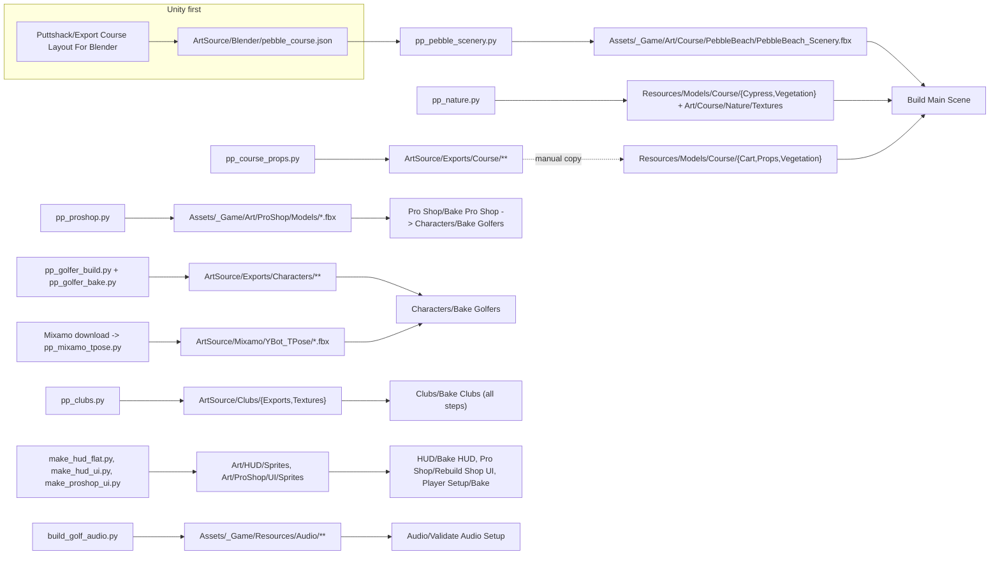
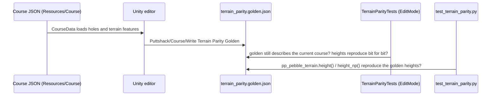
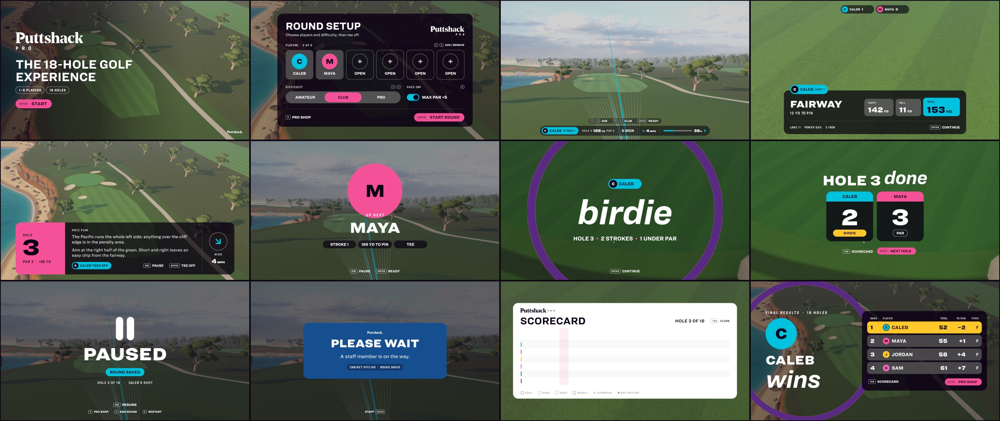

# 05 - Art Pipeline (Blender and Python -> Unity)

All source art lives in [ArtSource/](../ArtSource). It is produced by **headless Blender scripts** (`ArtSource/Blender/scripts/pp_*.py`) and a few **plain Python generators** (UI sprites, audio), and reaches Unity in one of two ways: either the script writes straight into `Assets/` (course scenery, trees, Pro Shop models, UI sprites, audio), or it writes a staging copy under `ArtSource/` that a `Puttshack/*` editor menu copies in (golfers, Mixamo clips, clubs). This page gives, for every asset family, the source file, the script, the exact command, the outputs and the Unity menu item that consumes them next, plus the course terrain parity check and a licence summary. Menu items are described in detail in [04-editor-tools.md](04-editor-tools.md). Everything here was read from the scripts; statements the code does not settle are marked **Unclear**.



---

## 1. Tools and conventions

| Item | Value | Where it comes from |
|---|---|---|
| Blender | **5.2** (5.2.0 LTS is installed at `/Applications/Blender.app`). `pp_lib.py` says "Blender 5.x"; `pp_golfer_build.py` hard-codes the MPFB data path under `~/Library/Application Support/Blender/5.2/`. | script headers |
| How scripts run | Headless, never as an add-on: `Blender -b [file.blend] [--factory-startup] --python <script.py> -- <args>`. Arguments after `--` are read with `sys.argv[sys.argv.index("--") + 1:]`. | every `__main__` block |
| Blender binary (macOS) | `/Applications/Blender.app/Contents/MacOS/Blender`. The commands below use `$BLENDER` for it: `export BLENDER=/Applications/Blender.app/Contents/MacOS/Blender`. | |
| Working directory | Run every command from the repository root (`Real-Golf/`). Several scripts ignore it anyway because they hard-code `/Users/calebsnyder/Real-Golf` (list in [tools and pipeline risks](notes/tools-and-pipeline-risks.md)); **edit `ROOT`/`REAL`/`HERE` in those scripts before running them on another machine.** | |
| Blender python packages | Scripts import `numpy` (bundled with Blender). `pp_golfer*.py` need the **MPFB 2** extension installed in Blender's `user_default` extension repo (module `bl_ext.user_default.mpfb`) plus the MakeHuman assets listed in section 3.1. | `pp_golfer.py` `enable_mpfb` |
| Plain Python | UI generators: Pillow + numpy (`make_hud_flat.py` also calls `rsvg-convert`, from `librsvg`). Audio: numpy, scipy, soundfile (libsndfile with Vorbis) and `ffmpeg` on `PATH`. The script headers suggest a venv in `/tmp`; use a persistent one instead, e.g. `python3 -m venv .venv && .venv/bin/pip install pillow numpy scipy soundfile` (the repo's `.gitignore` does not list `.venv/`; add it or create the venv outside the repo). | script headers |
| Units / axes | Metres. FBX export uses `axis_forward=-Z`, `axis_up=Y`, `apply_unit_scale`, `bake_space_transform` (scenery, props). Blender front = -Y = Unity +Z. | `pp_pebble.export_fbx`, `pp_course_props` header |
| Backups | Several scripts copy the `.blend` to `*_backup.blend` before saving. Those backups, `*.blend1`, `ArtSource/Backup/`, `ArtSource/Review/` and `ArtSource/Blender/wip/` are not deliverables (gitignored or excluded). | |


---

## 2. Course: Pebble Beach terrain, scenery, trees and props

### 2.1 Course layout and scenery (`PebbleBeach_Scenery.fbx`)

| | |
|---|---|
| Gameplay source of truth | Hole and course JSON in `Assets/_Game/Resources/Course/Pebble/` (format: [ArtSource/Course/README.md](../ArtSource/Course/README.md)) |
| Blender source | `ArtSource/Blender/PuttshackPro_PebbleBeach.blend` |
| Scripts | [pp_pebble_scenery.py](../ArtSource/Blender/scripts/pp_pebble_scenery.py) (entry point) -> [pp_pebble.py](../ArtSource/Blender/scripts/pp_pebble.py) (builders, no `__main__`) -> [pp_pebble_terrain.py](../ArtSource/Blender/scripts/pp_pebble_terrain.py) (Python port of `TerrainModel.cs`) |
| Inputs | `ArtSource/Blender/pebble_course.json` (written by Unity). `pp_pebble.py` loads it at import time and uses `Holes[0]`'s terrain list as the whole-course heightfield. |
| Outputs | `Assets/_Game/Art/Course/PebbleBeach/PebbleBeach_Scenery.fbx` (terrain rings, ocean, rocks, scenery trees, forest, buildings, pier, boats); the `.blend` is backed up to `PuttshackPro_PebbleBeach_backup.blend` and re-saved (compressed) |
| Next in Unity | Import is automatic (`CourseArtImportRules`, `NatureArtImportRules`), then `Puttshack/Build Main Scene` (rebuilds `Course/Baked/Environment/PebbleBeach_Scenery.prefab`), then `Puttshack/Verify Baked Course` |

Run order:

1. Unity: `Puttshack > Export Course Layout For Blender` -> writes `ArtSource/Blender/pebble_course.json`.
2. Blender (from the repo root):

   ```bash
   $BLENDER -b ArtSource/Blender/PuttshackPro_PebbleBeach.blend \
     --python ArtSource/Blender/scripts/pp_pebble_scenery.py
   ```

   This calls `pp_pebble.build_all(export=True, models=False)`: only the scenery is rebuilt and exported; the cypress and tee-marker models are left alone.
3. Unity: `Puttshack > Build Main Scene`, then `Puttshack > Verify Baked Course`.

**Full rebuild including hero cypress, tee marker and generated textures (`build_all(models=True)`):** there is no command-line entry point for it. It would also write `Assets/_Game/Art/Course/PebbleBeach/Textures/{ocean_normal,foam_noise}.png`, `Assets/_Game/Resources/Models/Course/Textures/{foliage_normal,foliage_noise}.png`, `Resources/Models/Course/Cypress/Cypress_{A,B,C}.fbx` and `Resources/Models/Course/TeeMarker/TeeMarker.fbx`. **Warning:** the cypress FBXs currently in the project come from `pp_nature.py` (LOD trees, newer timestamps); `build_all(models=True)` would overwrite them with `pp_pebble.py`'s simpler cypress. **Unclear** whether that is still intended; prefer `pp_nature.py` for trees.

How the seam works (from the `pp_pebble.py` header): the surround terrain is a set of concentric rings around the gameplay ground rectangle. Ring 0 reuses the gameplay grid vertices exactly (0.8 m spacing, from `Grid` in the JSON), heights blend from the gameplay `TerrainModel` (via `pp_pebble_terrain.py`) into the free-form coast over the first 40 m, and normals use the same central differences as `TerrainModel.Normal`. This is why the C# and Python terrain code must agree bit for bit (2.2).

Static textures with **no generating script** in the repo: `Art/Course/PebbleBeach/Textures/pebble_sky.hdr`, `boulder_albedo.png`, `boulder_normal.png`, and `Resources/Models/Course/Textures/{rock,beach}_{albedo,normal}.png`. Per [ArtSource/CREDITS.md](../ArtSource/CREDITS.md) they come from the Poly Haven downloads in `ArtSource/Blender/textures/pebble/` (Kloppenheim 06 sky, Cliff Side, Coast Sand 01, Rock Face 03). The conversion step (JPG -> PNG, renaming, resizing) is **not scripted; Unclear** how it was done. The other ground textures (`fairway/green/rough/deeprough/bunker_albedo.png`, `turf/sand/rough_normal.png`) and `Resources/Models/Course/Sky/*.hdr` have no source or script in `ArtSource/` either (**Unclear** origin).

### 2.2 Terrain parity system (C# <-> Python)

The gameplay ground is analytic (`Assets/_Game/Scripts/Core/Content/TerrainModel.cs`); the scenery evaluates the same heightfield in Python (`pp_pebble_terrain.py`, scalar and numpy ports) to meet it exactly at the seam. A shared golden file keeps the two implementations identical.



| Piece | What it does |
|---|---|
| `Puttshack > Course > Write Terrain Parity Golden` ([CourseExport.cs](../Assets/_Game/Scripts/Editor/CourseExport.cs) -> `TerrainParity.Golden`) | Writes [Assets/_Game/Tests/EditMode/Fixtures/terrain_parity.golden.json](../Assets/_Game/Tests/EditMode/Fixtures/terrain_parity.golden.json): every terrain feature and ~1600 probe points (tees, cups, routes, surfaces, trees, along cliff and shore, a seeded scatter over the grid), with doubles stored as 16-hex-digit IEEE bit patterns. |
| `TerrainParityTests` ([TerrainParityTests.cs](../Assets/_Game/Tests/EditMode/TerrainParityTests.cs)) | Fails if the golden no longer describes the current course ("Regenerate with Puttshack > Course > Write Terrain Parity Golden..."), if the golden features do not reproduce the golden heights bit for bit, or if bounds pruning in `TerrainModel.Height` differs from an unpruned reference. |
| [test_terrain_parity.py](../ArtSource/Blender/scripts/test_terrain_parity.py) | Loads the golden, evaluates `pp_pebble_terrain.height` (tolerance 1e-9 m) and, when numpy is available, `height_np` (1e-6 m). Prints `PASS`/`FAIL`, exits non-zero on mismatch. |

Commands (repo root):

```bash
python3 ArtSource/Blender/scripts/test_terrain_parity.py                # scalar port; numpy part skipped if numpy is missing
$BLENDER -b --python ArtSource/Blender/scripts/test_terrain_parity.py   # scalar + numpy port (Blender bundles numpy)
```

Verified while writing this page with the system `python3` (3.14): `golden: puttshack-pro-graybox graybox-0.4, 59 features ..., 1623 probes`, `scalar height(): 1623/1623 bit-identical`, `PASS`. The Blender variant was not run.

When terrain changes: edit the hole JSON -> `Write Terrain Parity Golden` -> run both Python commands -> if they fail, port the change to `pp_pebble_terrain.py` (keep it in lockstep with `TerrainModel.cs`: Plateau, Tilt, Shelf, Bowl) -> `Export Course Layout For Blender` -> re-run the scenery script -> `Build Main Scene` -> EditMode tests.

### 2.3 Course trees (cypress, pine, oak with LODs and impostors)

| | |
|---|---|
| Blender source | `ArtSource/Blender/PuttshackPro_Nature.blend` (re-saved by the script) |
| Scripts | [pp_nature.py](../ArtSource/Blender/scripts/pp_nature.py), [pp_nature_tex.py](../ArtSource/Blender/scripts/pp_nature_tex.py) (procedural numpy leaf atlases and bark) |
| Command | `$BLENDER -b --factory-startup --python ArtSource/Blender/scripts/pp_nature.py -- [all\|textures\|trees\|previews]` (default `all`) |
| Outputs (written **directly into Assets**) | `Assets/_Game/Resources/Models/Course/Cypress/Cypress_{A,B,C}.fbx`, `Assets/_Game/Resources/Models/Course/Vegetation/{Pine_A,Pine_B,Oak_A,Oak_B}.fbx` (each with `Name_LOD0..LOD3`, LOD3 = impostor cards), `Assets/_Game/Art/Course/Nature/Textures/{Leaf_Cypress,Leaf_Pine,Leaf_Oak,Bark_Tree,Bark_Tree_Normal,Impostor_Trees}.png`, `Assets/_Game/Art/Course/Nature/nature_manifest.json` (mode `all` only), `ArtSource/Blender/PuttshackPro_Nature.blend` (not in `previews` mode), previews in `ArtSource/Review/Nature/` |
| Dry run | Set `PP_NATURE_TEST=/some/dir` to write everything under that directory instead of the project. |
| Next in Unity | Automatic import (`NatureArtImportRules` sets the TreeFoliage shader and builds the LODGroup), then `Puttshack/Build Main Scene` (or `Bake Course`). Runtime loads them through `CourseVisualAssets` (`Models/Course/Cypress/*`, `Models/Course/Vegetation/{Pine,Oak}_*`). |

The `pp_nature.py` header also says Unity remaps the tree materials "through the FBX .meta externalObjects" to `Assets/_Game/Art/Course/Nature/Materials` and that `pp_pebble.py` reuses `scenery_tree_mesh()`/`impostor_mesh()`. Neither is true in the current code (no such folder; `pp_pebble.py` does not import `pp_nature`); materials are set by `NatureArtImportRules` instead.

### 2.4 Course props, cart and small vegetation

| | |
|---|---|
| Blender source | `ArtSource/Blender/PuttshackPro_CourseProps.blend` |
| Script | [pp_course_props.py](../ArtSource/Blender/scripts/pp_course_props.py) (imports `pp_pebble`, so `pebble_course.json` must exist) |
| Commands | `$BLENDER -b --factory-startup --python ArtSource/Blender/scripts/pp_course_props.py -- build` (build, back up + save `.blend`, export FBX); `-- render` (review renders from the saved `.blend` into `ArtSource/Review/Course/assets/`); `-- verify` (re-import `GolfCart.fbx` and print transforms) |
| Outputs | `ArtSource/Exports/Course/Cart/GolfCart.fbx`, `ArtSource/Exports/Course/Props/{BallWasher,Bench,BunkerRake,TeeSign,TrashBin,YardagePost}.fbx`, `ArtSource/Exports/Course/Vegetation/{Flowers_A,Grass_A,Grass_B,IcePlant_A,Oak_A,Oak_B,Pine_A,Pine_B,Shrub_A,Shrub_B,Shrub_C}.fbx`, `ArtSource/Exports/Course/course_props_manifest.json` |
| Into Unity | **Manual copy; no script or menu item does it.** Copy into `Assets/_Game/Resources/Models/Course/Cart/`, `.../Props/` and `.../Vegetation/` (the committed copies of `GolfCart`, `Bench`, `TeeSign`, `Grass_A`, `Shrub_A` are byte-identical to the exports, which is how this was established). **Do not copy `Oak_*` and `Pine_*`**: the project versions come from `pp_nature.py` (LOD trees) and differ from these exports. |
| Next in Unity | `Puttshack/Build Main Scene`. Runtime paths: `CartDrive.ModelPath = "Models/Course/Cart/GolfCart"`, `CourseVisualAssets` loads `Models/Course/Props/*`, `Models/Course/Vegetation/*`. |

---

## 3. Golfers (Caleb and Maya), rig, Mixamo animations and hair

There are two golfer pipelines in `ArtSource/Blender/scripts`. The editor code in the working tree (`GolferCharacterBaker.StagedSuffixes`) consumes the outputs of the **MPFB pipeline** (`pp_golfer*.py`), so that is the current one. The **stylized pipeline** (`pp_stylized*.py`, Hunyuan3D scans) produced the golfers in the last commit (`8592497`) and is what [ArtSource/CREDITS.md](../ArtSource/CREDITS.md) describes; its texture names (`_Head_Albedo`, `_Top_Mask`, `_Bottom_Mask`, `_skin.txt`) are no longer copied by Bake Golfers, and `GolferCharacterBaker.BakeMaterials` deletes leftover materials of "the retired stylized golfers" (code comment). Both pipelines write the same file, `ArtSource/Exports/Characters/<Name>/<Name>_Modular.fbx`; the last one run wins.

### 3.1 Current: MPFB golfers

Prerequisites: Blender 5.2 with the MPFB 2 extension, and these MakeHuman assets available in MPFB's data folder (names from `pp_golfer.py` `CHARS`/`CLOTHES`): skins `young_caucasian_male`, `young_asian_female`; eyebrows `eyebrow001`, `eyebrow010`; eyelashes `eyelashes01`, `eyelashes02`; hair `short02`, `long01`; eyes `high-poly`; clothes `namuhekam_male_polo_shirt`, `toigo_basic_tucked_t-shirt`, `toigo_wool_pants`, `shoes05`. `pp_golfer_build.py` reads their textures from `~/Library/Application Support/Blender/5.2/extensions/.user/user_default/mpfb/data` (macOS path, hard-coded).

| Step | Command (repo root) | Outputs |
|---|---|---|
| (optional) reference rig | `$BLENDER -b --factory-startup --python ArtSource/Blender/scripts/pp_golfer.py -- rig` | `ArtSource/Blender/PuttshackPro_GolferRig.blend`, `ArtSource/Blender/golfer_rig.json` (bone heads/tails and club data). Only the procedural animation script `pp_golfer_anim.py` reads these; the build does not. |
| Build | `$BLENDER -b --factory-startup --python ArtSource/Blender/scripts/pp_golfer_build.py -- Caleb Maya [--no-export] [--review]` | `ArtSource/Blender/PuttshackPro_Golfer_<Name>.blend`; `ArtSource/Exports/Characters/<Name>/<Name>_Modular.fbx` (rig + parts `Head_<Name>`, `Eyes_<Name>`, `Brows_<Name>`, `Lashes_<Name>`, `Hair_<Name>`, `Body_Arms`, `Top_Polo`, `Top_Tee`, `Bottom_Chinos`, `Bottom_Shorts`, `Socks_Ankle`, `Socks_Crew`, `Shoes_Golf`, `Belt`, `Club_Driver/Iron/Wedge/Putter` on `ClubGrip.L`, and a static arms-down `Idle` take); textures `<Name>_{Skin_Albedo,Face_Albedo,Eye_Albedo,Hair,Hair_Normal,Brow,Lash}.png` in `Exports/Characters/<Name>/Textures/`; shared garment textures in `Exports/Characters/Shared/Textures/` (only written if missing) |
| Skin/eye maps | `$BLENDER -b ArtSource/Blender/PuttshackPro_Golfer_<Name>.blend --factory-startup --python ArtSource/Blender/scripts/pp_golfer_bake.py -- <Name>` (once per name; Cycles) | `<Name>_{Face,Skin}_{Mask,Normal}.png`, `<Name>_Eye_Mask.png`, `Shared/Textures/Skin_Pores_Normal.png` (if missing); **re-tones `<Name>_Face_Albedo.png` and `<Name>_Skin_Albedo.png` in place**. **Unclear** whether running it twice without a rebuild double-applies the re-tone; rebuild first to be safe. |
| (optional) review renders | `$BLENDER -b ArtSource/Blender/PuttshackPro_Golfer_<Name>.blend --factory-startup --python ArtSource/Blender/scripts/pp_golfer_review.py -- <Name> <out_prefix> [polo\|tee]` | PNG renders (EEVEE, Kloofendal HDRI via `pp_stage.py`) |
| Next in Unity | `Puttshack > Characters > Bake Golfers` (copies the staged FBX/textures into `Assets/_Game/Art/Characters/`, see [04](04-editor-tools.md#13-characters)), then `Characters > Verify Golfers`, then `Characters > Render Review Stills` to eyeball the result. |

`pp_golfer_export.py` (`-- <Name> [--no-anims]`) re-exports a built golfer with clips from `ArtSource/Blender/PuttshackPro_GolferAnims.blend`. That file does not exist (it is the output of the procedural `pp_golfer_anim.py`, superseded by Mixamo), so the script falls back to the placeholder `Idle`; it is not needed in the current flow. `pp_golfer_anim.py` writes debug renders to `/tmp/pp_anim/`.

Hair: there is no separate Blender hair pipeline. Each golfer's MakeHuman hair becomes `Hair_<Name>`; the Unity menu `Puttshack > Characters > Bake Hair Styles` (also run inside Bake Golfers) fits each hair onto the other body and writes `Assets/_Game/Art/Characters/Hair/Hair_<From>_On_<To>.asset`.

### 3.2 Mixamo animations

| | |
|---|---|
| Source | Adobe Mixamo, character **Y Bot**, downloaded as FBX "without skin". `ArtSource/Mixamo/YBot/manifest.json` records each clip's Mixamo id, parameters and trim, and the download preferences (`format: fbx7_2019`, `skin: false`, `fps: 30`, `reducekf: 0`). 50 clips are downloaded. **No download script is in the repository**; download new clips by hand at mixamo.com with those settings and save them as `ArtSource/Mixamo/YBot/<ClipName>.fbx`. |
| Script | [pp_mixamo_tpose.py](../ArtSource/Blender/scripts/pp_mixamo_tpose.py) |
| Command | `$BLENDER -b --factory-startup --python ArtSource/Blender/scripts/pp_mixamo_tpose.py -- [src_dir] [dst_dir]` (defaults `ArtSource/Mixamo/YBot` -> `ArtSource/Mixamo/YBot_TPose`; skips clips whose output is newer than the source) |
| Outputs | `ArtSource/Mixamo/YBot_TPose/<Clip>.fbx` (T-pose as the default pose, animation as the take) and `YBot_TPose/YBot_Reference.fbx` (skeleton at rest, no take; created only if missing) |
| Next in Unity | `Puttshack > Characters > Bake Golfers` copies `YBot_Reference.fbx` and only the clips named in `GolferCharacterBaker.StateClips` into `Assets/_Game/Art/Characters/Animations/` (and deletes the others there). Today: `Idle_Standard`, `Golf_Drive_Standard`, `Golf_Chip_Swing2`, `Golf_Putt_Medium`, `React_FistPump`, `React_Disappointed`, `React_Victory`. To use a different clip, edit `StateClips` in [GolferCharacterBaker.cs](../Assets/_Game/Scripts/Editor/GolferCharacterBaker.cs) and re-bake. Import rules (one shared avatar from `YBot_Reference.fbx`, 90 degree yaw on `Golf_*`) are in [04](04-editor-tools.md#4-asset-import-rules-assetpostprocessors). |

`ArtSource/Mixamo/Upload/{Caleb,Maya}_upload.fbx` are uploads for Mixamo's auto-rigger made by the stylized pipeline (`pp_stylized_rig.py -- upload`); the current pipeline does not use them.

### 3.3 Previous: stylized (Hunyuan3D) golfers

Kept for reference; not consumed by the current Unity code. Sources: `ArtSource/Blender/stylized/source/{caleb,maya}_{body,head}.glb` (Hunyuan3D-2 output, generated outside this repo) and `stylized/source/views/` (concept views, mattes and parse maps).

| Stage | Command |
|---|---|
| Clothes parsing (plain Python with onnxruntime, numpy, Pillow; SegFormer ONNX model not in repo) | `python ArtSource/Blender/scripts/pp_stylized_parse.py <model.onnx> <views dir> caleb maya` |
| Prep / colours | `$BLENDER -b --factory-startup --python ArtSource/Blender/scripts/pp_stylized.py -- prep <Name>` then `-- colors <Name>` (writes `stylized/<Name>_prep.blend`, `stylized/<Name>_colors.blend`) |
| Parts | `$BLENDER -b --factory-startup --python ArtSource/Blender/scripts/pp_stylized_build.py -- <Name>` (writes `stylized/<Name>_parts.blend`, textures into `Exports/Characters/<Name>/Textures/`) |
| Rig / export | `$BLENDER -b --factory-startup --python ArtSource/Blender/scripts/pp_stylized_rig.py -- upload\|rig\|export <Name>` (`rig`/`export` write `Exports/Characters/<Name>/<Name>_Modular.fbx`) |

### 3.4 Legacy and experimental scripts

`pp_modular.py` (Quaternius Ultimate Modular Men Caleb; source `PuttshackPro_Caleb_Modular.blend`; exports `ArtSource/Exports/Caleb_*.fbx/.glb`, documented in [Caleb_Modular_README.md](../ArtSource/Exports/Caleb_Modular_README.md); no `__main__`, **Unclear** how it was invoked), `pp_cc0.py`, `pp_mpfb.py`, `pp_bakeoff.py`, `pp_caleb.py`, `pp_assets.py` (review set, `PuttshackPro_ReviewSet_WIP.blend`), `pp_stage.py` (review lighting helper). These belong to earlier character experiments. `PuttshackPro_Caleb_Modular.blend` is still an **input** of the Pro Shop script (section 4). `ArtSource/Blender/pebble_hole.json` is not read by any script.

---

## 4. Pro Shop (room, display items, bags)

| | |
|---|---|
| Blender source | Built from scratch each run; saved to `ArtSource/Blender/PuttshackPro_ProShop.blend` |
| Scripts | [pp_proshop.py](../ArtSource/Blender/scripts/pp_proshop.py) (entry point and room), [pp_proshop_pipeline.py](../ArtSource/Blender/scripts/pp_proshop_pipeline.py) (golfer posing, export, verification, renders), [pp_proshop_items.py](../ArtSource/Blender/scripts/pp_proshop_items.py), [pp_proshop_bags.py](../ArtSource/Blender/scripts/pp_proshop_bags.py), helpers from `pp_lib.py` |
| Inputs | `ArtSource/Blender/PuttshackPro_Caleb_Modular.blend` (the earlier Quaternius-based Caleb, appended to make the clothing display items), HDRI `ArtSource/Blender/textures/kloofendal_48d_partly_cloudy_puresky_2k.hdr` |
| Command | `$BLENDER -b --factory-startup --python ArtSource/Blender/scripts/pp_proshop.py -- [--no-export] [--no-render] [--no-save] [--no-verify] [--fast] [--room-only]`; `-- --verify` only re-imports the exported FBXs and prints names/materials/tris/bounds |
| Outputs (written **directly into Assets**) | `Assets/_Game/Art/ProShop/Models/{ProShop_Room, Display_Polo_Hanger, Display_Tee_Hanger, Display_Chinos_Folded, Display_Shorts_Folded, Display_Shoes_Pair, Display_Socks_Pair, Display_Belt_Coiled, Display_MannequinHead, Display_Club_{Driver,Wood,Iron,Wedge,Putter}, GolfBag_{Stand,Cart,Tour}}.fbx`; `ArtSource/Blender/PuttshackPro_ProShop.blend`; renders, contact sheets and `proshop_manifest.json` in `ArtSource/Review/ProShop/blender/` (gitignored). After exporting it launches itself again with `--verify`. |
| Contract with Unity | `ProShop_Room.fbx` must contain empties `Mark_Golfer`, `Mark_BagStand`, `Cam_Portrait`, `Cam_Portrait_Target`, `Cam_Overview`, `Cam_Overview_Target`, plus `Slot_Hang_*`, `Slot_Fold_*`, `Slot_Shoe_*`, `Slot_Sock_*`, `Slot_Bag_*`, `Slot_Mannequin_*` series (`ProShopBaker.BuildRoom`/`PopulateDisplays`). Bags use material slots `Bag_Body, Bag_Accent, Bag_Trim, Bag_Strap, Bag_Metal, Bag_Panel, HeadCover, HeadCover_Accent, Club_Steel, Club_Grip, Club_Shaft` in that order. |
| Next in Unity | Automatic import (`ProShopImportRules`), then `Puttshack > Pro Shop > Bake Pro Shop`, **then `Puttshack > Characters > Bake Golfers`** (Bake Pro Shop strips the golfer prefab), then `Pro Shop > Verify Pro Shop`. |

---

## 5. Clubs

| | |
|---|---|
| Sources | AI-generated images checked in under `ArtSource/Clubs/`: `Concepts/`, `Silhouettes/sil_*.jpg`, `Textures/ai/tex_*.jpg` |
| Script | [pp_clubs.py](../ArtSource/Blender/scripts/pp_clubs.py) (paths relative to the script, so it runs anywhere) |
| Command | `$BLENDER -b --factory-startup --python ArtSource/Blender/scripts/pp_clubs.py -- [all\|textures\|build\|render] [id1,id2,...]` (the README uses `-P`, same thing). With an id list the `.blend` is not saved. |
| Outputs | `ArtSource/Clubs/Exports/Club_<id>.fbx` (15 models), `ArtSource/Clubs/Exports/clubs_manifest.json` (reference points in Unity seat space), `ArtSource/Clubs/Textures/Club_*_{Albedo,Normal}.png`, `ArtSource/Clubs/PuttshackPro_Clubs.blend` (the previous file is renamed to `_backup.blend` first), renders `ArtSource/Review/Clubs/blender_*.png` |
| Next in Unity | `Puttshack > Clubs > Bake Clubs (all steps)`; if length, lie or head position changed also `Puttshack > Characters > Bake Golfers`. Full conventions: [ArtSource/Clubs/README.md](../ArtSource/Clubs/README.md). |

---

## 6. UI and HUD art

| Generator | Command (repo root) | Output | Next in Unity |
|---|---|---|---|
| [ArtSource/UI/HUD/make_hud_flat.py](../ArtSource/UI/HUD/make_hud_flat.py) | `python3 ArtSource/UI/HUD/make_hud_flat.py` (Pillow, numpy, and `rsvg-convert` for the wordmark) | `Assets/_Game/Art/HUD/Sprites/flat_{round,line_r10,line_pill,line_r28,line_r24,ring_thin,ring_mid,ring_band,arrow,fade_h,wordmark,logo_pin}.png` (wordmark rendered from `ArtSource/UI/HUD/Brand/logo_wordmark_white.svg`, `flat_logo_pin.png` copied from `Brand/logo_pin.png`). `HUD_SPRITE_OUT` overrides the output folder. | `Puttshack > HUD > Bake HUD` (or Place HUD in Main Scene); also `Pro Shop > Rebuild Shop UI` and `Player Setup > Bake Player Setup UI`, which use the same flat sprites |
| [ArtSource/UI/HUD/make_hud_ui.py](../ArtSource/UI/HUD/make_hud_ui.py) | `python3 ArtSource/UI/HUD/make_hud_ui.py` (Pillow, numpy; reads Barlow fonts from `Assets/_Game/Art/ProShop/UI/Fonts/`) | The `hud_*`, `key_*`, `score_*` and other sprites in `Assets/_Game/Art/HUD/Sprites/` (the current HUD builder uses `score_circle`, `score_circle2`, `score_square`, `score_square2` from this script) and `ArtSource/Review/HUD/hud_sprites_sheet.png`. `HUD_SPRITE_OUT` overrides the output folder. | as above |
| [ArtSource/UI/make_proshop_ui.py](../ArtSource/UI/make_proshop_ui.py) | `python3 ArtSource/UI/make_proshop_ui.py` (Pillow, numpy) | `Assets/_Game/Art/ProShop/UI/Sprites/ps_*.png` (16 sprites) | `Puttshack > Pro Shop > Rebuild Shop UI` |

9-slice borders are defined twice and must be kept in sync by hand: `BORDERS` in `make_hud_flat.py`/`make_hud_ui.py` <-> `HudBaker.Borders` ([HudBaker.cs](../Assets/_Game/Scripts/Editor/HudBaker.cs); the `make_hud_ui.py` header calls it "HudImportRules", which does not exist), and `BORDERS` in `make_proshop_ui.py` <-> `ProShopImportRules.BorderFor`.

Other UI inputs: `ArtSource/UI/HUD/Brand/Backdrops/bg_{tee,fairway,green,flyover,shop}.png` are captured frames of the Claude Design "Puttshack Pro HUD" mock-up, used only as backgrounds by `HUD/Capture HUD Previews` and `Pro Shop/Capture UI Preview`. Fonts are plain TTFs in `Assets/_Game/Art/HUD/Fonts/` (Ringside) and `Assets/_Game/Art/ProShop/UI/Fonts/` (Barlow Condensed, Puttshack Display, Puttshack Slab); their SDF assets are made by the `Rebuild Fonts` menus.



---

## 7. Audio

| | |
|---|---|
| Script | [ArtSource/Audio/tools/build_golf_audio.py](../ArtSource/Audio/tools/build_golf_audio.py) (paths relative to the script) |
| Command | `python3 ArtSource/Audio/tools/build_golf_audio.py` in an environment with numpy, scipy, soundfile and `ffmpeg` on `PATH`. Needs internet on first run: it downloads the Kenney packs `impact-sounds`, `music-jingles`, `interface-sounds` (scraping the zip link from `https://kenney.nl/assets/<pack>`) and Wikimedia Commons files into `$GOLF_AUDIO_CACHE` (default `/tmp/golfaudio`). |
| What it does | **Deletes every `.wav`/`.ogg`** in `Assets/_Game/Resources/Audio/{Ambience,Ball,Crowd,Stingers,UI}/` (the `.meta` files stay), then rebuilds: trimmed/looped/filtered recordings as `.ogg`, procedural placeholders as `.wav` named `*_ph_*`. Random seed is fixed (`20261005`). |
| Outputs | `Assets/_Game/Resources/Audio/<Folder>/<cue>_NN.{ogg,wav}`, `Assets/_Game/Resources/Audio/CREDITS.txt`, [ArtSource/Audio/audio_manifest.json](../ArtSource/Audio/audio_manifest.json) (per file: cue, placeholder flag, seconds, channels, processing, source, URL, licence, author). Today: 104 files, 49 placeholders. |
| Contract | File names are the cue keys of `GolfSoundBank` (a cue loads every clip in `Resources/Audio/` whose name starts with its key, e.g. `Ball/strike_driver_ph_01.wav` -> `Ball/strike_driver`). Keep the prefix when replacing a sound. |
| Next in Unity | Automatic import (`GolfAudioImportRules`), then `Puttshack > Audio > Validate Audio Setup`; `Create or Update Sound Bank` only if you want a tunable bank asset. |

---

## 8. Licences (summary)

Compiled from [ArtSource/CREDITS.md](../ArtSource/CREDITS.md), [ArtSource/Audio/audio_manifest.json](../ArtSource/Audio/audio_manifest.json), [ArtSource/Clubs/README.md](../ArtSource/Clubs/README.md), the `CREDITS.txt` files under `Assets/_Game/Resources/` and the licence files next to the fonts. Rows marked **Gap** are assets the code uses that no credits file covers; resolve them before shipping.

| Asset | Used for | Source | Licence |
|---|---|---|---|
| Tencent Hunyuan3D-2 | Body/face meshes of the **stylized** golfers (last commit) | https://github.com/Tencent/Hunyuan3D-2 | Tencent Hunyuan 3D 2.0 Community License; does not cover the EU, UK or South Korea |
| Concept views, face close-ups | Image-to-3D input and projected textures (stylized golfers) | Generated for the project (Cursor image generation) | Project-owned |
| SegFormer `mattmdjaga/segformer_b2_clothes` | Clothes segmentation of concept views | https://huggingface.co/mattmdjaga/segformer_b2_clothes | MIT |
| rembg (isnet-general-use) | Background mattes | https://github.com/danielgatis/rembg | MIT (tool), Apache-2.0 (weights) |
| Adobe Mixamo animations (Y Bot) | All golfer body animations | https://www.mixamo.com | Mixamo terms: free in projects; raw files may not be redistributed on their own |
| Quaternius Ultimate Modular Men (Feb 2022) | Earlier Caleb; Pro Shop display items derived from it | https://quaternius.com/packs/ultimatemodularcharacters.html | CC0 1.0 |
| Pro Shop geometry (`pp_proshop*.py`) | Room, props, bags, display items | Procedural, this project (display items derived from the CC0 Caleb parts) | CC0 1.0 per CREDITS.md |
| Pebble Beach geometry (`pp_pebble*.py`) | Terrain, rocks, buildings, cypress, ocean, tee markers, generated ocean/foliage maps | Procedural, this project | Project-owned |
| Poly Haven Kloppenheim 06 Pure Sky (4k HDR) | `pebble_sky.hdr` | https://polyhaven.com/a/kloppenheim_06_puresky | CC0 1.0 |
| Poly Haven Cliff Side | `rock_albedo/normal.png` | https://polyhaven.com/a/cliff_side | CC0 1.0 |
| Poly Haven Coast Sand 01 | `beach_albedo/normal.png` | https://polyhaven.com/a/coast_sand_01 | CC0 1.0 |
| Poly Haven Rock Face 03 | `boulder_albedo/normal.png` | https://polyhaven.com/a/rock_face_03 | CC0 1.0 |
| Poly Haven Kloofendal 48d Partly Cloudy (2k HDR) | Review renders only | https://polyhaven.com/a/kloofendal_48d_partly_cloudy_puresky | CC0 1.0 |
| Kenney Minigolf / Nature / Furniture kits, Quaternius Stylized Nature MegaKit | `Assets/_Game/Resources/Models/` (CREDITS.md points to the `CREDITS.txt` files there) | kenney.nl, quaternius.com | CC0 1.0 (but see [tools and pipeline risks](notes/tools-and-pipeline-risks.md): the `CREDITS.txt` files there describe folders that no longer exist) |
| Kenney UI Pack, Game Icons, RPG Expansion, Kenney Future font | `Assets/_Game/Resources/UI/` | https://kenney.nl | CC0 1.0 (`Resources/UI/CREDITS.txt`) |
| Kenney Impact Sounds, Music Jingles, Interface Sounds | 35 audio files | https://kenney.nl | CC0 1.0 |
| Wikimedia Commons recordings (surf, gulls, birds, applause, crowd) | 21 audio files | commons.wikimedia.org (per-file URLs in the manifest) | 18 public domain (pdsounds.org dedication), 3 CC0 1.0 |
| Procedural audio placeholders | 48 audio files (`*_ph_*`) | `build_golf_audio.py` | CC0 1.0 (as recorded in the manifest) |
| Club concepts, silhouettes, textures | Club models and materials | Generated for the project (Cursor image generator, per Clubs README) | Project-owned (not listed in CREDITS.md) |
| Barlow Condensed | Pro Shop and HUD text | Barlow Project | SIL OFL 1.1 (`OFL-BarlowCondensed.txt`) |
| Puttshack Display (from Bitter Pro) | Arrow-glyph fallback | Bitter Project | SIL OFL 1.1 (`OFL-Bitter-PuttshackDisplay.txt`) |
| Puttshack Slab Condensed (from Roboto Slab) | Pro Shop display text | Roboto Slab | Apache 2.0 (`LICENSE-RobotoSlab-PuttshackSlab.txt`) |
| **Gap:** Ringside fonts (6 TTFs in `Assets/_Game/Art/HUD/Fonts/`) | All HUD text, hole signs | "converted from the Puttshack design system's web fonts" (`HudFonts.cs`) | **No licence file, not in CREDITS.md.** Confirm the company's font licence covers embedding in a game build. |
| **Gap:** MPFB 2 + MakeHuman assets (`young_caucasian_male`, `young_asian_female` skins; `namuhekam_male_polo_shirt`, `toigo_basic_tucked_t-shirt`, `toigo_wool_pants`, `shoes05`; `short02`, `long01` hair; eyebrows/eyelashes) | Meshes and textures of the **current** golfers; garment textures in `Exports/Characters/Shared/Textures` are derived from these asset textures | MPFB (GPL-3.0 tool, output not GPL per CREDITS.md); asset packs from makehumancommunity.org | CREDITS.md lists only some MakeHuman packs as CC0 under "evaluated, not used". **Verify the licence of each asset above** (community assets can carry different licences) and update CREDITS.md. |
| **Gap:** Puttshack brand marks (`ArtSource/UI/HUD/Brand/logo_pin.png`, `logo_wordmark_white.svg`), design backdrops | HUD logo, preview backgrounds | Puttshack design system / Claude Design mock-ups | Company-owned (not stated in any credits file) |
