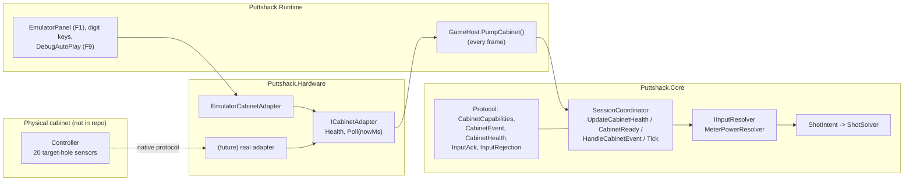

# 06 - Hardware layer and cabinet protocol

The game is designed to run on a "cabinet": a physical putting/rolling surface with **20 target holes** ("lanes") in front of a display. A player arms a shot on screen, a power meter starts sweeping, and the player rolls a real ball into one of the target holes. The **moment** the ball is detected sets the shot's power (read off the meter at that instant) and **which** hole it dropped into sets the shot's direction inside the club's aim fan. That is the only shot input; the device as modelled does not measure ball speed. The repository contains the normalized protocol the game consumes ([Core/Protocol/CabinetProtocol.cs](../Assets/_Game/Scripts/Core/Protocol/CabinetProtocol.cs)), the adapter interface ([Hardware/ICabinetAdapter.cs](../Assets/_Game/Scripts/Hardware/ICabinetAdapter.cs)) and a deterministic **emulator** ([Hardware/EmulatorCabinetAdapter.cs](../Assets/_Game/Scripts/Hardware/EmulatorCabinetAdapter.cs)). **There is no real hardware driver and no native/wire protocol in the repo**; `GameHost` always constructs the emulator. Everything in this document about the physical device is inferred from the normalized types and comments; the controller's real protocol, transport and commissioning procedure are not documented anywhere in the codebase.

---

## 1. Layers



Rules stated in code comments:

- `ICabinetAdapter` is "the only component allowed to talk to the controller. Real and emulated adapters emit the same normalized events, so both go through the same acceptance path."
- `CabinetProtocol` is the "normalized application protocol ... A driver translates the controller's native protocol into this. False/empty values mean unverified or disabled, not verified absence."

---

## 2. Normalized message types

All are plain in-process C# objects in namespace `Puttshack.Protocol`. They carry `[Serializable]`/Newtonsoft attributes, but no wire serialization or transport is implemented. Protocol version: `Versions.Protocol = 1` ([Models.cs](../Assets/_Game/Scripts/Core/Domain/Models.cs)).

### 2.1 `CabinetCapabilities` (what the controller says it can do)

| Field | Type | Meaning | Consumed by the service? |
|---|---|---|---|
| `ProtocolVersion` | int | Must equal `Versions.Protocol` (1). | Yes, `CabinetReady`. |
| `DeviceId` | string | Stable identity of the physical controller. | Yes: copied into `ArmState`, events from another device are `UnknownDevice`. |
| `BootId` | string | Changes on every controller boot. | Yes: a change while armed disarms; events with an old boot are `StaleBoot`. |
| `TargetHoleCount` | int | Must equal `LaneMapper.LaneCount` (20). | Yes, `CabinetReady`. |
| `TargetHoleDetection` | bool | Must be true. | Yes, `CabinetReady`. |
| `CaptureTimestamp` | bool | Controller supplies capture times. | No (informational). |
| `SpeedMeasurement` | bool | Controller measures ball speed. | No. |
| `BallReturnSensor` | bool | | No. |
| `MenuActions` | list of string | Emulator declares `navigate`, `confirm`, `back`. | No. |
| `LightingGroups` | list of string | | No. |
| `CalibrationVersion` | string | Commissioned lane map version; `"uncommissioned"` (default) or empty blocks play. Copied into `ArmState`; events must match. | Yes. |

### 2.2 `CabinetEvent` (one ball detected in one target hole)

| Field | Meaning |
|---|---|
| `DeviceId`, `BootId`, `Sequence` | Identity. `Key = "{DeviceId}\|{BootId}\|{Sequence}"` is the idempotency key stored in `SessionData.ConsumedEvents`. `Sequence` must be unique per boot. |
| `PhysicalHoleId` | Raw sensor id. Not read by the service. |
| `LogicalLane` | 1-20 from the commissioned mapping, "1 on the left facing the display". Selects direction. |
| `CaptureHostMs` (nullable) | Capture time **already mapped into the service's monotonic clock** (`IMonotonicClock`, see section 6). |
| `BridgeReceiptMs` | When the adapter received it, in the same clock. Used when `CaptureHostMs` is null. |
| `CalibrationVersion` | Must equal the armed calibration version. |
| `Quality` (flags) | `ReceiptTimeOnly` (no controller timestamp; informational), `ClockUncertain` (event is **rejected** with `ClockInvalid`). |
| `EffectiveCaptureMs` | `CaptureHostMs ?? BridgeReceiptMs`; this is what the meter reads. |

### 2.3 `CabinetHealth` (pushed every frame)

`Connected`, `LastHeartbeatMs` (service clock), `Capabilities`. `GameHost.PumpCabinet` calls `Coordinator.UpdateCabinetHealth(adapter.Health)` each frame.

### 2.4 `InputAck` / `InputRejection` (service reply to each event)

`InputAck { Accepted, Duplicate, ShotId, Rejection, EventKey, Power01, Lane }`. `GameHost` keeps the last one in `LastAck` (shown in the HUD context and emulator panel). `InputRejection` values: `None`, `NotArmed`, `UnknownDevice`, `StaleBoot`, `LaneOutOfRange`, `OutsideArmInterval`, `CalibrationMismatch`, `ClockInvalid`, `StorageFailure`.

---

## 3. How the service accepts input

### 3.1 Readiness gate: `SessionCoordinator.CabinetReady(out status)`

Checked in this order ([SessionCoordinator.cs](../Assets/_Game/Scripts/Core/Session/SessionCoordinator.cs) lines 126-137); the first failure becomes the player-facing status string:

| Condition | Status shown |
|---|---|
| `!Connected` | "Input connection lost - your score is saved" |
| `Capabilities == null` | "Waiting for cabinet" |
| `ProtocolVersion != 1` | "Cabinet protocol mismatch - ask staff" |
| `!TargetHoleDetection` or `TargetHoleCount != 20` | "Target holes unavailable - ask staff" |
| not commissioned | "Cabinet not commissioned - ask staff" |
| `now - LastHeartbeatMs > 1500` (`HeartbeatTimeoutMs`) | "Cabinet not responding - please wait" |
| otherwise | "Cabinet ready" |

`Arm` is rejected (`DEVICE_NOT_READY`) unless ready. `Tick()` only moves `ARMING -> SHOT_ARMED` when ready, and disarms `SHOT_ARMED -> SHOT_SETUP` if readiness is lost or the `BootId` changed.

### 3.2 Per-event acceptance: `HandleCabinetEvent(evt)`

1. If `evt.Key` was already consumed: return the original ack with `Duplicate = true` (no new stroke).
2. If state is not `SHOT_ARMED`: reject `NotArmed`.
3. `MeterPowerResolver.Validate(evt, arm, receivedMs = clock.NowMs)` ([MeterPowerResolver.cs](../Assets/_Game/Scripts/Core/Input/MeterPowerResolver.cs) lines 34-46), in order: no arm -> `NotArmed`; device id differs -> `UnknownDevice`; boot id differs -> `StaleBoot`; lane not 1-20 -> `LaneOutOfRange`; calibration differs -> `CalibrationMismatch`; `ClockUncertain` flag or non-finite capture -> `ClockInvalid`; capture before `ArmState.EpochMs` or more than 1 ms after `receivedMs` -> `OutsideArmInterval`.
4. `Resolve` builds the `ShotIntent`: `Power01 = MeterWaveform.Power(EffectiveCaptureMs - EpochMs, SweepSeconds)`, `RawYawRad = LaneMapper.RawYawRad(lane, FanHalfAngleRad)`, `YawRad` after assistance. The intent records `Source {DeviceId, BootId, Seq}`, `CalibrationVersion`, `CapturedHostMs`, `Lane`.
5. Reserve durably, then resolve (see [02-architecture.md](02-architecture.md) section 3.4). The first valid event wins; anything later in the same turn is `NotArmed` because the state has already left `SHOT_ARMED`.

**Arm epoch.** `ArmState.EpochMs` is the service clock when `Tick()` ran in `ARMING` (normally the frame after the `Arm` command). The HUD draws the meter from the same epoch via `SessionSnapshot.MeterEstimate(nowMs)`, so what the player sees and what is accepted share one time base. The meter is a triangle wave: 0 -> 1 over `SweepSeconds`, back to 0 over the next `SweepSeconds`, repeating. `SweepSeconds = ClubDefinition.SweepBaseSeconds * AssistanceProfile.SweepMultiplier` (for example the driver on Pro: 1.6 x 0.85 = 1.36 s per half cycle).

---

## 4. The emulator (driving shots without hardware)

### 4.1 `EmulatorCabinetAdapter`

Constructor `EmulatorCabinetAdapter(IMonotonicClock clock, string deviceId = "cabinet-emulator", int seed = 1234)`. On boot it declares: `BootId = "emu-boot-{n}"`, `TargetHoleCount = 20`, `TargetHoleDetection = true`, `CaptureTimestamp = SupplyCaptureTimestamp`, `SpeedMeasurement = false`, `BallReturnSensor = false`, `MenuActions = [navigate, confirm, back]`, `CalibrationVersion = "emulator-map-1"`, and resets `Sequence` to 0.

| Member | Effect |
|---|---|
| `TriggerLane(lane)` | A ball reaches `lane` now. `PhysicalHoleId = LogicalLane = lane`. Capture time = `clock.NowMs` (or none if `SupplyCaptureTimestamp` is false, then `Quality = ReceiptTimeOnly`). |
| `Poll(nowMs)` | Refreshes the heartbeat (unless disconnected or `HeartbeatSuppressed`), returns queued events whose delivery time has arrived sorted by time then sequence, and stamps `BridgeReceiptMs = nowMs`. Returns nothing while disconnected. |
| `DelayMs`, `JitterMs` | Delivery delay added to every event; jitter uniform in `[0, JitterMs)` from a `Random(seed)`. Capture time is unaffected, so power is unaffected (when timestamps are supplied). |
| `DuplicateNext` | Next event is delivered twice (1 ms apart) with the same identity. |
| `InjectLateEvent(lane, ageMs)` | Event whose capture time is `ageMs` in the past. |
| `InjectConflict(laneA, laneB)` | Two events 5 ms apart for one ball. |
| `RebootController()` | New `BootId`, sequence reset, queue cleared. |
| `Disconnect()` / `Reconnect()` | Drops the queue and stops delivery / resumes with a fresh heartbeat. |
| `HeartbeatSuppressed` | Heartbeat stops; after 1500 ms the service refuses to arm. |
| `SupplyCaptureTimestamp` | Toggle controller timestamps (see risk below). |
| `SetCommissioned(bool)` | Switches `CalibrationVersion` between `emulator-map-1` and `uncommissioned`. |

### 4.2 Playing a shot by hand in the editor

1. Play `Main.unity` (or `ProShop.unity`, which redirects to Main). Finish Player Setup and start the round (Enter).
2. In `SHOT_SETUP`: Left/Right aims (1 degree, 5 with Shift), Up/Down changes club, P cycles putt scale when the putter is selected, **Enter** sends `Arm`. The next frame `Tick()` arms and the meter starts.
3. While `SHOT_ARMED`, press a digit to drop the ball in a lane at that instant: **1-9 = lanes 1-9, 0 = lane 10, Shift+1..Shift+0 = lanes 11-20** (`GameHost.HandleKeyboard`, lines 586-590). Lanes 1-10 are left of the aim line (lane 10 nearly straight), lanes 11-20 right. Esc disarms.
4. **F1** toggles the emulator window (`EmulatorPanel`, requires `GameHost.ShowEmulatorPanel`, which is on in `Main.unity`): a 4x5 grid of lane buttons, delay (0-1000 ms) and jitter (0-300 ms) sliders, "Duplicate next event", "Suppress heartbeat", "Supply capture timestamps", "Late event" (lane 10, 60 s old), "Conflict 7+8", "Reboot", "Disconnect"/"Reconnect", crash toggles "After reserve" / "After result" (sets `SessionCoordinator.CrashAfter`), "Restart service now", the last `InputAck`, and the last 30 coordinator log lines.
5. **F9** (development builds and editor only, handled in `RoundFlow.HandleInput`) auto-plays to the end of the current hole; **Shift+F9** plays to the last hole's result. It uses `DebugAutoPlay`, which searches the best power with the solver, queues it on `DebugPowerResolver.NextPower`, arms, and fires `Emulator.TriggerLane` (lanes 9-12 at random), so every stroke still goes through the journal, solver and rules.

### 4.3 Driving it from tests

`Assets/_Game/Tests/EditMode/SessionHarness.cs` wires `SessionCoordinator` + `EmulatorCabinetAdapter` + `VirtualClock(1000)` exactly like `GameHost`. `Shoot(lane, power)` arms, advances the virtual clock to `EpochMs + power * SweepSeconds * 1000` (rising half of the meter), triggers the lane and pumps. `Pump()` mirrors `GameHost.PumpCabinet` + `Tick()`.

`EmulatorScript` ([EmulatorScript.cs](../Assets/_Game/Scripts/Hardware/EmulatorScript.cs)) is a small scheduler for timed emulator actions (`At(ms, action)`, `Lane(ms, lane)`, `Run(emulator, nowMs)`). Nothing in the repo uses it.

### 4.4 Fault scenarios and what the service does

| Scenario (emulator control) | Service behaviour | Covering test (`Tests/EditMode/SessionFlowTests.cs` unless noted) |
|---|---|---|
| Lane while not armed | `NotArmed`, nothing counted | `EventWhileNotArmed_IsRejected_AndCountsNothing` |
| Duplicate next | One shot; second delivery acked as duplicate | `DuplicateEvent_ProducesOneShot` |
| Late event | `OutsideArmInterval` | `LateEvent_BeforeArmEpoch_IsRejected` |
| Conflict 7+8 | First accepted, second `NotArmed` | `ConflictingEvents_OnlyFirstIsAccepted` |
| Reboot | Armed shot disarms ("Cabinet restarted - press Ready again"); old-boot events `StaleBoot` | `ControllerReboot_DisarmsAndRejectsOldBoot` |
| Uncommissioned / heartbeat lost | `Arm` refused with status text | `Arm_RefusedWhenCabinetUnavailable` |
| Delay / jitter | Power still from capture time | `Meter_PowerComesFromCaptureTime_NotDeliveryTime` |
| Disconnect | Status "Input connection lost - your score is saved"; armed shot disarms on next `Tick()` | (no dedicated test found) |
| Crash after reserve / after result | `SimulatedCrashException`; `GameHost.SimulateRestart` rebuilds from storage; reserved intent resolves without new input | `RecoveryTests.CrashAfterReservation_*`, `CrashAfterResolution_*` |

---

## 5. Plugging in a real device (the seam to implement)

The seam is `ICabinetAdapter`:

```csharp
// Assets/_Game/Scripts/Hardware/ICabinetAdapter.cs
public interface ICabinetAdapter
{
    CabinetHealth Health { get; }
    /// Returns events whose delivery time has arrived and refreshes heartbeat state.
    IReadOnlyList<CabinetEvent> Poll(double nowMs);
}
```

Steps for a new team:

1. **Get the controller's native protocol** (transport, message framing, heartbeat, boot/sequence semantics, timestamp source, lane commissioning). None of this exists in the repo.
2. **Write `XxxCabinetAdapter : ICabinetAdapter`.** `Puttshack.Hardware` has `noEngineReferences: true`; if the driver needs Unity APIs or a native plugin, put it in a new assembly referenced by Runtime, or put only the transport there and keep the normalization in Hardware. If you plan to use `System.IO.Ports`, check the project's API compatibility level first (`ProjectSettings.asset` has `apiCompatibilityLevel: 6`; I did not verify which profile that is or whether `System.IO.Ports` is available under it).
3. **Capabilities:** report a stable `DeviceId`, a `BootId` that changes on every controller reboot, `TargetHoleCount = 20`, `TargetHoleDetection = true`, `ProtocolVersion = 1`, and the commissioned `CalibrationVersion` (anything except empty or `"uncommissioned"`).
4. **Events:** one `CabinetEvent` per detected ball, `Sequence` strictly unique within a boot (it is the idempotency key, so re-sending after a reconnect is safe and desirable), `LogicalLane` 1-20 from the commissioned physical-to-logical map (1 = leftmost facing the display), `CalibrationVersion` = the map version.
5. **Timestamps** (the most important correctness item, see section 6): set `CaptureHostMs` in the service clock domain when you can map the controller clock reliably; otherwise leave it null, set `Quality = ReceiptTimeOnly`, and set `BridgeReceiptMs` at the moment bytes arrive (not at `Poll` time). Set `ClockUncertain` only if you want the event rejected.
6. **Heartbeat:** update `CabinetHealth.LastHeartbeatMs` from real controller traffic. The emulator refreshes it on every `Poll`, which a real adapter must not copy, or a dead controller would look healthy.
7. **Wire it into `GameHost`.** Today `GameHost.Emulator` is typed as `EmulatorCabinetAdapter` and is used directly by `PumpCabinet`, `HandleKeyboard` (digit keys), `EmulatorPanel`, `SimulateRestart` and `DebugAutoPlay`. Add an `ICabinetAdapter` field used by `PumpCabinet` and `SimulateRestart`, select real vs emulator by configuration, and keep the emulator-only features behind a development-build check.
8. **Different input semantics** (for example a sensor that measures ball speed) go behind `IInputResolver` (passed to `SessionCoordinator.StartOrResume`); keep producing the same `ShotIntent`. Bump `Versions.IntentSchema` if `ShotIntent` changes.
9. **Outputs to the cabinet** (lighting groups, menu actions, ball return) have no API: `ICabinetAdapter` is input-only and the service never reads those capabilities. Adding them means extending the interface and deciding who drives them (presumably Runtime, from the snapshot).
10. Add EditMode tests in the style of `SessionFlowTests` using a fake adapter or recorded traffic.

---

## 6. Threading and timing concerns

- **Everything is single-threaded on the Unity main thread.** `GameHost.Update` calls `Poll`, `UpdateCabinetHealth`, `HandleCabinetEvent` and `Tick` in that order each frame. `SessionCoordinator`, the stores and the emulator have no locking. A real adapter that reads a serial port or socket on a background thread must hand events to `Poll` through a thread-safe queue.
- **One clock domain.** All times are milliseconds of the `IMonotonicClock` passed to the coordinator (`SystemMonotonicClock`, a `Stopwatch` started in `GameHost.Initialize`; zero at each launch). A real adapter must be given the same clock instance and map controller times into it (offset/drift estimation is the adapter's job). Values from a previous process are meaningless, which is why recovery never restores an armed meter.
- **Frame quantization.** With `ReceiptTimeOnly`, power is computed from `BridgeReceiptMs`. The emulator stamps that in `Poll`, i.e. at frame time, and any delay is added to it, so power is biased by latency and quantized to frame boundaries. At 60 fps that is about 16.7 ms; on a 1.36 s half-sweep that is about 1.2% of power per frame. With controller capture timestamps (the emulator default), delay and jitter have no effect on power.
- **Acceptance window.** Capture must be `>= ArmState.EpochMs` and `<= receivedMs + 1 ms`. A controller whose mapped clock runs ahead of the service clock by more than 1 ms will have every shot rejected `OutsideArmInterval`.
- **Synchronous solve.** An accepted event is reserved, journaled (with `fsync`-style `Flush(true)`), solved (up to 4800 steps at 120 Hz) and journaled again inside one `HandleCabinetEvent` call on the main thread. Expect a frame hitch on shot acceptance; it has not been measured here.
- **Heartbeat timeout** is 1500 ms (`SessionCoordinator.HeartbeatTimeoutMs`). Readiness is evaluated on every `Tick()` and `Snapshot` read.

---

## 7. Known gaps and risks in this area

- No real adapter, no native protocol, no commissioning tool or lane-map format in the repo.
- Emulator controls are live in every build: `GameHost.HandleKeyboard` maps digit keys to `Emulator.TriggerLane` with no `Debug.isDebugBuild` check, and `EmulatorPanel` (F1, including crash injection) is added whenever `ShowEmulatorPanel` is true, which it is in `Main.unity`. Gate both before shipping.
- `EmulatorCabinetAdapter.SupplyCaptureTimestamp` changes per-event behaviour immediately, but `Capabilities.CaptureTimestamp` is only refreshed on the next `Boot()` (reboot). Harmless today because the service does not read that flag.
- `CabinetEvent.PhysicalHoleId`, `CabinetCapabilities.CaptureTimestamp`, `SpeedMeasurement`, `BallReturnSensor`, `MenuActions`, `LightingGroups` are declared but never consumed.
- `EmulatorScript`, `EmulatorCabinetAdapter.EventsEmitted` and `EventsPerLane` are unused.

See also [core and hardware risks](notes/core-and-hardware-risks.md) for file:line references.
